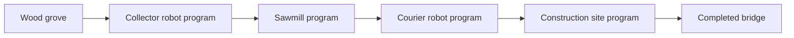

# BlocklyBots: implementation plan

Date: 14 October 2026

Build a browser game for children aged 7–9 in which Blockly programs bring a robot settlement to life. Robots collect and transport resources, buildings process them, and several programs cooperate to restore and expand a small island. The world uses real 3D geometry with simple, readable models.

This document defines the first release, the architecture, and the implementation order. It incorporates the requirement that every program runs on one fixed world clock: the player can pause the entire world, advance exactly one step, and see the executing block in every program.

Section 15 lists the corrections made in the review of 14 October 2026. Section 16 records later amendments, including the 40-mission campaign of [docs/campaign-plan.md](docs/campaign-plan.md), which replaced the original 12 missions.

## 1. Confirmed requirements and working decisions

### Confirmed requirements

- The intended players are children aged 7–9.
- Blockly is the main way to control the game.
- The game starts simply and grows into decisions, automation, and cooperation.
- Robots can have individual programs or share programs by role/type.
- Buildings also have programs.
- The world is 3D and uses simple models.
- All programs and gameplay systems run on a fixed step.
- Pause freezes world simulation; Step advances the whole world once.
- The currently executing step must be visible in every running program.
- The technology should follow the adjacent GyroRocket project.
- The whole app is available in at least English and German, and further languages can be added simply (Section 8, Languages).

### Working decisions

- Use a ground-based island with an elevated camera, pan/zoom, and optional quarter-turn rotation.
- Start with three general-purpose robots whose programs define their jobs.
- Use a small resource economy and a campaign of 40 short missions on one growing island (Section 9, [docs/campaign-plan.md](docs/campaign-plan.md)).
- Support a program library, type defaults, individual overrides, and settings per entity.
- Execute a small game instruction language compiled from Blockly, with explicit serializable runtime state.
- Use ten simulation ticks per second initially. This is a tuning value; all gameplay durations are integer tick counts. Fix the rate before authoring mission content in Phase 7: content durations, reference solutions, and saves all depend on it, so it is part of the simulation version.
- Allow at most one new visible Blockly instruction per entity per tick. Long actions continue across ticks.
- Save locally and provide file export/import. The first release is a static browser application.
- Introduce advanced programming through later missions; expose each feature when it has a useful purpose.

These decisions can be refined during playtesting without changing the global-clock requirement.

## 2. Stack checked in GyroRocket

The reference project is `../GyroRocket`. Its source and lockfile were inspected directly.

| Concern | Observed in GyroRocket | Decision for BlocklyBots |
| --- | --- | --- |
| Language | Vanilla JavaScript, ES modules, `type: module` | Use the same; add JSDoc contracts for simulation and program data |
| Build/dev server | Vite; lockfile resolves to 8.3.1 | Start from that resolved version and commit this project's own lockfile |
| 3D renderer | Three.js; lockfile resolves to 0.186.1 | Use the same version initially |
| UI | DOM components and plain CSS | Use the same approach for the shell, inspector, and debugger |
| Simulation | Pure `src/sim/`, separate from rendering; fixed 60 Hz loop with at most 10 catch-up ticks per frame | Preserve the separation; use an independently chosen 10 Hz world tick |
| Determinism checks | `SIM_VERSION`; recorded per-tick input replayed against golden files (`src/replay.js`, `scripts/golden.js`, `test/replay.test.js`) | Record tick-indexed command logs and replay them against golden world states; bump the simulation version on deliberate behaviour changes |
| Tests | `node --test` | Use for simulation, compiler, runtime, content, and saves |
| App structure | SPA navigation, theme/settings, lifecycle cleanup | Follow the same patterns with routes appropriate to this game |
| Local persistence | localStorage | Use localStorage for small settings; IndexedDB for worlds and program workspaces |
| Installable shell | Web app manifest and fullscreen support; no service worker | Add an installable shell and explicitly implement offline caching |
| Online features | Optional PHP 8.2+ and MariaDB/MySQL community backend | Keep as a possible later hosting pattern; local play is sufficient for the first release |
| Deployment | Build/header scripts and FTP/FTPS/SSH deployment tooling; `scripts/headers.js` writes an Apache `.htaccess` with CSP (`default-src 'self'`, `img-src 'self' data: blob:`) and SPA fallback | Reuse the relevant conventions when a hosting target is chosen; that CSP requires Blockly's media to be self-hosted |

Useful reference files are `package.json`, `package-lock.json`, `src/game.js`, `src/render/view.js`, `src/render/rocket.js`, `src/progress.js`, `src/main.js`, `src/replay.js`, `scripts/golden.js`, `scripts/headers.js`, `server/public/.htaccess`, `public/manifest.webmanifest`, and `server/README.md`.

The local Node runtime inspected was 24.14.1. GyroRocket's lockfile records Vite 8.3.1's engine range as `^20.19.0 || >=22.12.0`, which 24.14.1 satisfies; the Vite documentation lists the same minimums. [Vite guide](https://vite.dev/guide/)

Add `blockly` as a runtime dependency. The current stable release on 14 October 2026 is 13.4.0; confirm and lock it during the initial compatibility check. Its default entry point bundles core, the built-in blocks, and English messages, but no code generators. Three package details affect this plan:

- Blockly loads its cursors, sprites, and sounds from `https://static.blockly.com/media/` unless the `media` injection option is set. That breaks offline play and is blocked by a GyroRocket-style CSP. Copy `node_modules/blockly/media` into the build, point `media` at that local path, and precache it.
- Blockly's Node entry point needs `jsdom` as a peer dependency. Keep Blockly out of Node tests by compiling from its serialized JSON (Section 7).
- Blockly injects its CSS at runtime, which needs `style-src 'unsafe-inline'`. GyroRocket's CSP already allows this.

Add `@playwright/test` as a development dependency for browser behaviour that cannot be established by headless simulation tests.

Borrow architectural patterns and small suitable utilities from GyroRocket after reviewing their dependencies. Build the island simulation, editor, models, and missions specifically for this project. GyroRocket's flight model, tilt controls, cave collision system, and community database are outside the initial game's scope.

## 3. Game design and first-release scope

### The gameplay loop

1. A friendly character presents a concrete mission and points out relevant objects.
2. The player selects a robot or building and opens its Blockly program.
3. The player builds or changes instructions and applies the program.
4. The player runs the world or steps through it while observing the programs.
5. The player fixes behaviour, assigns reusable roles, or changes destinations.
6. A completed mission restores something visible and opens the next challenge.

The player directly selects entities, assigns programs, and places building blueprints. Robots and building programs perform the resource collection, transport, manufacturing, and construction work.

### First release

- One compact handcrafted island with a camp, grove, stone area, stream, bridge, and workshop region.
- Three helper robots, each independently programmed; additional robots can be enabled in sandbox.
- Robot roles such as collector and courier created by assigning programs.
- Four building categories: depot, sawmill, workshop, and construction site.
- Four initial item types: wood, stone, plank, and construction kit.
- Forty short missions in eight chapters (Section 9): a main journey of missions 1–25, from a first sequence to shared programs and the workshop's first kits, then an advanced continuation of missions 26–40 with memory, routines, and messages.
- Free play that opens after mission 15 with the blocks learned so far, and grows after mission 25 into a sandbox with a configurable starting layout.
- Shared program library, default programs by type/role, settings per entity, and individual copies.
- Global Run, Pause, Step, Step to Next Block, Restart Mission, and playback speed controls.
- A complete execution overview, an individual Blockly editor, and a view of several programs together.
- Local saves, resumable checkpoints, and validated save export/import.
- Mouse and touch support, with desktop and iPad landscape as primary layouts.
- English and German throughout, chosen automatically or by the player; further languages are added as catalogues without code changes.

Garden systems, batteries, charging stations, conveyors, weather, additional robot chassis, multiplayer, and cloud accounts are later extensions. Their concepts should fit the architecture, but the initial implementation is driven by the resource chain above.

### The bridge chain (mission 15)

The first substantial automation challenge, mission 15 (“Across the Stream”), joins four independently running entities, whose programs the child has met one at a time in missions 11–14:



- The collector repeatedly collects wood and delivers it to the sawmill.
- The sawmill waits for wood and produces planks.
- The courier waits for planks and takes them to the construction site.
- The construction site waits for four planks and assembles the bridge.
- Completing construction changes navigation and opens the next part of the island.

The bridge is the result of the construction site's program, which builds it once, outside any Forever. Mission completion observes that result and awards progress.

## 4. World, navigation, resources, and simple 3D models

### World representation

Use a grid for logical navigation and placement, with world-space X/Z coordinates and terrain elevation supplying Y. Render an actual 3D scene: island sides, shoreline, water, terrain, trees, rocks, robots, and buildings all have depth. An orthographic elevated camera keeps distances and selection easy to read.

- Begin with an approximately 32 × 32 logical-cell island.
- Store terrain kind, elevation, and walkability per cell.
- Store building footprints and explicitly named interaction cells outside those footprints.
- Represent bridges as walkable connections created by completed construction.
- Keep the first region mostly level; introduce height variation and accessible ramps after basic navigation works.
- Use stable entity IDs for program references; names and colours are presentation data.
- Define capabilities separately from appearance so future chassis can restrict actions without changing the runtime.

Use A* with integer path costs, a fixed neighbour order, and deterministic tie-breaking. Targets resolve to valid interaction cells. Paths are recomputed when the navigation revision changes. Movement takes a fixed integer number of ticks per cell; position is the current path segment plus integer tick progress.

Robots can pass one another; robot-to-robot blocking is outside the first release. Small visual offsets at shared interaction points keep overlapping robots readable. Unreachable destinations produce a visible blocked state and retry only after a relevant navigation change or a player restart.

### Resource rules

- Resources and inventories are authoritative simulation data.
- Inventories have integer quantities and capacities.
- A robot can collect or transfer only at a valid interaction location.
- Buildings use their own stored resources; materials physically arrive through deliveries.
- The first sawmill recipe is one wood → one plank.
- A later workshop recipe is two planks + one stone → one construction kit.
- Early missions supply enough resources for recovery and experimentation.
- Resource regrowth, if used, is scheduled by integer world ticks.
- Resource availability and capacity are checked atomically by the simulation.

Production reserves inputs and output capacity when it starts, then consumes inputs and creates output atomically on completion. Collection and transfers similarly reserve the required quantities/capacity while their actions run. Cancelling an unfinished action releases its reservations. Already completed work remains in the world.

Multiple actors requesting the same resource are handled by deterministic FIFO reservation queues, with entity ID as a final tie-breaker. A waiting actor does not retain unrelated reservations. Retry state is explicit and visible.

Action blocks wait rather than fail when the world is not ready. Collect at an empty source, Pick Up with nothing available, Unload into full storage, Make Item without inputs or output space, and Assemble without every part all keep their block active in a visible waiting state, with the missing item or space as the reason. A rejected intent joins the FIFO queue and is retried in each tick's resolution phase; a block is never skipped silently. The campaign depends on this implicit waiting: Wait Until arrives only in mission 19, and mission 8 teaches the basket's limit by letting a third Collect wait visibly. Program errors are reserved for code that cannot work as written, such as a missing or incompatible target.

When no action is in progress, no message is pending, and every entity is waiting, the world reports a stall. The clock keeps running, and mission hints can point to the waiting entities and their reasons.

### Model and animation plan

Create the first models procedurally in Three.js using reusable primitive geometry and a small material palette:

- Robot: rounded-looking body made from boxes/cylinders, head, two eyes, arms, wheels or feet, visible basket, and a role badge.
- Trees: trunk cylinders and low-segment foliage shapes.
- Rocks and island edges: simple faceted meshes.
- Depot: platform, crates, sign, and visible inventory stacks.
- Sawmill: base, roof, log feed, and moving saw assembly.
- Workshop: small hut, workbench, and clearly visible output shelf.
- Construction site: foundation, progress structure, and final bridge/building parts.

Define model pivots and interaction anchors consistently. Walking, collecting, unloading, and machine motion use tick-derived action progress. Robot roles differ through accessories, icons, and labels as well as colour.

Share geometry/materials, instance repeated scenery, and dispose graphics resources when leaving the game. Use hemisphere and directional lighting, a small shadow budget, and limited transparency. Keep a model-factory interface that can later return GLB assets without changing simulation code.

## 5. Program ownership and sharing

Separate program definitions from their assignments and runtime instances.

| Object | Responsibility |
| --- | --- |
| Program document | Stable ID, name, compatible entity capabilities, the entity settings it reads, Blockly draft, and published version |
| Type/role default | The program assigned to a robot group or building type unless an entity has an override |
| Entity binding | Resolved program ID, published version, settings, and optional individual override |
| Runtime instance | This entity's instruction position, variables, call stack, pending action, waiting reason, and messages |

Sharing code does not share instruction positions or local variables. Two collectors using the same program can be at different blocks and have different counters.

Provide these operations:

- Create and name a program.
- Assign it to one entity or a compatible role/type.
- Change an entity's settings, such as source, destination, resource, or target stock.
- Edit a shared program with the affected entities clearly listed.
- Make an individual copy and assign it only to the selected entity.
- Return an entity to its role/type default.
- Duplicate, rename, and archive unused programs.

For buildings, default programs are keyed by building type. For robots, one helper chassis can belong to a named role group. The UI uses friendly names such as “Collectors”; capability checks use explicit data.

An entity's program resolves in this order: individual override, then role default, then building-type or chassis default. A robot belongs to at most one role.

In the first release, settings are a fixed set of named slots per entity kind: Source, Destination, and Item for robots; Target Stock for buildings. Programs read them with value blocks such as “my Source”, so one shared program can serve robots with different settings. Children do not define program parameters; procedure inputs in Phase 8 cover parameterised reuse. Mission 22 depends on these setting blocks, which must plug into action inputs (Go To my Destination, Collect my Item), not merely be stored on the entity.

### Editing and applying

- Every robot and building has an Edit program button, in its flyout (Section 8). It opens the program the entity runs; one that runs none is given a new program of its own, a start block, and the editor opens on that. Other programs are given from the program library (decided 17 October 2026).
- Each program keeps its history: every version applied, and the version each was made from. The editor's Versions, folded away until opened, shows it as a tree, branches indented. Tapping a version puts it into the draft, not into the world: it runs once applied, as a new version branching from the one it came from. A draft with changes no version has is kept at the bottom, “Current, not applied yet”, to go back to (one at most). A save keeps each program's newest 40 versions.
- Entering edit mode pauses the entire world.
- Editing saves a draft; it does not change published running code.
- Apply validates and compiles a new published version.
- The resulting update is queued as a world command and applied at the next global tick boundary. Until that tick, the monitor marks the program “Apply pending” and keeps showing the running version.
- Affected runtime instances restart from their entry block with reset local variables. An affected robot's basket is emptied, so a restarted program never begins with a load it didn't ask for (decided 15 October 2026, docs/phase5.md); a robot that hasn't yet taken a step of its program keeps what its mission gave it (16 October 2026, docs/phase7.md). Buildings' stock and completed world changes are retained.
- Unfinished actions are cancelled through the reservation system. An interrupted move ends at whichever end of its current one-cell segment is nearer, with ties going to the cell it left; the renderer blends the visual position over a few frames.
- Unaffected entities retain their runtime state.
- Resume without Apply continues the existing published version.

The execution monitor always displays the published workspace matching the executing version. A draft with structural changes is marked separately so block highlights cannot silently refer to different code.

## 6. Fixed-step execution contract

This is the central architectural constraint and must be established before adding campaign content.

### Global clock

- `world.tick` is an integer.
- `advanceWorld(world, commands)` advances exactly from tick T to tick T+1.
- Every robot VM, building VM, movement action, manufacturing job, resource timer, message, and mission condition is advanced through this function.
- `requestAnimationFrame` renders and manages the fixed-step accumulator; it never advances entities independently.
- World behaviour never depends on `Date.now`, animation callbacks, JavaScript timers, promises, or frame rate.
- Pause stops calls to `advanceWorld` and clears accumulated elapsed time.
- Step calls `advanceWorld` once and leaves the world paused.
- Step to Next Block calls `advanceWorld` repeatedly until the selected entity, or any entity when none is selected, evaluates a new visible block, then pauses. It is a capped shortcut, for example 600 ticks, for pressing Step several times, and every entity advances on the same ticks. At ten ticks per second a short walk takes dozens of ticks, too many for a child to press through one at a time.
- Speed changes how often ticks are requested, not how much work a tick performs. Start with ½×, 1×, 2×, and 4×.
- Hidden tabs pause rather than simulating a large backlog on return.

Determinism also depends on how state is stored:

- Simulation state holds only integers, strings, booleans, plain objects, and arrays. No floating-point value is accumulated across ticks.
- Iteration order never depends on object-key order. Store entities in arrays sorted by stable ID, or use non-numeric string IDs such as `r1`; JavaScript orders integer-like object keys numerically, not by insertion.
- The simulation does not use `Math.random`. If later content needs randomness, the PRNG state, not only the seed, is part of `WorldState`.

### Tick phases

Use a documented, testable phase order:

1. Apply queued player commands at the tick boundary: placements, assignments, program updates, and entity restarts.
2. Advance actions already in progress; settle completed work and reservations in deterministic order.
3. Messages sent in the tick before are in their inboxes: a Send is an action of one step, which completes in phase 2 and delivers its message (decided in Phase 8, docs/phase8.md). Establish one immutable sensing snapshot.
4. Advance each entity runtime against that same snapshot, evaluating at most one new visible Blockly instruction. Produce action/message intents without directly mutating shared resources.
5. Resolve competing intents and begin accepted actions. New actions take at least one tick and cannot complete during their start tick. New messages are delivered on the following tick.
6. Evaluate objectives, record the tick's execution trace, and commit the new world state.

No entity can see another entity's newly issued action during the same sensing phase. This removes accidental behaviour based on the order in which programs are visited.

The sensing snapshot does not need to be a copy. Tick phase 4 reads committed state through read-only accessors and writes only intents, which tick phase 5 applies. A Wait For Message takes its message out of its own entity's inbox in phase 4, which no other runtime reads.

Action timing is fixed. An action accepted in phase 5 of tick T with duration d (d ≥ 1) completes in phase 2 of tick T + d, and its entity can evaluate its next visible block in phase 4 of that same tick. Wait N Steps is an action of duration N.

### Visible instruction stepping

- An action block such as Go To can remain active for many ticks.
- A Wait Until block stays active while its condition is false; the next block executes on a later tick after the wait succeeds.
- Conditions and loop controls are visible steps too.
- Expression inputs are evaluated as part of their parent visible instruction.
- Compiler bookkeeping and procedure return bookkeeping are bounded and do not become extra user-visible blocks.
- If an action completes during a tick, that entity may execute one following visible instruction in the instruction phase.
- A pure Forever loop remains bounded: returning to its visible loop block consumes another tick.

Store both the block evaluated during the last tick and the ongoing active action/wait block. The debugger can show the tick's decision and the work still in progress accurately.

### Rendering while paused

During continuous play, derive each pose from the committed action data (path, start tick, ticks per cell) and the fractional tick since the last commit. This needs no copy of the previous state. On Pause or Step, display the exact committed state and freeze action-related animations. Camera movement, selection, scrolling, and editing remain available. Rendering cannot change stock, position, action progress, or instruction state.

Given an initial state and a tick-indexed command sequence, continuous play and repeated Step must produce the same state after N ticks. Save/reload and different render frame rates must preserve that result.

## 7. Blockly blocks, compiler, and runtime

### Block families

| Family | In place (Phases 2–4) | Added for the campaign (the mission that first needs it) |
| --- | --- | --- |
| Entry | When Started | — |
| Robot actions | Go To, Collect, Pick Up, Unload, with places and items chosen in dropdowns | Place and item inputs that take setting values, such as Go To my Destination (22) |
| Building actions | Make Item, Build Blueprint | The workshop's kit (25) |
| Control | Repeat N, Forever, If/Else, Wait N Steps, Wait Until | — (taught from missions 6, 14, 17, 18, and 19; Wait N Steps only in optional experiments) |
| Sensing | Stock of an item at a place, items in the basket | — (stock counts are taught from mission 16) |
| Values | Number, comparisons, places and items | My Source, My Item, and My Destination settings (22); Target Stock only if a mission needs it |
| Memory | — | Set, Change, and Get Variable, with live values (26–27) |
| Reuse | — | Define and Call Procedure (31), with one input each: a place (33) or a number (34) |
| Coordination | — | Send Message to one named recipient, Wait For Message, and inbox display (36) |

No mission needs AND/OR, arithmetic, Has Message, message broadcasts or payloads, return values, recursion, lists, or global variables (docs/campaign-plan.md, Implementation dependencies). They stay out of the first release unless free play or playtests call for them.

Use familiar text plus icons, editable numbers, and valid-target dropdowns. Children see “steps”, not “ticks”: one step is one tick, matching the Step button. Provide robot and building toolboxes filtered by capability and mission unlocks. Loading an older program preserves its blocks even when they are absent from the current toolbox. Blockly cannot load a block type that is no longer registered, so retired block definitions stay registered and hidden from toolboxes until a migration replaces them.

Messages use a bounded inbox per entity and explicit receive/wait blocks. The first release has one entry thread per entity; a message never creates another independently running thread. Waiting consumes the matching message. Deliveries occur on the next tick. The campaign sends each message to one named recipient; broadcasts, if they are ever added, expand to a stable recipient list. When a recipient's inbox is full, Send stays active in a visible waiting state (“Workshop's mailbox is full”) and retries each tick. Messages are never dropped silently.

### Compilation

```text
Published Blockly workspace JSON
    → normalized program tree with stable Blockly block IDs
    → validated game instructions and expression trees
    → one runtime instance per entity
    → fixed world ticks and execution traces
```

Keep the Blockly adapter separate from the pure compiler. The adapter reads Blockly's JSON serialization, not live workspace objects. That JSON already contains each block's `id`, `fields`, `inputs`, `next`, and mutator `extraState`, so the compiler, `verify:missions`, load-time recompilation, and save tests run in Node without Blockly or `jsdom`. The adapter normalizes the JSON and records IDs, fields, inputs, statements, and procedure definitions. The compiler produces instructions such as ACTION, BRANCH, REPEAT, WAIT, SET, CALL, RETURN, and SEND.

Every visible instruction has its originating `blockId`. Compiler output is a cache of published source, not the editable source of truth. The runtime executes explicit instruction data with a program counter and stack; the game does not execute generated user JavaScript. Program counters are indices into compiled output, so each runtime records the `COMPILER_VERSION` that produced its program (Section 10).

Validate one entry stack, supported blocks, connected required inputs, valid target IDs, compatible capabilities, procedure signatures, and expression types. Flag disconnected stacks as unused. Errors identify the responsible block and explain how to fix it.

Place finite limits on program size, expression depth, procedure call depth, message inbox size, and internal operations per tick. Reject recursive procedures in the first release. Limits protect responsiveness and produce a readable program error for the affected entity.

Use Blockly's JSON workspace serialization for drafts and published source. [Blockly save/load documentation](https://docs.blockly.com/guides/configure/serialization/)

Define ordinary game blocks with Blockly JSON definitions and small extensions for dynamic target fields and validation. [Blockly custom block definitions](https://docs.blockly.com/guides/create-custom-blocks/define/json-and-js/)

## 8. Execution overview and player interface

### Main layout

- World view filling the window, with selection outlines, entity labels, inventory indicators, and destination markers. Everything else floats over it, and most of it is folded away until asked for, or until the game has something to say (amendment of 18 October 2026).
- One line along the top that never wraps: home and the mission's title, with its goals as pictures, on the left; icons for the overview, Programs Together, the program library, Build, the sandbox's tools and the settings (language, graphics) on the right.
- Mission card with the goal in one short sentence and pictures, objective progress, and the hint ladder (Beginner support), opened below the mission's title. What it asks or offers by itself (the prediction, a trial passed, the offer of a hint, Start again, the way on) comes in a bubble above the clock while it holds.
- A mission's two big moments, each a window over the whole page: the briefing as it starts (its title, goal, setup and goals with pictures, and Let's go), and the win once it's done (fireworks behind “Mission complete!”, the reward, a large glowing Next mission and a smaller Keep playing). The win pauses the world; Keep playing runs it again if it was running (decided 17 October 2026).
- Global Run/Pause, Step, Step to Next Block, speed, tick counter, and Restart Mission controls, as icons in one bar at the bottom; the view's own controls fold away behind a camera button.
- Execution overview as a list, one row per robot, building and deposit, opened on the right from its icon. Choosing one, in the list or in the world, slides in its flyout, beside its row when the list is open: name and state, Edit program, stock or basket and current status, where its program comes from with its own copy and the way back to the shared one, and team, name and settings.
- Blockly editor in a partially transparent overlay panel, with the 3D world still visible behind it on larger screens. Editing pauses the world (Section 5); the camera still moves, and while the world is paused the renderer draws only when the view changes.
- Execution overview available throughout play and stepping.

Prototype a visual redesign of Blockly in Phase 0: calmer colours, clearer typography, comfortable spacing, and simpler block styling. Start from Blockly's bundled Zelos renderer, which has larger, rounder, touch-friendly blocks, and test themes on it. Consider a custom renderer only if themes and CSS cannot reach the chosen direction, because a custom renderer must be maintained across Blockly releases. The workspace and panel backgrounds should be partially transparent; blocks, text, dropdowns, and execution markers should retain strong contrast. Render the world underneath the editor rather than showing an empty surface behind the transparent area. Apply transparency to background surfaces instead of reducing the opacity of the entire editor.

On iPad landscape, use adjustable overlay panels with generous touch controls. In portrait, use World, Code, and Execution tabs while keeping global stepping controls visible. All text comes from per-language catalogues (Languages, below). Label length shapes block layout, so German, the longer language, is checked alongside English from Phase 0.5 on.

### Every program is observable

The overview contains every active robot and building, including entities whose editor is closed. Each row shows:

- Entity name and role/type.
- Program name and published version.
- Current Blockly block label, shown as a DOM chip with the block's colour, icon, and label rather than a miniature Blockly workspace.
- State: ready, moving, working, waiting, stopped, or error.
- A concrete waiting reason and relevant value, such as “Need 1 wood; stored 0”.
- The visible block evaluated in the latest world step.

In the world view, each entity also shows a small bubble with its active block's icon, plus a waiting symbol whose reason appears on tap or hover. For children this is the first place to look; the overview and Programs Together give the detail.

Provide a Programs Together view showing read-only Blockly workspaces grouped by program/version. All currently active blocks are marked, so interactions between programs can be watched after each Step. Panels can be expanded or pinned beside the world. Keep overview rows for all entities even when off-screen workspace panels are virtualized.

For a shared program, show a labelled marker for each robot at its active block. Several robots may share one block or occupy different blocks in the same workspace. Selecting a marker reveals that robot's local values and action progress.

Blockly's selection marks one block, and `workspace.highlightBlock(id, true)` can mark several, but neither shows which entity is at which block. Implement separate SVG marker/outline overlays keyed by block ID and entity ID; recalculate their positions after workspace pan, zoom, resize, or source reload. Use labels/shapes as well as colours.

Publish one immutable debugger snapshot after each world tick. All rows, workspaces, inventory panels, and world poses render that same tick. At high speed, views may refresh less often than the tick rate, but each refresh shows one complete snapshot, never a mix of ticks. A selected entity can show additional trace details without changing the simulation.

Resize Blockly when panel dimensions or orientation change, using `Blockly.svgResize` after layout updates. [Blockly resize documentation](https://docs.blockly.com/guides/configure/resizable/)

### Beginner support

The campaign plan's teaching support (docs/campaign-plan.md, Teaching support and progression) applies to every mission:

- Introduce one new concept at a time, with room to practise it before the next.
- Start with a toolbox containing only a few useful blocks.
- Provide visible starter programs. Alternate completing a starter, changing a working example, repairing a mistake, and making a small program independently; scaffolds fade across a chapter, and “Show me a start” stays available in projects.
- Use short labels and optionally spoken mission instructions after a user gesture, in the player's language.
- Offer the same three-level hint ladder in every mission: Look (point to the evidence), Think (one concrete question), Try (a partial arrangement, then a worked example). Hints respond to the observed problem and cost nothing.
- Offer an optional prediction before Run and an explanation after success, by speaking, pointing, or skipping; reading and writing never become the programming test.
- Support several valid solutions and unlimited retries. World outcomes decide completion, never one exact block arrangement.
- Offer optional experiments and variations after the main goal. There are no countdowns, lost lives, hint penalties, or required speed or block-count scores.
- Keep drag interactions away from camera gestures; include accessible DOM controls for selection and execution.

### Languages

The whole app is available in English and German. Adding another language means translating a folder of catalogues, with no code changes. English is the source language. New text is written in English and translated in the same change, so no listed language falls behind.

Everything the player reads or hears is translated: the shell and settings, inspector, execution overview, Programs Together, mission cards, objectives, hints, rewards, spoken instructions, waiting reasons, stall reports, program errors, block labels, tooltips, dropdown options, toolbox categories, place and item names, accessibility labels, and the document title. Blockly's own blocks and menus (If, Repeat, comparisons, variables, the context menu) use Blockly's catalogue for the language, `blockly/msg/<code>`. Blockly 13.4.0 ships these for more than 120 languages. The game overrides individual Blockly strings where needed (German, below).

**Stored data contains no display text.**

- The simulation and compiler report codes with values, such as `{ code: "wait.item", item: "wood", need: 1, have: 0 }`, and the interface words them in the current language. Traces, golden files, and saves therefore don't change when a translation does, and translating never bumps `SIM_VERSION`.
- Block fields store stable IDs (`grove`, `wood`); only their labels are translated. A program saved or exported in German opens unchanged in English.
- Names the player types (robots, programs, variables, procedures) stay as written. Authored names, such as default robot names and starter program names, are stored as catalogue keys and worded at display time until the player renames them.
- Starter programs that contain variables or procedures are given names in the current language when they are copied into the player's library. From then on those names belong to the player.
- The language is a device setting in localStorage, like display settings. It is not part of a save.

**Choosing and switching.** On the first visit, the game uses the first of the browser's languages that it supports (`de-AT` → `de`), otherwise English. The title screen and settings offer each language under its own name (English, Deutsch), never as a flag. A switch applies at once and reopens the current screen. Blockly words a block only when it creates the block, so editors are recreated from their JSON. The world keeps its state and stays paused, and labels in the 3D view are redrawn. `<html lang>` follows the language, which also gives the browser correct hyphenation.

**Catalogues.** Each language is a folder `src/i18n/<code>/` with the same files as English:

- `ui.js`: interface and status messages, with `{name}` placeholders.
- `blocks.js`: the game's block messages for `Blockly.Msg`, referred to as `%{BKY_…}`. A language may reorder `%1`, `%2`… for its word order, but every message keeps its inputs.
- `missions.js`: mission titles, objectives, hints, rewards, and spoken text, keyed by mission.
- `blockly.js`: the loader for Blockly's catalogue, and the game's overrides of Blockly's own strings.

`src/i18n/languages.js` lists the languages: code, own name, and, for a regional variant, its base language. English is bundled as the fallback. Other languages load on demand together with their Blockly catalogue, so an added language costs nothing until a player chooses it. A regional variant, such as Swiss spelling without ß, is a folder holding only the keys it changes.

**Messages.**

- A message is a whole sentence or label with named placeholders. Never assemble a sentence from translated fragments: word order differs between languages, and fragments cannot be reordered.
- Plural forms are chosen with `Intl.PluralRules`, e.g. `{ one: "{count} plank", other: "{count} planks" }`, so languages with more plural categories need no code. Numbers are formatted with `Intl.NumberFormat`; German writes 0,5×.
- Inserted names should not need inflection. “Unterwegs zu: Baustelle” works for every place; “unterwegs zur Baustelle” depends on the place's grammatical gender. Where inflection is unavoidable, the language provides a whole message per item or place.
- A block's words cannot change with the number typed into it, because Blockly draws them once. Choose wording that reads acceptably with any number.
- English entries carry short notes for translators where the meaning is not obvious, such as which `%n` is the icon.

**German.** Use the informal du and short imperatives, matching Blockly's own German blocks (“wiederhole %1-mal:”, “setze %1 auf %2”, “falls”, “sonst”), for example “gehe zu %2”, “sammle %2”, “warte %2 Schritte”. A step is a “Schritt”, as on the Step button. Keep a glossary of game terms (step, basket, program, sawmill, construction site…) for each language, so the interface, blocks, and missions use the same words. Blockly 13.4.0's German catalogue leaves 344 of its 701 strings identical to English. Most are screen-reader announcements and accessibility labels, but some can be seen or heard, such as “Zoom in” (docs/languages.md). `de/blockly.js` translates every Blockly string the game shows or announces. Strings belonging to Blockly features the game doesn't enable go on an explicit allowlist. A fluent speaker reviews German text before each playtest.

**Layout.** German text runs about a third longer than English and has long compound words (Baustelle, Sägewerk, Lagerbestand). Text containers have no fixed widths. Buttons and rows wrap or shorten with an ellipsis, with the full text available on hover or tap, and `hyphens: auto` breaks long words. Blockly never wraps block text, so block words stay short in every language, and the width of the widest toolbox block is checked for each language. German serves as the long-text language in screenshots and layout tests.

**Pseudo-language.** Development builds offer a pseudo-language (`?dev&lang=pseudo`): English with accented letters, padded by about 40% and enclosed in brackets, Blockly's strings included. Text shown without brackets is hard-coded, and clipped text shows where a layout is too tight.

**Adding a language:**

1. Copy `src/i18n/en/` to `src/i18n/<code>/`, translate it, and point its `blockly.js` at `blockly/msg/<code>`.
2. Add one line to `src/i18n/languages.js`.
3. Run `npm test`. It lists missing and extra keys, placeholder mismatches, missing plural forms, and Blockly strings the game shows that are still in English.
4. Run the browser tests and check the screenshots in the new language for clipped text.

Left-to-right languages written in Latin, Greek, or Cyrillic script need nothing more. A self-hosted font, if one is added, must cover every listed language's characters. Right-to-left languages would also need Blockly's `rtl` injection option and a mirrored layout, so they are outside the first release. CSS uses logical properties such as `margin-inline-start` where they cost nothing, to keep that path open.

Decided 18 October 2026: the game is called BlocklyBots (until then Robot Island), and the name isn't translated. The name of the installed app comes from the single web app manifest, which cannot follow the in-app language, so it is the same name. The island in the missions is still Robot Island (Roboterinsel).

## 9. Campaign and sandbox

The campaign is specified in [docs/campaign-plan.md](docs/campaign-plan.md): 40 short missions in eight chapters on one growing island. Each mission card gives the child-facing goal, what it teaches, its setup and support, the player's task, its success condition, and a hint. That document is the content specification; this section says what the game must provide for it, and Section 11 says when.

| Chapter | Missions | What the child learns | Visible milestone | Built in |
| --- | --- | --- | --- | --- |
| 1. Hello, Helper! | 1–5 | Instructions, order, testing, fixing one mistake | Camp has its first supplies | Phase 7 |
| 2. Do It Again | 6–10 | Repeat, loop bodies, basket limits, small nested loops | Regular deliveries reach camp | Phase 7 |
| 3. A Working Island | 11–15 | Building programs, transfers, simultaneous programs, Forever | The bridge opens | Phase 7 |
| 4. Look Before You Act | 16–20 | Reading counts, If, Else, Wait Until, controlled production | The island keeps a useful reserve | Phase 7 |
| 5. Give Everyone a Job | 21–25 | Shared programs, settings, individual copies, a production recipe | The workshop makes its first kits | Phase 7 |
| 6. Remember the Job | 26–30 | Variables, changing values, countdowns, separate memories | The team fulfils counted orders | Phase 8 |
| 7. Make Your Own Blocks | 31–35 | Procedures, reuse, inputs, breaking a job into parts | A reusable kit-delivery plan works | Phase 8 |
| 8. Talk and Work Together | 36–40 | Messages, request/reply, diagnosing a stalled team, system design | The island is ready to welcome visitors | Phase 8 |

Missions 1–25 are the main learning journey and a complete achievement in themselves. Missions 26–40 continue into memory, routines, and messages, which younger children may play with an adult or later. The pacing targets (3–6 minutes for the first five missions, 5–10 for ordinary missions, 10–15 for chapter projects) are to be tested with children, not enforced. Free play opens after mission 15 with the blocks learned so far, and grows after mission 25; the advanced chapters are never a condition for it.

The campaign keeps to the game's own rules (docs/campaign-plan.md, World rules): Go To chooses a named place, never a grid direction; a basket holds two items; the sawmill turns one wood into one plank; the bridge takes four planks; a kit takes two planks and one stone. A change to any of these changes the missions too.

**Missions stand alone.** Each mission is a start set and its goals, nothing more: nothing the player did in another mission carries into it, neither programs, stock, positions, names nor settings (decided 17 October 2026: carrying work over confused children of 7–9). The island still grows across the chapters as authored content: a mission's setup is written as what it adds to the island before it (terrain access, entities, unlocks), and its start set is the base island with every setup up to it made in turn, nothing played between (`src/campaign.js`, `missionStart`), so the bridge is there after mission 15 and the workshop from 25. Each mission begins with every building's store empty and every deposit full, then stages what its lesson needs, and its program library holds its own starter programs alone. Its start is its checkpoint. Restart restores that mission's world while preserving edited programs and unapplied drafts, so a corrected solution can be retried; each program also offers “Back to starter program”. A mission's state is kept, and saved, only until it is done: then the next mission starts afresh, and nothing of the one before is kept but that it was done. Replaying an earlier mission starts it from its start, apart from the campaign, and a finished replay is let go the same way. A replay awards progress without changing the campaign.

**Reliable lessons.** The campaign's rules for checkpoints, resources, and goals are requirements on mission definitions:

- Setup changes are visible: staged stock, supplied orders, parked helpers. Every mission starts from its own start set, so none depends on what an earlier one left.
- Where a race for reservations would muddle a lesson, only the entities it is about have active jobs (missions 16–19). There are still no separate clocks or individual Pause controls.
- Every mission budgets its whole chain and its storage: materials, preloaded amounts, capacities, and output room, without counting a material twice or relying on unknown leftovers. Baskets stay at two items.
- Objectives judge completed actions, not started ones. An exact order also checks deliveries still under way, so an imminent extra delivery cannot pass unnoticed.
- A mission can have several trials, each from its own starting variation, such as one plank and then two (missions 16–19). The child sees what changed between them; there are no hidden test cases.
- Missions that test steady behaviour (20 and 40) observe a settled cycle, not the instant a count is reached.

**Mission definitions.** Each mission definition contains its starting additions, the narrow new unlock on top of earlier blocks (filtered per robot or building, Section 7), its trials, objective predicates, three hints, starter programs, reference programs for every participating entity, a resource budget, a step bound for completion, and its reward and transition. Objectives inspect actual world outcomes and never require one exact block arrangement, fixed block IDs, variable names, or workspace positions. A mission's text (goal, hints, reward, prediction and explanation prompts, and accessible goal descriptions) lives in each language's `missions.js`, and its definition refers to that text by key.

**Verification.** Run each reference solution headlessly from the mission's start, with its actual toolbox and resources, for every trial and within its step bound. Since missions stand alone, that is the only way a mission is played; there is no sequence to check. Keep the campaign and sandbox on the same simulation and runtime. Sandbox adds blueprint placement, robot creation, and resource settings through normal tick-boundary commands.

## 10. Data, persistence, and project layout

### Data contracts

- `WorldState`: schema/simulation/content versions, tick, PRNG state if randomness is used, terrain, navigation revision, entities, resource nodes, reservations, messages, mission state, and queued commands.
- `EntityState`: ID, kind/type/role, name, capabilities, position, inventory, settings, binding, and active action.
- `ProgramDocument`: ID, name, compatible capabilities, settings read, draft JSON, published workspace JSON, and published revision.
- `RuntimeState`: entity/program/revision IDs, compiler version, instruction position, local variables, call/loop stacks, active block, last evaluated block, waiting reason (a code with values), inbox, and action continuation.
- `ExecutionTrace`: tick, entity IDs, evaluated/active block IDs, evaluated conditions, accepted/rejected intents, and resulting statuses.
- `MissionDefinition`: additions, unlocks, trials, predicates, hint keys, starter and reference programs, resource budget, step bound, and progression rewards.
- `SaveEnvelope`: schema version, content/simulation versions, world, program library, progress, settings, and mission checkpoints.

The simulation stores plain serializable data. DOM nodes, Blockly workspace objects, Three.js objects, functions, and unresolved promises stay outside it. Stable IDs and source versions make reloads and debugger mapping reliable. None of these contracts holds display text. Names are either the player's own text or a catalogue key for an authored name (Section 8, Languages).

### Persistence

- Use IndexedDB transactions for world, published programs, drafts, and mission checkpoints.
- Save drafts after a short debounce; save world snapshots at completed tick boundaries and meaningful milestones.
- Load into a paused world so children can inspect before continuing.
- Recompile published workspaces on load and validate the runtime's instruction references.
- Include enough action/reservation/runtime state to resume mid-movement or mid-production exactly.
- Store `SIM_VERSION` and `COMPILER_VERSION` with each save. With matching versions, resume exactly. After an app update changes either, load the world at its tick boundary, cancel unfinished actions through the reservation system, restart every runtime from its entry block, and tell the player. Never resume on instruction indices produced by a different compiler.
- Save when `visibilitychange` reports hidden and on `pagehide`; iPadOS may discard a background tab without further events.
- Safari can delete script-written storage, IndexedDB included, after seven days of Safari use without interaction with the site; Home Screen web apps are exempt. Request `navigator.storage.persist()`, recommend Home Screen installation on iPad, and remind players to export.
- Store small display, audio, and language settings in localStorage with error handling.
- Keep a previous valid save and run explicit migrations for schema changes.
- Validate imported file size, structure, IDs, program limits, and version compatibility before replacing a save.
- If storage is unavailable, keep the session playable and clearly offer export.

### Proposed layout

```text
index.html
package.json
vite.config.js
playwright.config.js
PLAN.md
src/
  main.js                  app routes and screen lifecycle
  game.js                  fixed-step driver, pause/step/speed, render snapshots
  sim/
    world.js               creation and advanceWorld tick phases
    commands.js            tick-boundary player commands
    terrain.js             logical cells, elevations, footprints
    navigation.js          deterministic paths and interaction targets
    entities.js            robots/buildings and capability definitions
    inventory.js           quantities, capacities, reservations, transactions
    actions.js             tick-based action lifecycle
    recipes.js             manufacturing/construction definitions
    messages.js            bounded next-tick delivery
    objectives.js          mission predicates and completion
    validate.js            world/content invariants
  programming/
    adapter.js             Blockly workspace to normalized program tree
    compiler.js            pure tree to instructions and source mapping
    expressions.js         typed bounded expression evaluation
    runtime.js             per-entity serializable instruction state
    programs.js            library, revisions, defaults, bindings
    validate.js            program validation and diagnostics
  blockly/
    workspace.js           create/load/save/dispose editor and read-only panels
    blocks.js              definitions and extensions
    toolboxes.js           capabilities and progression filters
    fields.js              stable target/parameter dropdowns
    markers.js             multi-entity execution overlays
    theme.js               readable block appearance
  render/
    view.js                scene, camera, lights, resize, lifecycle
    terrain.js             island, shore, water, bridges
    models.js              reusable geometry/material factories
    robot.js               model and tick-derived action poses
    buildings.js           models, production/construction progress
    resources.js           visible resource nodes and inventory stacks
    selection.js           raycast picking and destination markers
  ui/
    shell.js               navigation and persistent controls
    play.js                world/editor layout
    inspector.js           entity settings, stock, role assignment
    execution.js           all-entity overview and Programs Together
    library.js             shared programs, copies, assignment previews
    missions.js            objectives, hints, rewards
    settings.js            camera/audio/display preferences
    dom.js                 common DOM helpers
  content/
    island.js              authored terrain and entity placement
    missions/              one module per mission, a folder per chapter
    programs/              visible starter and reference workspaces
    catalog.js             resources, entities, recipes, unlocks
  storage/
    database.js            IndexedDB transactions and backups
    saves.js               save envelope, import/export
    migrations.js          schema/content migration
  i18n/
    index.js               t(), plural forms, number formatting, language choice and switching
    languages.js           the listed languages: code, own name, base language of a variant
    pseudo.js              development-only pseudo-language
    en/                    source language: ui.js, blocks.js, missions.js, blockly.js
    de/                    the same files, translated
  style/                   shell, world, editor, debugger CSS
public/
  manifest.webmanifest
  icons/
  audio/
scripts/
  verify-missions.js       headless reference solution runner
  headers.js               static hosting header output
  build-offline.js         generated precache manifest/service worker
test/                      node:test simulation/runtime/compiler/content/save tests
e2e/                       browser integration and touch/layout tests
```

Create modules when their milestone needs them; this tree describes responsibility boundaries rather than a requirement to scaffold empty files.

## 11. Implementation steps and acceptance criteria

Implement these phases in order. Each phase produces something runnable or verifiable. Maintain the checkboxes as work progresses. Phases 1 and 2 are headless and define the state that the renderer and editor read, so they come before the 3D island.

From Phase 0.5 on, each phase writes its new text in every listed language as it goes. Each phase's acceptance includes the language checks in Section 12.

### Phase 0 — Foundation and compatibility

- [x] Initialize a git repository with a `.gitignore` based on GyroRocket's; this directory is not yet under version control.
- [x] Initialize the Vite vanilla-JavaScript application in this directory with its own package/lockfile.
- [x] Pin the initial Vite/Three.js versions observed in GyroRocket and lock Blockly (13.4.0 at review time).
- [x] Serve Blockly's `media` folder from this app and set the `media` injection option to it; confirm that no request reaches `static.blockly.com`.
- [x] Choose the initial content language and load the matching Blockly message catalogue. (English, the source language. German and switching languages follow in Phase 0.5.)
- [x] Add the app shell, plain CSS, minimal navigation, and consistent cleanup functions.
- [x] Add `dev`, `build`, `preview`, and `test` scripts; configure Node tests to run only the intended test directory.
- [x] Verify that Three.js rendering and a resizable Blockly workspace coexist in one page.
- [x] Prototype at least two Blockly visual treatments on the Zelos renderer with updated colours, typography, spacing, and block styling; assess whether theme/CSS changes are enough or whether a custom renderer is useful.
- [x] Extend the 3D canvas behind the editor and test partially transparent workspace, toolbox, and panel backgrounds while retaining readable blocks, labels, dropdowns, and execution markers.
- [x] Add a prototype transparency control and compare settings against bright and dark world backgrounds with a moving test model behind the editor. Compare subtle background blur with no blur for readability and rendering cost.
- [x] Verify block dragging, scrolling, zooming, dropdowns, and touch input in the overlay; editor gestures must not accidentally select or move the world behind it. (Emulated touch only; a real iPad is still to try, as is blur cost on its GPU: docs/phase0.md.)
- [x] Record screenshots and the preferred styling/transparency direction to guide the later editor and debugger work.
- [x] Record supported development runtime and dependency versions in the README.

Acceptance: the app builds and opens with a simple 3D scene visible behind a partially transparent Blockly overlay. At least two restyled editor treatments can be compared, and the chosen transparency keeps blocks and execution markers readable. Mouse/touch editing works without unintended world interactions; workspace serialization and resizing work; leaving the page releases listeners/workspaces/render resources.

### Phase 0.5 — Languages

This phase comes before Phase 1 so that the simulation's waiting reasons and the compiler's errors have English and German catalogues to go into from the start. While there are about 60 strings, adding the language system is cheap.

- [x] Restructure `src/i18n/` into `languages.js` and one folder per language (Section 8, Languages). Bundle English; load other languages and their Blockly catalogues on demand. (`missions.js` joins each folder with the first mission.)
- [x] Extend `t()` with plural forms through `Intl.PluralRules` and number formatting through `Intl.NumberFormat`. A key missing in a production build shows the English text, never the key.
- [x] Translate everything Phase 0 shows into German: the shell, the lab, the game's blocks and tooltips, toolbox categories, dropdown options, and the sample entity names. (Awaiting a fluent speaker's review. The game's name, BlocklyBots, isn't translated: Section 8.)
- [x] Add `de/blockly.js` overrides for the Blockly strings the game shows or announces that Blockly 13.4.0 leaves in English, with an allowlist for features the game doesn't enable. (157 overrides; `src/i18n/blockly-unused.js`. Blockly fixes the modifier-key names in shortcut hints when it loads, so “Control”, “Alt” and “Shift” stay English: docs/languages.md.)
- [x] Choose the language from the stored setting, otherwise from the browser's languages, otherwise English. Add a language selector to the title screen. Set `<html lang>` and the document title. (The lab has the selector too.)
- [x] Make switching reopen the current screen and recreate editors from their JSON, leaving programs unchanged. (The lab also keeps its markers, camera and selection.)
- [x] Add the development-only pseudo-language. (`?dev&lang=pseudo`; lazily loaded, so it costs players nothing.)
- [x] Extend the Node tests and the browser tests with the language checks in Section 12. Add German screenshots to `npm run shots`, and check that the Calm treatment still fits German block words. (Widest German toolbox block 217 px against 191 px in English; the limit is 240 px.)
- [x] Start the English and German glossary of game terms. Document “Adding a language” in the README. (docs/glossary.md)

Acceptance: the title screen and the editor lab run entirely in English or German, chosen automatically or by the player. Switching keeps the program exactly as it was. The pseudo-language shows no hard-coded text. Adding a language needs only a folder and one line in the language list, and the tests name everything still missing.

### Phase 1 — Pure fixed-step world

- [x] Implement `createWorld` and `advanceWorld` with documented phase order and serializable state. (Until Phase 2, entities follow fixed scripts through the same runtime interface programs will use: docs/phase1.md.)
- [x] Add global Run/Pause/Step controls and an integer tick counter on a minimal DOM status view. (The world lab at `/world`, with a map and a table of every robot, building and deposit.)
- [x] Implement the accumulator, bounded catch-up, speed control, and hidden-tab pause.
- [x] Implement navigation, tick-based movement, interaction cells, and navigation revisions. (The construction site's bridge opens the east of the island.)
- [x] Add inventories, collection, transfers, reservations, implicit action waits, stall reporting, and production action lifecycles.
- [x] Report waiting reasons and stalls as codes with values, never as text. Every code has a message in every listed language.
- [x] Add `SIM_VERSION` and golden command-log replays, following GyroRocket's replay tests. (`npm run golden`)
- [x] Add initial tests for conservation, conflicting requests, action cancellation, and deterministic stepping.

Acceptance: scripted headless actions move resources correctly. Step increments tick once and advances every entity; Pause changes no world state; outcomes match continuous execution after the same number of ticks.

### Phase 2 — Program compiler and runtime

- [x] Define normalized trees, expression types, compiled instructions, and runtime state contracts. (`src/programming/`: docs/phase2.md.)
- [x] Implement the adapter from Blockly workspace JSON; test it with JSON fixtures in Node, without Blockly. (The fixture is a workspace Blockly built and saved itself; a browser test checks it still loads and saves unchanged.)
- [x] Implement entry, sequence, actions, finite repeat, waiting, conditionals, and Forever. (Wait N Steps and Wait Until; If with else ifs and else, on comparisons of numbers. The start block takes no step.)
- [x] Retain Blockly source IDs through compilation and execution.
- [x] Enforce one new visible instruction per entity per tick and bounded internal work. (64 instructions a tick at most; limits on blocks, nesting and expression depth.)
- [x] Integrate action intents with the world phase/reservation system. (The island now runs starter programs; `publish` and `assign` commands; `SIM_VERSION` 2.)
- [x] Produce execution traces and test nested control flow and long-action continuation.
- [x] Report validation and runtime errors as codes with the block ID and values. The editor words them in the player's language. (The editor lab shows them as Blockly's warnings on their blocks; the world lab shows each entity's block as a chip.)

Acceptance: several robot/building programs run concurrently on the same clock; a pure loop cannot freeze the app; each visible instruction and wait has the correct source mapping.

### Phase 3 — Selectable 3D island

- [x] Build the first terrain grid, island mesh, shore/water, grove, camp, and building placeholders from `WorldState`. (The island at `/island`: docs/phase3.md. The bridge's gap shows a blueprint until it's built.)
- [x] Create procedural robot, tree, rock, depot, sawmill, and construction-site models. (Every store's items are stacked beside it.)
- [x] Render robot poses from committed action data and the fractional tick.
- [x] Add orthographic camera pan/zoom/reset and quarter-turn rotation.
- [x] Add pointer/touch selection, outlines, labels, status bubbles, and a basic entity inspector. (Labels are buttons; the inspector also lists everything to choose from.)
- [x] Establish graphics counters and a simple quality setting. (With `?dev`; graphics Simple or Detailed, kept on the device.)

Acceptance: a player can inspect robots and buildings from different viewpoints and select the intended entity on desktop and iPad-sized layouts. Robots driven by Phase 2 programs move smoothly during play and show the exact committed state when paused.

### Phase 4 — Blockly editing and world-wide debugger

- [x] Define robot/building blocks, capability-filtered toolboxes, and stable target fields. (The editor on the island: docs/phase4.md. Place dropdowns come from the island, Make and Build from the building's recipes.)
- [x] Implement workspace draft/published serialization, validation, and tick-boundary Apply. (A program library of starters, drafts and applied versions, `src/programming/programs.js`; Start again keeps applied programs.)
- [x] Highlight the selected entity's active instruction and show relevant sensor values. (The chosen one's marker is ringed; what its conditions read sits on their blocks and in its row.)
- [x] Implement overview rows for every running entity. (The chosen one's row opens with its details.)
- [x] Implement read-only Programs Together panels and multi-entity block markers. (“All programs”; a workspace is made only while its panel is near the view. Markers can be tapped to choose their robot.)
- [x] Update all execution views from the same post-tick snapshot. (`src/ui/snapshot.js`; a browser test checks forty frames at 4×.)
- [x] Add Step to Next Block. (“Next block”; a Wait Until still waiting doesn't count as a new block. It stops at a stall, and after 600 ticks.)

Acceptance: one Step visibly updates all program panels. Step to Next Block stops when the selected entity evaluates a new block, with every other entity advanced by the same ticks. Robots sharing code can occupy distinct blocks with distinguishable labels. Long actions keep their source block active. Editing a draft cannot mislabel running code.

### Phase 5 — Complete bridge vertical slice

- [x] Make the bridge chain playable as one slice mission: the situation of mission 15 (“Across the Stream”) without the chapters that lead to it, with collector, sawmill, courier, and construction-site programs. (At `/play`: docs/phase5.md. The courier still takes its planks to the depot, and the site's Build Bridge lies beside its start block; Robo 3's program is parked, ready to edit. A mission card with the goal, pictures, progress and a fixed three-hint ladder, in each language's new `missions.js`.)
- [x] Add enough real resources, waits, visible stock, and construction progress to finish the bridge. (The grove's twelve wood, growing back; the card's planks fill as they reach the site, then “Building the bridge” with its progress.)
- [x] Connect bridge completion to navigation changes and a mission reward. (Goals are world data, checked in tick phase 6 against completed work: `src/sim/objectives.js`, `SIM_VERSION` 3. The reward, commands applied at the end of that tick, sends Robo 3 across the bridge to fetch stone.)
- [x] Add restart/checkpoint behaviour and basic local saving for this slice. Version the save envelope from the start; saves made before Phase 9 may be discarded rather than migrated. (`src/storage/saves.js`, in localStorage until Phase 9; every part checked on load, and programs compiled again. Start again keeps applied programs and drafts; *Start over* on the title page forgets the save. A robot given a program starts with an empty basket, and after a change mid-run the card offers Start again.)
- [x] Write a headless reference solution and a browser test exercising Pause/Step and highlighting. (`test/missions.test.js`: the bridge at step 241 of 600; `e2e/play.spec.js`, also reload, completion and Start over; a golden replay of the slice.)

Acceptance: the bridge can be built entirely through Blockly-controlled work. A player can diagnose supply waits by observing all four programs and resume after reload. This slice is ready for an initial supervised playtest.

The slice is an implementation milestone. In the campaign, chapters 1–3 (Phase 7) reach the same bridge through fifteen shorter missions.

### Phase 6 — Shared roles, type defaults, and placement

- [x] Implement the program library, robot role defaults, and building-type defaults. (On the island at `/island`: docs/phase6.md. Roles are *teams* to the player; who runs what is world state, `src/sim/bindings.js`, resolved own → team → type. *Programs* in the bar is the library: edit, give, copy, rename, put away, new.)
- [x] Add individual overrides, per-entity settings, assignment previews that name every affected robot, and copy/return-to-default actions. Settings plug into action inputs (Go To my Destination, Collect my Item), as mission 22 needs. (In the chosen robot's or building's flyout since 17 October 2026, `src/ui/setup.js`, `flyout.js`; first in its row of the overview. Go To, Collect and Pick Up take a value in a gap, a shadow until a setting covers it; `COMPILER_VERSION` 2. Robots only: no mission needs a building's Target Stock.)
- [x] Keep authored robot and program names as catalogue keys until the player renames them. Name the variables and procedures in copied starter programs in the current language. (A copy's name is a reference holding its program's and its robot's; `wordStarter` words the names a starter gives, tested ahead of Phase 8's variables and procedures.)
- [x] Add deterministic program revision application and cancellation of affected unfinished actions. (Every change of who runs what starts again exactly the entities whose program changes, at the next tick; previews apply the change to the world as it will be, so they name exactly those. `SIM_VERSION` 5.)
- [x] Add blueprint placement with footprint/path validation and visible starter construction programs. (*Build* places the workshop: open ground, clear of everything and its interaction cells, cutting nobody off now or once the bridges are built, `src/sim/placement.js`. Its site runs the *Workshop builder*, then becomes the workshop.)
- [x] Add the workshop with its recipe of two planks and one stone for one construction kit, and kit stores and models, as mission 25 needs. (Every workshop runs the *Kit maker*; a test plays mission 25's chain to two kits.)

Acceptance: two collectors share code but keep separate runtime state/settings. A personal copy can be edited independently. Shared Apply affects precisely the listed entities on the next tick. Invalid placements cannot cut off required interaction cells. These are the tools chapter 5 (missions 21–25) teaches.

### Phase 7 — Main campaign (chapters 1–5) and free play

- [x] Implement data-driven objectives (completed actions; exact orders that check deliveries under way), unlocks, trials, three-level hints, checkpoints, rewards, and mission transitions. (The campaign at `/play`: docs/phase7.md. Goals read a tally of the trial's finished work, `src/sim/objectives.js`; an exact order is judged once the work is over, and one too many fails it. Trials are staged in the world, the clock pausing between them. Hints answer the problem in view. `SIM_VERSION` 6.)
- [x] Add the teaching interface the mission cards rely on: a persistent goal card with pictures, an optional prediction before Run and explanation after success, “Show me a start”, and the choice of a blank workspace. (A prediction said aloud or by pointing at the island; “Show me a start” and “Show me the whole program” in the Try hint; *Start from nothing* in the chapter projects and free play.)
- [x] Author chapters 1–3 (missions 1–15) as the campaign plan's authoring package describes, with their text in English and German. Hold the playtest gates after missions 5, 10, and 15 (docs/campaign-plan.md, Playtest gates). (`src/content/missions/chapter1.js`–`chapter3.js`. The gates need children and are still to hold; German awaits a fluent speaker's review.)
- [x] Open free play after mission 15, with the blocks learned so far and an unlocked program library. (`/free`: the island with its teams at work and programs of its own; since missions stand alone, the missions' programs stay in them.)
- [x] Author chapters 4–5 (missions 16–25), including the paired trials of missions 16–19 and the workshop project of mission 25. Hold the playtest gates after missions 20 and 25, and grow free play into the sandbox after mission 25. (The sandbox adds Build, robots, supplies and a choice of layout. The gates are still to hold.)
- [x] Grow the island between missions and isolate earlier-mission replay. (Each mission's setup changes only what its lesson needs, `src/sim/staging.js`. Since 17 October 2026 every mission, played in the campaign or again, starts from the setups up to it with its own programs alone, and nothing of another mission's play: Section 9, Missions stand alone.)
- [x] Add `verify:missions`: every mission's reference solutions, for each trial and within its step bound, from its start, with its toolbox, resource and storage budget, and text keys in every listed language. (`scripts/verify-missions.js`, also run by `npm test`; it checks too that each mission's starters alone don't do it. A golden file holds each mission's world once its reference has done it. It checked the whole sequence too, until missions came to stand alone.)

Acceptance: a fresh player can complete missions 1–25 in sequence, restarting without losing edited code. The settlement expands visibly: new buildings and robots, the bridge at mission 15, and the workshop's first kits at mission 25. Free play opens after mission 15 and grows after mission 25. `verify:missions` passes for every mission.

### Phase 8 — Variables, reusable routines, coordination, and chapters 6–8

- [x] Add local variables with Set, Change, and Get, and live value inspection beside each entity. Values belong to one entity's runtime and reset predictably on restart. (Blockly's own blocks in a Memory category; whole numbers, 0 until set, forgotten at every start; each robot's row shows them as it runs: docs/phase8.md.)
- [x] Add non-recursive procedures with one input each, a place or a number, explicit call frames, and block-level tracing into and out of a routine. (“my block …” and its uses, in My blocks; an input's type is what its blocks use it as; the inspector says which blocks of its own a robot is inside, and the editor marks the use it came from with ↪.)
- [x] Add bounded next-tick messages to one named recipient, matching Wait For Message blocks, and inbox inspection. (Seven named messages; Send is a step, delivered at the start of the next tick; an inbox holds four, and a Send to a full one waits: `src/sim/messages.js`.)
- [x] Author chapters 6–8 (missions 26–40) in English and German, and extend the reference solution runner, including the finale's normal and slower-courier conditions. Hold the playtest gates after missions 30, 35, and 40. (`src/content/missions/chapter6.js`–`chapter8.js`; mission 40's two trials are the normal run and the kit courier starting at the grove. The gates need children and are still to hold.)
- [x] Exercise shared routines and resource competition with several active entities. (Three robots sharing a block of their own compete for one pile, `test/memory.test.js`; missions 39 and 40 run five programs at once.)

Acceptance: children can express reusable delivery routines and supply requests. Variable scopes remain local to an entity. Messages arrive at the documented tick and never create hidden concurrent threads. A fresh player can continue from mission 25 to the end of the campaign. (`verify:missions` passes for all forty missions; `SIM_VERSION` and `COMPILER_VERSION` are unchanged, and a world that doesn't use the new blocks runs as before.)

### Phase 9 — Robust saves and offline shell

- [ ] Implement IndexedDB save transactions, previous-save recovery, and migrations.
- [ ] Save/restore full VM, action, reservation, inbox, and queued-command state.
- [ ] Add validated import/export and useful storage failure feedback.
- [ ] Add manifest/icons and versioned offline precaching for the app, authored content, and Blockly media. Precache every listed language's catalogues and Blockly messages, so the language can be switched offline. Settle the app's name in the manifest (Section 8, Languages).
- [ ] Make navigation requests fall back to the cached `index.html` so app routes open offline. Service workers need HTTPS; localhost is exempt.
- [ ] Apply app updates between play sessions rather than replacing assets during a running world.
- [ ] Add the persistent-storage request, Home Screen guidance, export reminders, and the version-mismatch restart path.

Acceptance: a world saved mid-action continues identically after reload with the same app version. After a simulation or compiler update, it reloads with its programs restarted as described in Section 10. Program markers map to the correct restored source version. A previously loaded game can open and play offline; incompatible/corrupt imports preserve the existing save.

### Phase 10 — Touch, readability, and game feel

- [ ] Refine desktop/iPad layouts, portrait tabs, split-panel sizing, and touch targets.
- [ ] Verify Blockly drag, dropdowns, zoom, marker overlays, camera gesture isolation, and the readability/performance of the Phase 0 styling and transparent backgrounds on actual devices.
- [ ] Add readable mission presentation, the hint ladder's wording and timing, optional speech, and short action/reward sounds. Offer speech only when the device has a voice for the current language.
- [ ] Add tick-driven movement/processing/construction animation and reduced-motion settings.
- [ ] Playtest progression across the campaign's gates, waiting explanations, and the usefulness of global stepping with children, in English and in German.
- [ ] Have a fluent speaker review all German text against the glossary, with block words, waiting reasons, and hints read the way children read them.
- [ ] Revise confusing blocks or missions based on observed behaviour.

Acceptance: children can find the relevant entity, change a program, step the world, explain a wait, and complete early missions with limited adult guidance. Program status remains readable on an actual iPad.

### Phase 11 — Release verification and hosting preparation

- [ ] Complete focused browser tests, reference-solution checks, and performance measurements.
- [ ] Prepare static-host headers, SPA fallback, cache/version behaviour, and a deployment dry run.
- [ ] Document controls, program sharing, reset/save semantics, local development, and hosting.
- [ ] Record tested devices/browser versions and remaining issues, and the languages with who reviewed each.
- [ ] Package a production build and verify it from a clean browser profile.

Acceptance: the release criteria below pass and a reviewable static build is ready. Deployment itself is a separate action once the hosting target is selected.

## 12. Verification and release criteria

### Meaningful automated checks

Use Node tests for behaviour that must be independent of the browser:

- Same starting world and commands → same state after N ticks.
- Golden command logs replay to their recorded world states; a deliberate behaviour change bumps `SIM_VERSION` and re-records them.
- Actions at empty sources or full storage wait with a reason and resume without skipping blocks; an all-waiting world reports a stall.
- Continuous playback, different render frame rates, and N manual steps agree.
- Pause introduces no ticks; each Step adds exactly one tick for all entities.
- Every VM obeys the per-tick visible-instruction budget, including nested loops/procedures.
- Sensors use the common snapshot; messages arrive on the next tick.
- Resource races cannot duplicate items, overfill storage, or consume reserved items twice.
- Cancel/update/reset correctly releases reservations and preserves completed work.
- Shared code preserves separate counters, call stacks, destinations, and instruction positions.
- Save/load mid-action or mid-procedure preserves future execution.
- Published/draft revisions and source IDs remain coherent after edits/imports/migrations.
- Every authored mission completes from its start with its reference solutions, toolbox, and budgeted resources, for every trial and within its step bound.
- Objectives count completed actions only, and an exact order fails while an extra delivery is under way.
- No-op loops, missing targets, blocked routes, and full message queues yield readable states.
- Every listed language has exactly English's keys (interface, blocks, missions), the same `{name}` placeholders, the same `%n` inputs in each block message, and the plural forms `Intl.PluralRules` reports for that language.
- Every code the simulation, compiler, and missions can produce has a message in every language. World state, traces, saves, and golden files contain no display text.
- Every Blockly string the game shows or announces is translated in each language or explicitly allowed to stay in English.

Use a focused Playwright suite for editor integration, selection, shared markers, panel resizing, actual Step button behaviour, save/reload, offline loading, and languages. The language tests open the main screens in each language and fail on clipped text or a toolbox block wider than the set limit. They switch the language in mid-session and check that the tick, programs, and selection are unchanged. They also fail on any text the pseudo-language leaves unmarked. Include Chromium and WebKit runs, plus real-device iPad checks. Playwright supports those browser engines and mobile emulation, but device-specific touch/GPU behaviour still needs direct testing. [Playwright documentation](https://playwright.dev/docs/intro)

### Performance targets to measure

- Smooth 60 fps presentation on a desktop and at least 30 fps on the chosen reference iPad.
- Initial stress scene: approximately 20 robots, 10 buildings, and 1,000 logical cells.
- Aim for a world tick under 2 ms for the stress scene, so that 4× speed (40 ticks per second) costs only a few milliseconds per frame, and a debugger refresh under 16 ms on the reference device.
- Keep rendering responsive with the world paused and the Blockly editor open.
- Use an adjustable pixel-ratio cap, limited shadows, instancing, and lazy execution panels.
- Profile path recalculation, per-block marker layout, allocation, and IndexedDB save frequency.

These are development targets, not measured claims. Select and record a specific reference iPad before final tuning. Reduce visual quality or panel rendering frequency before changing simulation semantics.

### First-release completion checklist

- [ ] The world uses selectable 3D models, useful camera controls, and readable stock/action indicators.
- [ ] Robots and buildings are controlled by Blockly programs with shared defaults and individual overrides.
- [ ] The 40 missions in eight chapters (docs/campaign-plan.md) and free play demonstrate a progression from sequences to cooperating systems.
- [ ] Run, Pause, Step, and speed controls obey the same fixed-clock contract.
- [ ] Every running entity appears in the execution overview, with its active block and waiting reason.
- [ ] Programs Together correctly displays simultaneous positions within shared code.
- [ ] Local saves, checkpoints, export/import, and offline loading work.
- [ ] Every screen, block, mission, hint, waiting reason, and error is available in English and German, with the German reviewed by a fluent speaker. Adding a language is documented and needs no code change beyond its folder and list entry.
- [ ] Reference solutions, simulation checks, editor browser tests, and real-iPad interaction checks pass.
- [ ] Performance results and supported devices are documented.
- [ ] Production build, hosting instructions, and deployment dry run are reviewable.

## 13. Main implementation risks and controls

| Risk | Control |
| --- | --- |
| Deep game features arrive before an understandable core | Complete the bridge slice and playtest before authoring the campaign |
| Forty missions are too much content to author and keep working | One authoring package per mission, each standing alone; `verify:missions` over every mission; chapters 6–8 can follow the first release if scope must shrink |
| A lesson depends on leftover stock, a reservation race, or a hidden test | Visible staging, budgeted chains and storage, active jobs only for the entities a lesson is about, and visible trials (Section 9) |
| Several programs compete for one stock item | Atomic reservations, deterministic queues, conservation tests |
| Single stepping disagrees with live play | One advanceWorld function; tick-based actions; equivalent-state tests |
| Runtime markers refer to edited source | Published revisions and separate drafts; block-ID/version mapping |
| Shared code hides individual robot behaviour | Labelled markers, per-entity values, and independent runtime instances |
| A robot appears stuck with no explanation | Explicit waiting/blocked states with target and required values |
| Showing many Blockly workspaces slows the app | Persistent lightweight overview; virtualized read-only panels; cached source versions |
| Navigation or building placement breaks a mission | Validate interaction reachability and required routes; restart checkpoints |
| A save resumes with different code/content | Versioned source and state, migrations, and compatibility checks |
| Touch editing competes with world camera control | Separate gesture regions and real-device testing from the vertical slice onward |
| Blockly fetches media from its CDN, breaking offline play and the CSP | Self-hosted `media` path, precached, checked by an offline browser test |
| Safari deletes local saves | Persistent-storage request, Home Screen installation, export reminders |
| An app update changes compiled code under a saved runtime | Versioned simulation/compiler; clean runtime restart on mismatch |
| Single-tick stepping is too slow to follow a program | Step to Next Block on the same global clock |
| The first release is too large to validate with children | Treat the Phase 5 playtest as a go/no-go point for the remaining scope; portrait layout, speech, sandbox placement, and chapters 6–8 (missions 26–40) are the first candidates to defer |
| Text is hard-coded, or assembled from fragments, and can't be translated | All text comes from catalogues as whole messages; the simulation and compiler emit codes; a pseudo-language browser check catches hard-coded text |
| German words break layouts or make blocks too wide | German is the long-text test language; overflow and block-width checks and screenshots run in every language |
| A translation falls behind English | New text is translated in the same change; completeness tests fail the build |
| Blockly's own German catalogue leaves strings in English | Game-side overrides and a test of every Blockly string the game shows |

## 14. First implementation milestone

The first milestone is a thin cut through phases 0–4, not their completion: a deliberately small demonstrator with only the blocks, models, and views it needs. It has a 3D patch of island, one robot, one programmable sawmill, a Blockly editor, a global clock, and execution panels for both entities. Complete the remaining phase 0–4 items after the demonstrator works.

The robot delivers wood; the sawmill waits and makes a plank. The player pauses, presses Step, and sees exactly which block each program evaluated and which action is still active. This demonstrates the essential technical and learning experience before the island grows into the complete bridge chain of mission 15.

## 15. Review corrections (14 October 2026)

The plan was checked against GyroRocket's source and lockfile and against the published `blockly@13.4.0` package. The corrections below have been applied in the sections named. Mission numbers in this table are those of the original 12-mission campaign, which the 40-mission campaign has since replaced (Section 16, Campaign).

### Verified as stated

- GyroRocket resolves Vite 8.3.1 and Three.js 0.186.1, has a fixed 60 Hz loop with bounded catch-up, uses localStorage only, tests with `node --test`, and has a manifest but no service worker.
- Node 24.14.1 satisfies Vite 8.3.1's engine range.
- `Blockly.svgResize` exists in Blockly 13.4.0, and the three Blockly documentation links resolve.

### Corrections

| Area | Problem in the original plan | Correction | Where |
| --- | --- | --- | --- |
| Blockly media | Blockly loads its sounds and cursors from `static.blockly.com` by default, which breaks offline play and violates a GyroRocket-style CSP | Self-host `media`, set the injection option, and precache it | 2, Phase 0, Phase 9, 13 |
| Compiler input | The adapter traversed live Blockly objects, but Blockly's Node build needs `jsdom`, so `verify-missions` and load-time recompilation would need a browser DOM | Compile from Blockly's JSON serialization, which carries block IDs and mutator state | 2, 7, Phase 2 |
| Saved program counters | Saves resumed on instruction indices, but recompiling after an app update can change them | Store `COMPILER_VERSION`/`SIM_VERSION`; on mismatch, restart runtimes cleanly | 7, 10, Phase 9, 13 |
| Determinism | Integer storage, key order, and randomness were unspecified; `seed` alone cannot resume a PRNG | Integer-only state, ID-sorted arrays, no `Math.random`, PRNG state if needed, and golden command-log replays | 2, 4, 6, 10, 12, Phase 1 |
| Action outcomes | Collect at an empty source, Unload into full storage, and rejected intents had no defined behaviour, although missions 3–6 depend on waiting before Wait Until exists | Action blocks wait with a visible reason; all-waiting worlds report a stall | 4, 12, Phase 1 |
| Action timing | The completion tick relative to the start tick was implied, not stated | Accepted at T with duration d → completes at T + d | 6 |
| Stepping | One tick per Step is 0.1 s; following a single walk would take dozens of presses | Add Step to Next Block on the same global clock | 3, 6, 8, Phase 4, 13 |
| Interpolation | Interpolating between committed states implies keeping the previous state | Derive poses from action data and the fractional tick | 6, Phase 3 |
| Interrupted moves | “Stops at a valid waypoint” was undefined | End at the nearer end of the current one-cell segment | 5 |
| Program settings | Mission 8 needs per-robot sources, but parameters were neither designed nor given blocks | Fixed setting slots with “my Source”-style blocks; no child-defined parameters | 5, 7, 10 |
| Assignment precedence | Override, role, and type defaults had no stated order | Override → role → type/chassis | 5 |
| Mission concepts | Mission 7 introduced If/Else, comparisons, and Forever together, against the one-concept rule; Wait Until was in no mission | Forever moves to mission 4; mission 7 teaches conditions, with Wait Until as an alternative | 9 |
| Earlier-mission replay | Which program library a replay uses was undefined | Use the library saved with that checkpoint; add “Back to starter program”. Superseded 17 October 2026: every mission, replayed or not, starts with its own starters alone | 9 |
| Child-facing terms | “Wait N Ticks” uses an engine term | “Wait N Steps”, matching the Step button | 7 |
| Full inboxes | The policy was undefined | Send waits visibly; nothing is dropped | 7 |
| Retired blocks | Blockly cannot load unregistered block types | Keep retired definitions registered and hidden until migrated | 7 |
| Editor and world | “World continuing behind” the editor contradicted “edit mode pauses the world” | The world stays visible but paused; render on demand | 8 |
| Block markers | The plan said Blockly has only one highlight, but `highlightBlock(id, true)` marks several | Overlays are still needed, because highlights cannot show which entity is where | 8 |
| Kid-facing status | Execution state was visible only in panels | Status bubbles above entities in the world | 8, Phase 3 |
| Renderer | “Custom renderer if needed” skipped the bundled Zelos renderer | Start from Zelos | 8, Phase 0 |
| Language | Deciding during implementation is too late for block layout and Blockly's built-in messages | Decide in Phase 0 | 8, Phase 0 |
| Phase order | The 3D island was built before `WorldState` existed | Pure world and runtime come first; the island renders their state | 11 |
| First milestone | “Combines phases 0–4” read as completing all five phases | Thin cut through phases 0–4 | 14 |
| Version control | The plan says to commit a lockfile, but this directory is not a git repository | `git init` in Phase 0 | Phase 0 |
| Safari storage | Safari can delete IndexedDB data for sites not used for seven days | `navigator.storage.persist()`, Home Screen install, export reminders, save on `pagehide` | 10, Phase 9, 13 |
| Tick budget | 10 ms per tick at 4× speed is 400 ms of every second | Target under 2 ms per tick for the stress scene | 6, 12 |
| Scope | Nothing tied the remaining scope to the first playtest | Phase 5 playtest as go/no-go, with named deferral candidates | 13 |

## 16. Amendments

### Languages (15 October 2026)

New requirement: the whole app is available in at least English and German, and further languages can be added simply. This replaces the earlier plan of one content language with translation later.

Applied in: 1 (requirement), 3 (first release), 8 (Languages), 9 (mission text), 10 (data contracts, persistence, layout), 11 (Phase 0.5, and items in Phases 1, 2, 6, 7, 8, 9, 10, and 11), 12 (checks and completion), and 13 (risks).

Checked against the installed `blockly@13.4.0`:

- It ships `msg/de` among its catalogues for more than 120 languages.
- Its German catalogue has every key, but 344 of its 701 strings are identical to English (corrected in Phase 0.5 from 285 of 629, which could not be reproduced). Most are screen-reader announcements and accessibility labels; some can be seen or heard, such as “Zoom in”. (“Move Block”, named here before, belongs to the keyboard-navigation plugin; Blockly's core doesn't read it.)
- Its German blocks use short informal imperatives: “wiederhole %1-mal:”, “setze %1 auf %2”, “falls”, “sonst”.

### Campaign (15 October 2026)

The 12-mission campaign is replaced by the 40-mission campaign in [docs/campaign-plan.md](docs/campaign-plan.md): eight chapters of five short missions, each introducing one idea and leaving room to practise it before the next. The campaign plan is the content specification; this plan says what the game provides for it and when.

- The main journey is missions 1–25; missions 26–40 continue with memory, routines, and messages. The bridge chain, which the old campaign reached in its sixth mission, is now mission 15.
- Free play opens after mission 15 and grows into the sandbox after mission 25. It replaces the sandbox that opened after the old eight-mission introduction.
- Phase 7 builds the mission infrastructure and chapters 1–5; Phase 8 adds variables, procedures, and messages with chapters 6–8. Phase 5's bridge slice stays as an implementation milestone and the first supervised playtest. Phases 9–11 are unchanged.
- No mission needs AND/OR, arithmetic, message broadcasts or payloads, Has Message, return values, recursion, lists, or global variables, so they leave the first release's block families. Procedures take one input, a place or a number; messages go to one named recipient.
- Settings must plug into action inputs (mission 22), and mission 25 needs the workshop and its kit recipe; both are in Phase 6.
- Missions gain trials, resource and storage budgets, step bounds, completed-action objectives, three-level hints, and a “Show me a start” option. `verify:missions` checks each mission (and checked the whole sequence, until missions came to stand alone on 17 October 2026).
- The campaign's playtest gates, after missions 5, 10, 15, 20, 25, 30, 35, and 40, join the Phase 5 playtest.

Applied in: the introduction, 1 (working decisions), 3 (first release, the bridge chain), 4 (resource rules), 5 (settings), 7 (block families, messages), 8 (main layout, beginner support), 9 (campaign and sandbox), 10 (data contracts, layout), 11 (Phases 5, 6, 7, 8, and 10), 12 (checks and completion), 13 (risks), 14, and 15 (a note on its mission numbers).

### Playtest of Phase 7 (17 October 2026)

Three changes after a first playtest of the campaign (docs/phase7.md):

- Each mission begins with its resources reset: every building empty, every deposit full. Supplies no longer pile up at the camp from mission to mission.
- The program library is offered in every mission, so every program can be opened and given to any robot or building at any time. Missions 21–24 still teach teams and settings; settings open with mission 22.
- The title page is a mission map: a card for each chapter, done missions starred, the current one to go on with, later ones locked; `?dev` opens every mission on its own.

Applied in: 9 (settlement and checkpoints, reliable lessons), and 11 (Phase 7's acceptance).

### Phase 8 (17 October 2026)

Decisions made while building memory, blocks of one's own and messages (docs/phase8.md):

- Variables hold whole numbers and start at 0 whenever their program starts; reading one never set is 0, not an error.
- A procedure's input takes its type from where its blocks use it, and every use must give that type; Set or Change of an input is refused.
- Send is an action of one step. Its message is delivered when it ends, at the start of the next tick (phase 2, which Section 6's phase 3 now describes), before any runtime reads an inbox. A Send stopped on its way still delivers. Restarting a program keeps its inbox; a mission's start and each trial empty them.

Applied in: 6 (tick phases), 7 (memory, reuse and coordination), and 11 (Phase 8's notes).

### Phase 7 (16 October 2026)

Two decisions made while building the campaign (docs/phase7.md):

- A robot given a program keeps what it carries when it hasn't yet taken a step of the program it had. Mission 3 starts Robo 1 with the wood from mission 2; emptying its basket on Apply undid the lesson. A robot that has begun its program is still emptied.
- A mission played again starts from its checkpoint as the setups before it build it, with a copy of the player's current library, rather than the library saved when the mission was first played (Section 9). Each mission's programs have ids of their own, so the copy holds the child's solution from then unless it was changed later. Keeping a library for every checkpoint is left for Phase 9's IndexedDB saves. (Superseded on 17 October 2026: a replay starts with the mission's own starters alone.)

Applied in: 5 (editing and applying), and 11 (Phase 7's notes).

### Missions stand alone, and programs open from their robot (17 October 2026)

Two changes asked for while playing chapters 1–8:

- Every mission stands alone: a start set and its goals. Nothing of another mission's play carries into it: no programs, stock, positions, names or settings. Its library holds its own starter programs, so no program of another mission can be opened or given. Once it's done, the next mission starts afresh and the one before is let go but for being done; a mission's state is kept, and saved, only until then. A replay starts from the mission's start, and a finished one is let go too. Free play has its own programs. The island still grows as authored content: each mission's start set is the setups up to it, made one after another with nothing played between. `verify:missions` and the golden file check every mission from its start; the sequence check is gone. Saves are schema 3; a campaign saved at schema 2 keeps its progress, and its mission starts afresh.
- Every robot and building has Edit program. It opens what the entity runs, or gives one that runs none a new program of its own. The program is chosen at the editor's head, from those the entity can run or a new one, with its own copy and the way back to the shared program; the row keeps the team, name and settings. The editor follows the entity to the program it runs.

Applied in: 5 (editing and applying), 8 (main layout), 9 (missions stand alone, reliable lessons, verification), 11 (Phases 6, 7 and 8), 12, 13, and 15.

### The briefing and the win (17 October 2026)

Asked for while playing: every mission begins with a big briefing over the page, and ends with a win, fireworks bursting behind “Mission complete!”, its reward, and the way on. Next mission (or, after a replay or the last mission, Back to the missions) is the big, glowing button; Keep playing goes back to the island as it is, where the card still offers the next mission. Both are modal dialogs (`src/ui/mission-overlays.js`, `src/ui/fireworks.js`); with reduced motion there are no fireworks and nothing animates. The briefing shows while the mission is at step 0, until the player goes past it; the win once the mission is done, until the player keeps playing.

Applied in: 8 (main layout).

### The editor's versions, and the flyout (17 October 2026)

Asked for while playing, replacing the dropdown at the editor's head (amendment above):

- The editor's head shows the program alone. Versions, folded away until opened, shows its history as a tree (`src/ui/history.js`); each version applied records the version it was made from (`published[].from`, `programs.js`). Tapping a version puts it into the draft, not into the world; changes not applied are kept at the bottom, “Current, not applied yet”, to go back to. A save keeps each program's newest 40 versions, not only those something runs.
- The overview is a list and no more. The chosen one's details, Edit program, its program's origin with its own copy and the way back, a robot's team, name and settings, and the sandbox's supplies are in its flyout beside the list (`src/ui/flyout.js`), opened from the list or the island, closed by its ×, Escape, or choosing it again. Another program is given from the program library.

Applied in: 5 (editing and applying), 8 (main layout), and 11 (Phase 6's notes).

### The island page's layout (18 October 2026)

Asked for after playing on an iPad, where the bar along the top took two lines and the mission card, the overview and the flyout covered a third of the island at once: most of the page is hidden until it's needed or asked for, and words give way to icons and numbers wherever they can (`src/ui/island.js`, `src/style/island.css`).

- The world fills the window. Along the top, one line that never wraps: home and the mission's title, with its goals as pictures that fill as they're met, on the left; the panels' icons and the settings' gear on the right. The language and the graphics are in the settings.
- The clock is one bar at the bottom: Start again, Run and Pause (the biggest, green, amber while it pauses), Step, Next block, one speed button that goes on to the next speed with each press, and the steps as a number. The view's controls fold away behind a camera button at the bottom left.
- The mission's card opens below its title. What it asks or offers by itself comes in a bubble above the clock while it holds: the prediction before Run, a trial passed, the offer of a hint when everything has stopped (which gives the hint and opens the card at it), the offer to start again, a notice, the explanation, and the way on once it's done. The world's own word that everything waits gives way to the mission's offer of a hint.
- The overview opens on the right from its icon. The chosen one's flyout slides in on the right, beside the overview when it's open; its details are lines under icons, and its setup comes last.
- Buttons that can be icons are icons, named in words for screen readers and on hover (`src/ui/icons.js`). A version is a number in a bubble whose colour and icon say its state: “Version 1 is running” is a green bubble with ▶ 1. A state is an icon, an amount an item's picture with its number, a stock or a basket a fraction. The sentences stay, for screen readers.
- Panels, the flyout, the menus and the bubbles slide or pop in, and appear at once with reduced motion. The browser tests run with reduced motion, so they measure where things come to rest.

Applied in: 8 (main layout).

### The campaign's second plan, phases 1 and 2 (18 October 2026)

The second plan ([docs/campaign-planv2.md](docs/campaign-planv2.md)) was reviewed against the engine and corrected (its “Review and delivery phases”), and is built in ten delivery phases alongside this campaign, which stays at `/play` until the second has everything this one teaches.

- Phase 1 is in place: the second campaign's infrastructure, and its chapters 1–2 (missions 1–10), at `/play2`, with a save and progress of its own and a map among the prototypes on the title page. Its missions are `c2-m001`… (`src/content/missions/v2/`): each says what its focus program opens with (Build, the start block alone; Repair; Change; Explore), stands alone with a complete setup, and names the missions it needs, a requirement on one not built yet standing for the last built below it. The toolbox offers what a mission and the missions it needs introduced. The first time it's opened, this campaign's progress on the device counts for the same lessons.
- “Show me a start” and “Show me the whole program” keep a draft with changes not applied in the history, to go back to (`giveDraft`, `src/programming/programs.js`), in both campaigns.
- Phase 2 is in place too: chapters 3–5 (missions 11–25), the second campaign's foundation. Free play opens after its mission 15 and the sandbox after its 25, as after the first campaign's; its settings wait for its chapter 17.
- `npm run verify:missions` plays both campaigns, and checks the second's authoring rules: a Build mission's program is the start block alone, a Repair or Change starter doesn't already do the mission, and through mission 40 the reference changes the focus program alone.

Applied in: 9 (campaign and sandbox).
