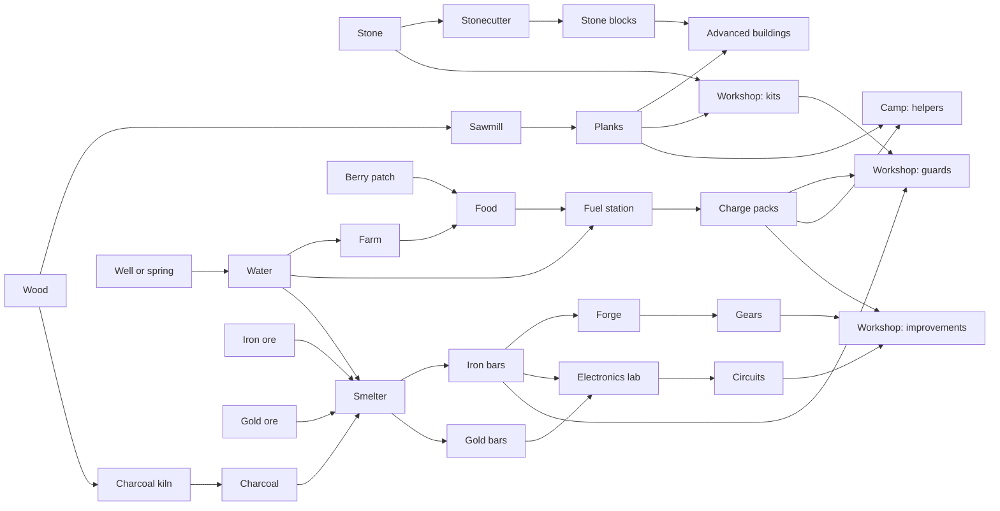

# Robot Skirmish: player-versus-computer mode

Date: 17 October 2026

Status: proposed design and implementation plan; not implemented.

Build a small, pausable strategy mode in which children aged 7–9 program their settlement and robot squad against the computer. Gathering resources, expanding production, protecting supply routes, and deciding when to attack should provide an Age of Empires feel within Robot Island's existing programming model.

This is an additional mode alongside the campaign and free play. The full skirmish economy includes wood, stone, food, water, iron, and gold, with connected production chains. Introduce those chains gradually through tutorials and starter programs; all six resource families belong in the full mode. The values below are starting points for prototyping and child playtesting, not final balance settings.

## 1. Existing foundation

The source, campaign plan, and existing screenshots were reviewed before writing this proposal. The game already provides:

- Physical resource collection and deliveries.
- Production recipes and construction sites.
- Shared robot job programs, building type defaults, and individual overrides.
- Per-robot source, item, and destination settings.
- A deterministic world clock with Run, Pause, Step, and Next block.
- A debugger that shows executing blocks and reasons for waiting.
- Starter programs, contextual hints, and progressive toolbox unlocks.
- English and German localization.

The working tree inspected also included the later campaign's variables, custom blocks, and messages. Those features are being developed separately; coordinate against their final interfaces before implementation.

The main additions are opposing sides, a larger production and delivery economy, paid robot production, combat and recovery, a computer strategy controller, and a match win condition. Existing campaign recipes and progression remain distinct from the proposed skirmish content.

## 2. First playable version

| Part | Proposed design |
| --- | --- |
| Players | One child against one computer settlement |
| Map | One symmetrical island with two bases, local supplies of every essential resource, and contested production sites around a central crossing |
| Length | Aim for 10–15 minutes for introductory matches and 15–25 minutes for the full economy, with unlimited thinking time while paused and save/resume |
| Units | Existing helpers plus one new combat robot, a Guard |
| Buildings | Camp, sawmill, stonecutter, well, farm, fuel station, charcoal kiln, smelter, forge, workshop, and electronics lab; reuse the construction-site system |
| Resources | Wood, stone, food, water, iron ore, and gold ore; processed into planks, stone blocks, charcoal, iron bars, gold bars, gears, circuits, kits, and charge packs |
| Objective | Reduce the opposing camp's shield to zero while protecting your own |
| Combat | Guards shoot playful energy pulses; shields visibly lose segments |
| Defeated robots | Return to camp and reboot after a delay, retaining their assigned programs |
| Size | Initially allow six helpers and four guards per side in introductory matches; eight helpers and six guards in the full economy. Rebooting robots and assembly reservations occupy their respective slots |
| Visibility | Show the entire map |
| Controls | Pause freezes both sides; opening the programming editor pauses by default |

The strategic choices should be understandable: make more helpers, expand production, secure water and ore, research an improvement, defend, or send guards forward. Rebooting makes a lost fight recoverable, while the time spent recovering still matters. Separate helper and guard limits leave room to maintain the economy while assembling a squad.

The player places buildings and chooses robot jobs through the interface, as in the existing game. Blockly controls how those jobs run. Improving a program should visibly improve the economy or the squad's behaviour.

Introductory matches start with the production buildings and working delivery programs needed for their lesson. Full matches let children build and connect the expanded economy. Economy complexity and opponent difficulty are separate choices: the full economy must also be playable against the Practice opponent.

## 3. Economy and construction

### Resource families and their purposes

Preserve physical deliveries and building-local inventories. Every resource has a visible source, a useful destination, and at least one strategic purpose.

| Resource family | Source | Processing | Main uses |
| --- | --- | --- | --- |
| Wood | Groves | Sawmill makes planks; charcoal kiln makes charcoal | Buildings, helpers, kits, and fuel for metal production |
| Stone | Quarry | Stonecutter makes stone blocks | Basic construction, kits, and foundations for advanced production buildings |
| Water | Spring collection point or well | Transported as pictured buckets; no container bookkeeping | Farms, charge-pack production, and smelter cooling |
| Food | Berry patches for the starting supply; farms for larger output | Farms use water to grow food crops; fuel stations turn food and water into charge packs | Robot assembly and optional faster repair |
| Iron | Iron deposit | Smelter makes iron bars; forge makes gears | Guards, electronics, and production/logistics improvements |
| Gold | Gold deposit | Smelter makes gold bars; electronics lab uses them for circuits | Stronger shields and larger carrying baskets |

Food has a concrete purpose in the robot setting: the fuel station converts crops into biofuel and packages the energy into charge packs. Explain this with a short animation. Robots use the packs; they do not need hunger or thirst meters.

At first, food is one pictured item representing berries and harvested crops. Grain, flour, and meals can become a later food-chain expansion if the setting adds residents who eat them. The initial six families already provide a substantial production network.

### Connected production chains

Each arrow between buildings represents a delivery job. The child can see why assigning another wood collector can improve either construction or metal output, and why water shortages can slow several chains at once.

### Prototype recipes

These are proposed skirmish recipes and costs. Times are seconds at normal speed, displayed to the child as progress bars and stored as integer simulation ticks. Balance them through complete-match simulations and playtests before treating them as final.

| Building | Inputs | Output or result | Initial duration |
| --- | --- | --- | --- |
| Sawmill | 1 wood | 1 plank | 2 seconds |
| Stonecutter | 2 stone | 1 stone block | 3 seconds |
| Well | None; timed extraction from its water source | 1 water | 2 seconds |
| Farm | 1 water | 2 food | 6 seconds |
| Charcoal kiln | 2 wood | 2 charcoal | 4 seconds |
| Smelter: iron | 2 iron ore + 1 charcoal + 1 water | 2 iron bars | 6 seconds |
| Smelter: gold | 2 gold ore + 1 charcoal + 1 water | 1 gold bar | 8 seconds |
| Forge | 1 iron bar | 2 gears | 4 seconds |
| Electronics lab | 1 gold bar + 1 iron bar | 2 circuits | 6 seconds |
| Fuel station | 2 food + 1 water | 2 charge packs | 4 seconds |
| Workshop: kit | 2 planks + 1 stone | 1 kit | 3 seconds |
| Camp: helper | 2 planks + 1 charge pack | 1 helper, with a chosen job | 6 seconds |
| Workshop: guard | 1 kit + 1 iron bar + 1 charge pack | 1 guard, with a chosen job | 8 seconds |
| Workshop: bigger baskets | 2 gears + 1 circuit + 2 charge packs | One side-wide improvement: helpers carry one extra item | 10 seconds |
| Workshop: stronger shields | 2 gears + 2 circuits + 2 charge packs | One side-wide improvement: guards gain one shield segment | 10 seconds |
| Camp: fast repair | 1 charge pack | Shortens one robot's repair/reboot cycle | Tune with combat |

The workshop's existing kit recipe remains recognizable. Assembly and improvements are separate operations, even when the same building performs them. Improvements are paid once per side and cannot be applied repeatedly; their recipe cards show the result before work begins. Existing and newly made robots benefit, with the exact shield-change rule defined to avoid granting a free heal during combat.

Basic repair and rebooting remain free but slower. Charge packs improve recovery and are required to assemble additional robots. Running out of food or water pauses expansion; it does not kill robots or remove the player's ability to recover.

### Building roles and construction order

| Building | Job | Construction dependencies |
| --- | --- | --- |
| Camp | Assembles helpers, receives supplies, and repairs robots | Present at the start |
| Sawmill | Converts wood into planks | Present at the start; additional mills use wood and raw stone |
| Well | Provides a local water pickup buffer | Planks and raw stone; a natural spring also remains usable |
| Farm | Converts delivered water into food over time | Planks and raw stone |
| Fuel station | Makes charge packs | Planks and raw stone |
| Stonecutter | Converts raw stone into blocks | Planks and raw stone |
| Charcoal kiln | Converts wood into charcoal | Planks and raw stone |
| Workshop | Makes kits, assembles guards, and installs improvements | Planks and raw stone; retain the existing basic workshop construction recipe |
| Smelter | Processes either iron ore or gold ore | Planks and stone blocks |
| Forge | Makes gears from iron | Planks and stone blocks |
| Electronics lab | Makes circuits from gold and iron | Planks, stone blocks, and iron bars |

For a prototype full-match start, give each side a camp, sawmill, well, four helpers, one guard, and a small starting stock such as 8 planks, 6 stone, 6 food, and 4 charge packs. Put wood, stone, a spring, berries, iron, and gold within reach. Provide collector/courier starters. Tutorial maps may prebuild the chain being taught.

Check construction recipes as a dependency graph: a fuel station must not require charge packs to build, a smelter must not require iron bars, and a stonecutter must not require stone blocks. Starting robots can gather and carry without consumable fuel. A player who spends all starting charge packs must still be able to build the food-and-water chain and make more.

### Logistics and stock control

- Materials physically arrive at the building that consumes them. The top bar can summarize owned resources, but must not imply that distant stock is available everywhere.
- Buildings expose input stock, reserved stock, output stock, and a small target buffer. A useful starting target is enough inputs for two production cycles.
- Each item uses one basket slot, including a water bucket. Delivery abstracts reusable containers so children do not have to return empty buckets.
- Buildings have separate input/output capacities appropriate to their recipes. A destination must have room for a complete input set, and the output store must fit a full batch.
- Use shared collector and courier programs, plus a supplied building-supply routine for children who want to focus on strategy. Show and step through what the routine does.
- Give every active chain a pictured route preset that sets sources and destinations. The player can alter the underlying program later.
- Show shortages at their cause: Workshop needs iron → Smelter needs charcoal → Kiln needs wood. Selecting the shortage opens the relevant building or courier.
- Use stock targets to stop overproduction. A smelter handling two recipes should have an explicit program or production plan that gives both a turn; endlessly waiting for gold must not block all iron production without explanation.
- New robots inherit a selected shared job program. Changing a courier team's route must preview the affected robots.

The full economy offers construction, food/energy, iron, and gold/electronics groups in the UI. Each group can start from a functioning template. The child can improve one chain while observing the others run.

### Map resources and strategic choices

For the initial release, resource sites remain productive at fixed extraction or regrowth rates and have finite pickup buffers. Home supplies provide a slow but viable route to every required material. Additional central sites offer more throughput or shorter delivery routes, creating reasons to expand and protect couriers. Depleting ore deposits can be a later challenge setting.

Make competition affect production: a disabled courier delays a smelter, a guarded crossing protects water delivery, and an extra kiln supports more iron processing. Basic workers and resource sites must remain recoverable under the match's existing reboot rules.

Food, water, wood, stone, iron, and gold all belong in the full economy. Gold-funded improvements are optional ways to compete; a player can also win through a larger basic squad and reliable production. This gives a real choice between immediate guards and investment in better logistics or shields.

## 4. Blockly blocks

### Reuse existing blocks

| Existing blocks | Skirmish use |
| --- | --- |
| Go to, Collect, Pick up, Unload basket | Collect wood, stone, berries, ores, and spring water; carry processed goods between buildings |
| Make, Build | Process the expanded recipes and complete construction sites; farms grow food and wells extract water through their own programs |
| Forever, Repeat | Keep jobs running |
| If / Else, comparisons, Wait until | React to danger and production needs |
| Stock and basket counts | Diagnose shortages and control deliveries |
| My source, My item, My destination | Share a program across several helpers |
| Variables, custom blocks, messages | Optional later challenges |

### Essential additions

The following are proposed child-facing labels. Start with a small toolbox and reveal blocks through the introductory challenges.

| Block | Who uses it | Behaviour |
| --- | --- | --- |
| Make a [helper / guard] for [job] | Camp or workshop, with suitable choices | Pays the material cost, assembles one robot, and assigns its shared job program |
| Supply [building] | Helper | Runs one visible delivery cycle for that building's declared input needs, using selected sources |
| Improve [baskets / shields] | Workshop | Pays for and completes one named, side-wide improvement; exposes its progress and completed state |
| Advance toward [place] | Guard | Moves toward the destination, engaging nearby opponents along the way |
| Guard [place] | Guard | Approaches and protects a small area, without chasing opponents across the island |
| Go home and repair | Robot | Returns to its camp and restores its shield |
| Opponent near [me / place]? | Robot or building | A simple true/false danger sensor |
| My shield is low? | Robot | A pictured condition, such as one shield segment remaining |
| Number of our [helpers / guards] | Any program | Supports population targets and decisions about when to advance |

Supply is a beginner convenience routine with inspectable movement, pickup/collection, and unloading steps. It must use the same travel times, baskets, permissions, and reservations as an ordinary courier program. Its sources are explicitly selected neutral resource sites or friendly stores. Prefer the most under-supplied required input, with deterministic tie-breaking. It cannot teleport goods or read the opponent's private stock as its supply.

Demand comes from a construction recipe, selected production plan, active recipe, or queued robot assembly, with an explicit input buffer target. Do not try to infer demand from arbitrary future branches in a program. If nothing is needed or available, the routine shows why, waits briefly, and returns to its caller. A building cannot be its own supply source.

Extend place choices with **my camp**, **opponent camp**, **this building** for building programs, and a player-placed **rally flag**. The existing Go to and stock blocks can use appropriate choices. Resolve them relative to the program's side so shared starters work for both settlements.

### Economy sensing and recipe choices

The six resource families should mostly add choices to existing blocks, with a few reusable sensors. A child learns Collect once and then selects wood, stone, food, iron ore, gold ore, or spring water as appropriate. Goods at a well or other production building use Pick up. Building capabilities restrict Make to valid products.

| Block or extension | Purpose |
| --- | --- |
| Make [water / food / plank / stone block / charcoal / iron bars / gold bar / gears / circuits / charge packs / kit] | Existing production block extended with each building's recipes |
| [item] at [place] | Existing stock sensor extended to every material and contextual building target |
| [building] needs [item]? | True when a declared production input is below its target, accounting for reservations and incoming deliveries |
| Space for [item] at [building] | Reports capacity available for a delivery after reservations |
| Ready to make [product]? | Checks inputs and output space for a recipe; the actual action still checks and reserves atomically |
| [improvement] finished? | Lets a workshop move on after completing one improvement |

Show the additional sensors after basic collection and Repeat. Beginners can use ready-made supply programs and the existing implicit waiting on Make. More experienced children can program stock targets, alternatives, and fair sharing between recipes.

Only show blocks appropriate to the selected entity. Helpers get collection actions, guards get combat actions, and production buildings get suitable assembly choices. Extend the existing capability and [toolbox filtering](src/blockly/toolboxes.js) system.

### Example programs

A defender:

~~~text
when started
forever
    if my shield is low?
        go home and repair
    else
        guard [our workshop]
~~~

An attacker changes one action:

~~~text
when started
forever
    if my shield is low?
        go home and repair
    else
        advance toward [opponent camp]
~~~

A workshop assembles a small squad after couriers supply planks, stone, iron bars, and charge packs:

~~~text
when started
repeat [3] times
    make [kit]
    make a [guard] for [Attackers]
~~~

The child can change squad size, protect a different building, or experiment with retreating earlier and then observe the result.

A fuel station limits its output to a small reserve:

~~~text
when started
forever
    if [charge packs at this building] < [4]
        make [charge packs]
    else
        wait [10] steps
~~~

The exact wait is a supplied courtesy delay, not a timing puzzle. Make automatically waits for food and water and shows the missing input.

A water courier uses familiar blocks:

~~~text
when started
forever
    go to [well]
    pick up [water]
    go to [farm]
    unload basket
~~~

An optional starter can fill the basket through Repeat. A more general supplier uses the new routine to alternate food and water deliveries as the fuel station needs them:

~~~text
when started
forever
    supply [fuel station]
~~~

The routine can be opened and stepped through so a child can discover how it works and later write a custom supplier.

### Action timing and waiting

Guard and Advance toward must perform a short action—one movement segment or firing cycle—then let the program continue. A guard must not remain inside Advance toward for an entire battle and never return to its low-shield condition.

The highlighted block should explain its current action: Moving toward camp, Firing, or Watching for opponents. An idle guard cycle must still consume simulation time.

Missing materials produce the familiar waiting state. A full robot limit says Robot limit reached. An opponent disappearing or rebooting triggers a fresh target choice rather than a program error. Distinguish valid temporary absence from an invalid program configuration.

Specify whether the robot-count sensor includes assembly reservations and rebooting robots, and make that meaning visible. Population enforcement must reserve slots atomically so multiple buildings cannot exceed the cap.

### Later additions

| Later block | What it adds |
| --- | --- |
| Attack [nearest opponent / chosen target] | Explicit target selection |
| Patrol between [A] and [B] | Protecting a delivery route |
| My shield and Opponents near [place] | Numeric conditions |
| Repair [friendly building] | A support job |
| Send [advance / help] to [job group] | Coordinating a squad; extends today's individual messages |

Add these when a lesson or strategy needs them. Keep them out of the initial beginner toolbox.

## 5. Experience for ages 7–9

The first experience should ask the child to change one useful decision in an otherwise working settlement. Reuse the campaign's demonstration, partial-program, and contextual hint structure. A complex economy should introduce one useful connection at a time, with functioning starter programs for the rest of the settlement.

Use three economy presets for practice and gradual introduction. They are separate from computer difficulty; the full economy is part of the release.

| Preset | Chains the child manages | Supplied support |
| --- | --- | --- |
| First settlement | Wood, stone, water, food, planks, kits, and charge packs | Small pre-stocked iron supply for a short guard lesson; no gold or upgrade objectives |
| Working industry | Adds charcoal, stone blocks, iron mining, and smelting | Operating food/water starters; gold chains can remain absent from this practice scenario |
| Full skirmish | All six resource families, gears, circuits, and improvements | Optional complete economy templates and supply routes, with every chain editable |

Introduce the mode through short challenges that can be revisited independently:

1. **Connect a delivery.** Send wood to the sawmill and deliver its planks to a construction site.
2. **Grow food.** Deliver water to a farm and watch the crop cycle finish.
3. **Power a new helper.** Supply food and water to a fuel station, then bring a charge pack to the camp.
4. **Make iron.** Follow the pictured ore, charcoal, and water inputs to the smelter; complete one missing link.
5. **Make a guard.** Connect the kit, iron, and charge-pack supplies to the workshop.
6. **Protect a route.** Guard a crossing used by a water or ore courier during a small announced attack.
7. **Come home safely.** Add the low-shield condition and repair action.
8. **Build an improvement.** Connect gold and iron to the electronics lab, then choose larger baskets or stronger shields.
9. **Beat the computer.** Choose between immediate squad growth and investment in production or improvements.

Provide these supports:

- Working Collector, Courier, Supplier, Producer, Defender, and Attacker starters.
- A pictured economy map, showing source → building → output for each chain, with arrows highlighted when a delivery occurs.
- Collapsible construction, food/energy, iron, and electronics groups. Show relevant local counts when selecting a building and let the player pin useful resource totals.
- Recipe cards with pictures, small integer quantities, and output previews. Show the missing ingredient beside the highlighted Make block.
- Job-group summaries in the overview, with individual inspection when needed.
- Both camp shields and the match objective always visible.
- Side badges and shapes alongside colours.
- An announcement before the first attack, with an optional automatic pause.
- Contextual hints such as: Your smelter has ore, but needs charcoal. Which building makes charcoal?
- Try again retains the child's programs.
- English and German text delivered together.
- Touch-friendly controls, short instructions, and pictured quantities.
- Optional blank workspaces for children who want to write their own programs.

The player should be able to pause and reason about the whole situation. Do not require fast clicking or calculations in simulation ticks to succeed.

## 6. Computer opponent

Use authored, deterministic strategies through the same simulation and resource rules. The computer's workers gather, buildings wait for deliveries, and guards run programs. A small strategy controller chooses jobs, construction, production targets, improvements, and attack timing.

The controller must build the actual food, water, fuel, metal, and electronics chains available in the selected economy preset. Give it dependency-aware build orders, small input reserves, a minimum helper allocation for essential supplies, and recovery rules for interrupted couriers. Reserve enough planks for useful construction before sending all wood to charcoal. Never inject missing materials to disguise a stalled computer economy.

| Difficulty | Computer behaviour |
| --- | --- |
| Practice | Announces attacks, sends small squads, and leaves generous recovery gaps |
| Friendly | Builds a steady economy, maintains food/water reserves, keeps defenders, and attacks with small groups |
| Challenge | Adjusts workers to bottlenecks, expands toward useful deposits, invests in improvements, coordinates larger groups, and retreats damaged guards |

Difficulty comes from decisions and timing. Both sides pay the same costs. Keep computer state serializable and its decisions tied to simulation ticks.

Since the map is visible, let the child inspect the opponent's programs in a read-only view as a learning aid. Editing and assignment controls must remain limited to the player's side.

## 7. Technical integration

### Make the expanded economy data-driven

Extend the item, entity, recipe, and blueprint registries in [entities](src/sim/entities.js), [recipes](src/sim/recipes.js), and [placement](src/sim/placement.js). Support the new resources through the same collection, production, and inventory operations rather than a special simulation for each chain.

Recipes need an identifier, allowed buildings, complete inputs, complete outputs, integer duration, and any assembly or one-time improvement effect. Allow a smelter to have both iron and gold recipes, and expose only its valid choices. Wells are production buildings with timed, zero-material water recipes and finite output capacity; spring collection points remain resource nodes. Farms consume water through an ordinary timed recipe.

Extend building-specific storage capacities, construction recipes, localization, item icons, recipe cards, and program validation together. Construction sites must have capacity for their entire bill of materials. Preserve the existing campaign's recipes and toolboxes through explicit content availability and mode configuration.

Represent side-wide improvements and their paid/in-progress/completed states in saved world data. Prevent duplicate purchases and define how already active robots gain a changed capacity or shield maximum.

### Track delivery demand and prevent reservation deadlocks

The larger economy needs explicit per-building input targets and incoming-delivery reservations for the Supply routine and needs sensors. Do not count the same item twice as stocked, reserved for consumption, or arriving.

A supplier reserves destination room and a delivery claim only when it can acquire its load. It must release claims on cancellation, route failure, reboot, or program reassignment. Avoid holding an unrelated input while waiting indefinitely for a different one. Production reserves a whole recipe atomically and waits without partial input holds when it cannot start.

Define each count shown in the debugger: physically stored, available to take, reserved for a recipe, and on the way. Default child-facing labels should stay short; the detailed inspector can explain the distinction.

Bound the Supply routine to one delivery cycle and expose its internal steps to the global debugger. Resolve competing demands deterministically and test that shared suppliers do not permanently neglect an input or duplicate delivery claims.

### Ownership is separate from jobs

Today, a team means robots sharing a program. Add a separate side identifier for player/computer ownership.

Scope program defaults, job groups, message recipients, resource interactions, and editable entities by side. In particular, [type defaults](src/sim/bindings.js) are currently global: editing all sawmills must never alter the opponent's sawmills. Apply ownership checks in simulation commands and actions as well as in the interface.

Keep neutral map resources distinct from owned buildings. Define which target choices are friendly, opposing, or neutral for each action.

### Preserve the world-clock contract

Production, crop growth, well output, resource extraction/regrowth, computer decisions, combat cooldowns, repair, and rebooting all advance through [the world simulation](src/sim/world.js). Pause and Step must affect every system and both sides together. Farms must not grow on wall-clock timers while the editor is open.

Save the computer's decision state, combat state, active targets, production plans, incoming-delivery claims, improvement state, production reservations, and recovery timers. Replay must reproduce the same match from the same initial state and commands.

### Add robot lifecycle rules

Assembly requires paid costs, reserved population slots, valid spawn positions, and inherited programs. New robots should enter the simulation at a defined tick boundary.

Rebooting must release pending reservations and handle cargo consistently. Rebooting robots still count toward the cap. Specify how their programs restart on recovery.

Sandbox commands that freely add robots or stock must be unavailable in skirmish, including through simulation-level validation.

### Extend navigation for combat

Current [navigation](src/sim/navigation.js) targets buildings and resource interaction cells, and robots pass through each other. Start with ranged guards and retain simple movement.

Combat needs moving-target tracking, range checks, deterministic target selection, and bounded pursuit. Avoid introducing unit collision and formation systems in the first version.

Lay out the skirmish map with enough room for the complete production chain on each side and reachable access cells for every building. Do not assume the campaign island's narrow regions fit the new economy. Test delivery distances and building placement with both complete settlements present, including the longer routes to central deposits.

### Define fair combat resolution

Resolve hits due on the same tick together so entity iteration order does not give one side an advantage. Define simultaneous camp defeat as a draw.

Specify eligible targets and friendly-fire rules explicitly. Handle targets that move, reboot, or become unavailable between selection and action completion.

### Make program edits safe for the economy

Applying programs currently can empty robot baskets through [the binding and restart logic](src/sim/bindings.js). Skirmish needs an explicit policy. Preserve cargo and make starter programs handle partially filled baskets when restarted.

Cancelling assembly or other paid work must release or settle reservations consistently, without duplicating resources or creating free robots. Editing must not reset shields or bypass recovery delays.

### Protect existing progress

Give skirmish its own play/session type and save slot. The current [save loader](src/storage/saves.js) rejects version mismatches, so schema and simulation changes need a deliberate compatibility plan that preserves existing campaign progress.

Coordinate changes to shared simulation, compiler, block, localization, and session files with the ongoing campaign work. Add new skirmish content and strategy modules separately where practical.

## 8. Implementation sequence

| Stage | Deliverable | Completion check |
| --- | --- | --- |
| 1. Two settlements | Side ownership, mirrored map, separate programs and controls | Player changes cannot affect computer-owned entities |
| 2. Combat prototype | Fixed guards, shields, Advance/Guard/Repair, camp victory | A small battle works identically with Run, Step, and replay |
| 3. Basic supply network | Wood/stone construction, water, food, charge packs, stock targets, Supply routine, paid helper assembly | A settlement can recover from zero charge packs and grow using collected materials |
| 4. Industry and full economy | Stone blocks, charcoal, iron, gold, gears, circuits, paid guard assembly, improvements, all buildings and route templates | Both sides can complete every chain from the proposed starting resources without resource leaks or circular dependencies |
| 5. Computer opponent | One reliable full-economy strategy, recovery from shortages, then difficulty settings | The computer pays for and supplies everything it uses; complete matches are reproducible |
| 6. Child-facing release | Economy presets, tutorials, starters, pictured chains, hints, saves, localization, touch layout | Children can find a missing input, fix a delivery, and observe the effect on production or combat |

Validate combat with fixed units early, and validate each production chain in isolation before connecting the full network. The release gate includes all six resource families; the early stages are implementation milestones and tutorial configurations.

## 9. Validation and playtesting

During implementation, prioritize checks for:

- Ownership isolation across edits, defaults, assignments, messages, and resource actions.
- Simultaneous hits and simultaneous camp defeat.
- Targets disappearing, moving, or rebooting.
- Assembly reservations, population limits, and valid spawning.
- Resource conservation across cancellation, editing, and recovery.
- Recipe dependency checks and complete bootstrap runs from the proposed starting stock, including a recovery run with no charge packs left.
- Full chains from raw materials to helpers, guards, gears, circuits, and both improvements, with no injected intermediate goods.
- Input/output capacity checks for every building, recipe batch, and construction site.
- Supply routines sharing sources, interrupted couriers, full destinations, stale incoming claims, and recovery from temporary route loss.
- Smelters alternating recipes and suppliers servicing all required inputs without starvation.
- Zero water or food stalling expansion while leaving a recoverable path to production and basic repair.
- One-time improvement costs, duplicate requests, existing-robot effects, and newly assembled robot effects.
- Reactive programs returning to their conditions during combat.
- Pause, Step, and replay determinism, including computer decisions.
- Saving and loading during assembly, crop growth, metal processing, an improvement, a reserved delivery, combat, and rebooting.
- English/German labels and touch layouts.

Re-run the existing campaign checks after shared-engine changes.

For the first child playtest, success means the child can:

1. Trace a pictured chain from source to final product and identify the missing ingredient when production stops.
2. Fix a delivery or change an input target through blocks or a visible starter routine.
3. Change a guard's behaviour through blocks.
4. Use Pause to think and Step to investigate.
5. Explain a visible consequence of a program change, such as more water producing more food and charge packs.
6. Choose between more immediate guards and an improvement funded by the gold chain.
7. Retry after a setback while keeping their work.

Tune match duration, helper count, delivery distances, stock targets, squad size, production costs, recovery delays, and attack spacing from these sessions. Check whether the full economy remains understandable when starter programs run most chains and the child edits one or two. Age suitability is a playtest requirement, not an assumption established by the design alone.

## 10. Deferred scope

Defer additional combat types, fog of war, houses, a full technology-age tree, walls, procedural maps, and multiplayer until the full-economy version is enjoyable. The two named improvements are included in the first full skirmish.

Later economy expansions can add grain/flour/meals, fishing, clay/bricks, pipes, conveyors, markets, and depleting ore deposits. Wood, stone, food, water, iron, gold, and their planned chains are included in the current scope.

The first release should support building and balancing an economy, programming a squad, protecting deliveries, choosing between expansion and improvements, and deciding when to advance.

## 11. References

- [Robot Island implementation plan](PLAN.md).
- [Campaign plan and teaching progression](docs/campaign-plan.md).
- [Age of Empires II: Expanding Your Empire](https://www.ageofempires.com/learn-to-play/expanding-your-empire-aoe2/) — resource allocation, production, and expansion as strategic decisions.
- [ScratchJr background](https://www.scratchjr.org/about) — developmentally appropriate programming design; ScratchJr's audience begins at ages 5–7, while Scratch serves children from eight upward. Offering scaffolded and open programming paths here is a design recommendation to validate with the intended players.
