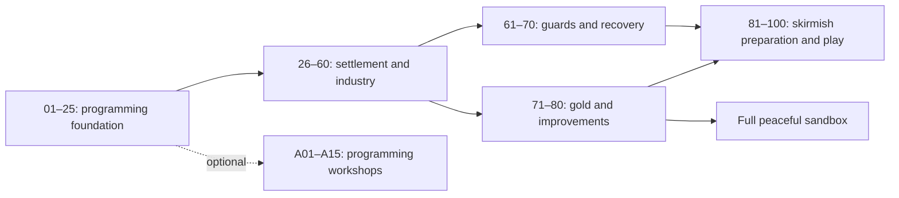

# BlocklyBots: campaign plan v2

17 October 2026 · Ages 7–9 · Proposed content specification, not implemented

This plan reworks the [40-mission campaign](campaign-plan.md) into a gradual route from a first instruction to the full economy and computer opponent in [SKIRMISH_PLAN.md](../SKIRMISH_PLAN.md). It proposes **100 main-path missions in twenty chapters, plus 15 optional programming workshops**. This is a working itinerary, not a mission limit: split a lesson again whenever playtesting reveals two unfamiliar ideas competing for attention.

Missions 1–25 retain the original programming foundation. The continuation teaches construction, all six resource families, physical supply networks, paid robot assembly, guards, recovery, improvements, and strategy. The original memory, custom-block, and message lessons become optional workshops A01–A15. They remain proper lessons with their own milestones; they are not prerequisites for playing skirmish.

This document specifies the proposed v2 campaign. It does not renumber the implemented campaign, change its saves, or claim that skirmish features already exist. [PLAN.md](../PLAN.md) and the original campaign remain the record of the current release until v2 is implemented. The skirmish plan owns shared economy and combat mechanics; this plan owns their teaching sequence. Any unresolved shared rule must be settled before its dependent mission is authored.

## Learning and pacing

- A mission introduces **one main idea**. A new resource name, a recipe, a new interface, and a new programming structure each consume attention. Do not introduce all four together.
- Use a repeating progression: watch or fill one gap → change a working example → diagnose one visible fault → combine familiar jobs. Projects supply working programs for everything outside the lesson's focus.
- Missions 1–5 aim for 3–6 minutes, ordinary lessons for 5–10, and production projects for 10–15. Full matches may take 15–25 minutes of running play plus unlimited paused thinking time. These are targets to validate with children, not deadlines.
- One or two missions make a session. Save inside projects and matches; a child never has to finish a chapter or match in one sitting.
- Most immediate orders use 1–4 pictured items. Larger construction bills and multi-stage chains use grouped recipe pictures and visible deliveries, not mental arithmetic exercises.
- Give each mission one visible main outcome. Authoring checks may inspect several contributing events, but the child sees a single order, reserve, building, protected route, or match objective.
- Introduce Pause, Step, and Next block early and reuse them throughout. Opening the editor pauses the whole world, including production, the opponent, combat, and recovery.
- Offer a short prediction before Run and an explanation after success. Pointing and speaking count; neither reading fluency nor typing is the programming test.
- No speed medals, block-count requirements, hint penalties, lost lives, or surprise attacks during a first encounter. A longer chain is not permission to remove scaffolding.
- Combat uses playful pulses and shield segments. Let children stay in peaceful economy play. Combat lessons can be revisited with demonstrations and generous Practice settings.

Every mission stands alone. Its island, stock, robots, programs, settings, improvements, and opponent state are authored for that mission; nothing depends on the child's previous solution. “Use the plan again” means supplying a fresh mission-owned example. Restart keeps this mission's edits and drafts while restoring its world; Back to starter is a separate choice. Progress records completion and unlocks, not a settlement carried into the next lesson.

## Chapter map

| Chapter | Missions | Main learning | Milestone |
| --- | --- | --- | --- |
| 1. Hello, Helper! | 01–05 | Instructions, order, observing and repairing | Camp receives its first wood |
| 2. Do It Again | 06–10 | Repeat, loop boundaries, two basket spaces | Reliable repeated deliveries |
| 3. A Working Island | 11–15 | Building programs, Pick Up, concurrent jobs, Forever | Bridge opens; basic free play |
| 4. Look Before You Act | 16–20 | Stock, If/Else, Wait Until, feedback | A useful reserve |
| 5. Give Everyone a Job | 21–25 | Shared programs, settings, copies, kit recipe | First kits; original sandbox milestone |
| 6. Make Room to Grow | 26–30 | Placement, construction bills, local materials, access | Build and use a workshop |
| 7. Water Makes Things Grow | 31–35 | Spring versus well, water deliveries, farms | A working food chain |
| 8. Energy for More Helpers | 36–40 | Charge packs, paid helper assembly, recovery | First settlement economy |
| 9. Supply What Is Needed | 41–45 | Inspectable Supply, sources, demand, room, incoming goods | A dependable supplier team |
| 10. Materials for Industry | 46–50 | Stone blocks, charcoal, sharing wood, advanced construction | A supplied industrial district |
| 11. From Ore to Iron | 51–55 | Ore, three-input smelting, tracing shortages | Reliable iron bars |
| 12. Keep the Factory Flowing | 56–60 | Recipe readiness, batch targets, competing consumers, buffers | Balanced working industry |
| 13. Meet the Guards | 61–65 | Guard, Advance, free repair, repeated danger decisions | A guard that returns safely |
| 14. A Team That Recovers | 66–70 | Reboot, paid guards, job groups, danger sensing | Protect a production route |
| 15. Gold and Clever Parts | 71–75 | Gold, fair smelter scheduling, gears, circuits | All six resource families connected |
| 16. Improve the Settlement | 76–80 | Bigger baskets, stronger shields, one-time improvements | Peaceful full-economy project |
| 17. Prepare a Skirmish | 81–85 | Population targets, faster repair, rallying, camp objective, opponent inspection | Understand the match |
| 18. Play and Recover | 86–90 | Supported matches, setbacks, home/central routes, expansion choices | Win a working-industry match |
| 19. Manage the Full Economy | 91–95 | Full-economy Practice, bottlenecks, investment, safe editing | A resilient full settlement |
| 20. Your Island Strategy | 96–100 | Choose, bootstrap, rehearse, debug, play | Full skirmish finale |
| Workshop A. Remember the Job | A01–A05 | Local variables and counted orders | Optional after 25 |
| Workshop B. Make Your Own Blocks | A06–A10 | Procedures and one typed input | Optional after 25; independent of A01–A05 |
| Workshop C. Talk and Work Together | A11–A15 | Individual messages and system projects | Optional after 25; independent of the other workshops |

The child can stop at several satisfying points. Keep basic free play after 15 and the original sandbox after 25. Add peaceful energy templates after 40, industry after 60, guard practice after 70, and the full peaceful economy after 80. Mission 86 opens First settlement Practice, 90 opens Working industry Practice, and 91 opens Full skirmish Practice. Do not require the finale or optional workshops to revisit those modes. Economy preset and opponent difficulty are separate: the full economy works with Practice; Friendly and Challenge are optional replay choices.

Missions 01–60 follow the chapter sequence. After 60, offer two chapter routes: guard training 61–70, and peaceful gold/improvements 71–80. Either route can come first. Mission 81 requires both routes; later match chapters proceed in order. Thus a child can unlock the complete peaceful economy without fighting. If the guard route has not been taken, mission 78 supplies a noncombat shield demonstration with recovery and assembly programs already configured; the child edits only the improvement. Completing it does not claim the guard lessons were learned.

Workshop progress grants no implicit main-path prerequisite and does not enlarge a lesson's default toolbox. Offer advanced blocks in an optional expanded drawer only after the relevant workshop. Replays always use the selected mission's own availability profile.

## Shared world rules and teaching boundaries

1. **Physical actions remain familiar.** Go To finds a route to a named place. Collect takes a raw item from a resource node; Pick Up takes stock from a building. Unload transfers the basket. No coordinates, steering, bucket returns, hunger, thirst, or consumable movement fuel are introduced.
2. **Stock belongs somewhere.** Materials must reach the building that uses them. A global total is informational. Source choices for Supply name neutral resource sites or friendly stores, never the recipient itself or an opposing store.
3. **Capacity matters.** Helpers initially carry two items total, including water and mixed loads. Bigger baskets adds one slot, once per side. Building inputs must fit a whole recipe, outputs a whole batch, and construction sites their whole bill.
4. **Programs share one clock.** An action finishes before its following block. Make and Pick Up may wait for missing supplies; this is observable, normal behavior. Forever never reaches a block placed after it. One-time construction belongs outside it.
5. **Sensors are observations.** Stock, room, and Ready to make do not reserve anything. Supply and production must recheck and acquire their reservations through the shared engine. Repeat reads its count on entry. If only checks when execution reaches it.
6. **Supply performs one bounded delivery cycle.** It uses actual travel, basket space, collection/pickup, and unloading. It returns after that cycle, or after a short, visible no-work wait. Forever repeats it. Its pictured steps can be opened and stepped through. Demand comes from a declared recipe, production plan, construction bill, or queued assembly, with an explicit target; it is not inferred from arbitrary code.
7. **Expose the cause of waiting.** Show here, in use, on the way, and room with pictures; show detailed reservation terms only in the inspector. Never count one item as both free stock and incoming. Two suppliers cannot claim the same unmet delivery indefinitely or block an unrelated ingredient.
8. **Jobs and sides differ.** A job group shares instructions. Player/computer ownership controls editing, inventories, defaults, and messages. A shared edit cannot change the opponent. Each robot still has its own instruction pointer and memory.
9. **Assembly is paid and limited.** Camp makes helpers; workshop makes guards. A chosen job is inherited. Use the skirmish limits of six helpers/four guards for introductory matches and eight/six for full matches; a small lesson may declare a smaller limit. Population includes active robots, rebooting robots, and reserved assembly slots, each exactly once. It does not mean “robots currently ready at the flag.”
10. **Combat decisions keep returning.** Guard and Advance perform a movement segment, firing cycle, or timed watch, then return so low-shield and danger conditions can run again. Go home and repair restores a robot at its own camp. Basic recovery is free; an optional charge pack accelerates one recovery. Defeated robots reboot with their job assignment retained.
11. **Improvements are side-wide and one-time.** Both existing and new eligible robots benefit. A basket upgrade changes capacity, not existing contents. The shield rule must not provide a free heal through an upgrade or program edit. Do not teach a specific current-shield increase until the shared rule is fixed.
12. **Resource sites remain viable.** Advanced v2/skirmish profiles use productive sites with finite pickup buffers and fixed extraction/regrowth rates, plus slow viable home supplies. Legacy foundation fixtures can retain their explicit finite lesson budgets. Neither version inherits depleted resources from earlier play.
13. **Opponents follow the same rules.** Announced Practice attacks are produced by authored programs and paid stocks. Scripted training may start with visibly preplaced robots. No resources or raiders appear invisibly during a lesson to force its outcome. Both camps reaching zero shield on one tick is a draw.

The bridge still costs four planks; a workshop building costs four planks and two raw stone; a kit still costs two planks and one raw stone. **Stone blocks do not replace raw stone in familiar recipes.** Production and assembly quantities below follow the skirmish prototype. Other building bills are not numerically settled there: missions must display and budget the eventual shared recipe rather than inventing a different campaign cost. Exact build costs are an implementation gate, not a calculation left to children.

## Mission cards

Quoted text is draft child-facing copy. Cards specify the learning focus, prepared support, task, completed-world evidence, and an observation prompt. The defaults above apply to every card. Supporting jobs are visible, supplied, and inspectable. No card requires a reference program's exact block layout.

### Foundation: missions 01–25

These retain the original campaign's gradual introduction. Each setup is authored afresh, including a basket that deliberately starts with wood or an already opened bridge.

### Chapter 1 — Hello, Helper!

#### 01. Hello, Helper!

“Help Robo 1 find the grove.”

- **Learn:** A block tells a robot what to do.
- **Setup and support:** One selectable helper, a clearly marked grove, and a fixed `When Started` block. Offer only `Go To`; preselect the grove. Point to Apply and Run in context.
- **Player task:** Attach the action and run the program.
- **Success:** Robo 1 reaches the grove's interaction point.
- **Hint / talk:** “Put the instruction under Start.” Ask the child to point to the place the robot will go before running.

#### 02. One Piece of Wood

“Put one piece of wood in the basket.”

- **Learn:** An action can change what a robot carries.
- **Setup and support:** Robo 1 starts at the grove with an empty basket. Show its two basket spaces as pictures. Supply Start and introduce `Collect Wood`.
- **Player task:** Add Collect and watch one wood appear in the basket.
- **Success:** The robot holds one wood after collection completes.
- **Hint / talk:** “The robot is already beside the wood.” Ask what changed and what did not.

#### 03. Bring It Home

“Bring your wood back to camp.”

- **Learn:** Instructions run from top to bottom.
- **Setup and support:** Start at the grove carrying one staged wood, as pictured in mission 2. Offer `Go To Camp` and the new `Unload Basket`, with two visible spaces in the starter.
- **Player task:** Put travel before unloading.
- **Success:** One wood reaches camp and the robot's basket is empty.
- **Hint / talk:** “Where must the robot be before it can unload?” Follow the highlight from travel to unloading.

#### 04. The Mixed-Up Instructions

“Something is in the wrong place. Help Robo 1 fix it.”

- **Learn:** Debugging means noticing what happened and changing a cause.
- **Setup and support:** A fresh empty robot at camp; a four-action delivery program tries Collect before Go To Grove. Supply every needed block.
- **Player task:** Predict the first action, use Step to see the problem, then move the misplaced block. Demonstrate Step to Next Block for the corrected walk.
- **Success:** The repaired program delivers one wood without the location error.
- **Hint / talk:** “Which instruction needs the robot to be at the grove?” Change one thing, then try again.

#### 05. Camp Is Ready

“Bring two pieces of wood for our camp.”

- **Learn:** Make a complete short sequence independently; no new block.
- **Setup and support:** Empty basket at camp; a picture strip shows grove, two wood, camp, empty basket. Provide Start and familiar blocks, without placing the sequence for the child.
- **Player task:** Go to the grove, collect twice, return, and unload. Two separate one-item trips are also valid.
- **Success:** Two new wood reach camp.
- **Hint / talk:** “Tell the robot the whole job.” Reveal a small camp improvement and ask the child to describe their instructions in order.

### Chapter 2 — Do It Again

#### 06. Again, Please!

“Can one Repeat block collect two pieces?”

- **Learn:** Repeat does its inside instructions a chosen number of times.
- **Setup and support:** Robo 1 starts at the grove. Show one Collect block beside a starter `Repeat 2` with one gap. (Two Collects, as first planned, were one stack: dragging it put both into the loop, and the third Collect waited for room in the basket forever.) Keep the count fixed at first.
- **Player task:** Put Collect inside Repeat. Travel home is already supplied after the loop.
- **Success:** Two wood are collected and delivered.
- **Hint / talk:** “What happens once? How many times should it happen?” Point to each basket space as a round finishes.

#### 07. A Whole Trip Again

“Bring three pieces, one trip at a time.”

- **Learn:** A loop can repeat an entire sequence.
- **Setup and support:** Start at camp. Supply one working trip: go to grove, collect one, go to camp, unload. Show three empty delivery pictures.
- **Player task:** Put the whole trip inside `Repeat 3`.
- **Success:** Three one-item deliveries complete, with the robot ending empty at camp.
- **Hint / talk:** “Which parts must happen on every trip?” Compare repeating Collect with repeating the whole journey.

#### 08. Two Basket Spaces

“Bring four pieces without overfilling the basket.”

- **Learn:** A program must respect a physical limit.
- **Setup and support:** A starter tries to collect three times before unloading. Show two basket spaces and let the third collection wait visibly. Provide a partly filled plan for two trips.
- **Player task:** Make each trip collect two items before returning. An outer `Repeat 2` with two ordinary Collect blocks is enough; do not introduce nesting yet.
- **Success:** Four wood reach camp, and no trip needs more than two basket spaces.
- **Hint / talk:** “The basket is full. What must happen before another collection?” Waiting is a clue, not a punishment.

#### 09. A Repeat Inside a Repeat

“Make two trips, with two pieces on each trip.”

- **Learn:** An inner loop finishes as part of each outer round.
- **Setup and support:** Supply a fresh copy of the working two-trip program. Its outer loop and travel actions are already placed. Highlight only the two adjacent Collect blocks.
- **Player task:** Replace those two blocks with an inner `Repeat 2 → Collect`.
- **Success:** Four wood arrive in two full-basket deliveries.
- **Hint / talk:** “Two pieces for this trip; then the next trip begins.” Animate the two loop counts separately. Do not require multiplication vocabulary.

#### 10. The Loop Detective

“The robot collects wood, but never brings it home. Find out why.”

- **Learn:** Review loop boundaries and diagnose a full-basket wait.
- **Setup and support:** A supplied three-trip loop has Go To Camp and Unload accidentally placed after the loop. All action choices and the repeat count are correct.
- **Player task:** Move the return-and-unload pair inside the loop; use the highlight and basket to check the repair.
- **Success:** Exactly three one-item deliveries finish without a full-basket stall.
- **Hint / talk:** “What is repeated? What is left until the very end?” Award a delivery badge without introducing another mechanic.

### Chapter 3 — A Working Island

#### 11. Wake Up the Sawmill

“Turn one piece of wood into a plank.”

- **Learn:** A building can run a program too.
- **Setup and support:** The sawmill already holds one wood and has output space. Focus selection on the sawmill; introduce `Make Plank` under Start.
- **Player task:** Program the sawmill and watch its input become its output.
- **Success:** One plank is produced by the building.
- **Hint / talk:** “Which thing does the making?” Show that making takes time while the same action remains highlighted; no Wait block is needed.

#### 12. The Plank Courier

“Take two planks from the sawmill to the depot.”

- **Learn:** Pick Up takes a finished item from a building.
- **Setup and support:** The sawmill holds two planks. Supply travel and unloading, with a familiar Repeat containing a new Pick Up gap.
- **Player task:** Pick up two planks and deliver them to the depot.
- **Success:** Two planks move from the sawmill into the depot.
- **Hint / talk:** “Collect finds raw materials. Pick Up takes something stored here.” Use different source pictures as well as words.

#### 13. Two Jobs at Once

“Bring wood while the sawmill gets ready to make planks.”

- **Learn:** Separate programs work at the same time on one world clock.
- **Setup and support:** The sawmill starts empty with a supplied `Repeat 2 → Make Plank` program. The child has a familiar two-wood delivery program with its destination left to choose.
- **Player task:** Deliver to the sawmill, then pause and inspect both programs together.
- **Success:** The robot supplies two wood and the sawmill produces two planks.
- **Hint / talk:** “The sawmill is waiting for wood. Who can bring it?” One Step advances both workers; no message or guessed delay is needed.

#### 14. Keep It Going

“Keep bringing wood while your friends make and move planks.”

- **Learn:** Forever keeps a useful job running.
- **Setup and support:** Supplied sawmill and courier programs repeatedly make planks and take them to a roomy depot. Show their existing loops. Give the child the collector's known one-item delivery trip.
- **Player task:** Wrap that trip in Forever. Show how Pause stops the whole world.
- **Success:** At least four new planks reach the depot while the collector completes multiple trips.
- **Hint / talk:** “What should happen after this delivery?” Explain that a worker waiting for supplies may still be doing the right job.

#### 15. Across the Stream

“Work together to build our bridge.”

- **Learn:** Combine familiar programs into a production chain. `Build Bridge` is a new action using the familiar building-program pattern.
- **Setup and support:** Supply working collector and sawmill programs. The courier has a destination gap; the site has Start and a Build Bridge block to attach. Use a four-plank picture on the site.
- **Player task:** Send planks to the site and start its one-time building program. Observe collector → sawmill → courier → site.
- **Success:** The site consumes four planks, completes the bridge, and opens the route across the stream.
- **Hint / talk:** “Follow one piece of wood all the way to the bridge.” Celebrate with a crossing and unlock basic free play. Never put Build Bridge in Forever.

### Chapter 4 — Look Before You Act

#### 16. How Many Are Ready?

“Look at the sawmill's stock and take what is ready.”

- **Learn:** A sensor supplies a number from the world.
- **Setup and support:** One isolated courier starts at a sawmill holding one or two planks. No other program changes that stock during the pickup. Supply `Repeat [gap] → Pick Up Plank`, followed by travel and unloading.
- **Player task:** Put the sawmill's plank-count sensor into Repeat. Show the number it reads before running.
- **Success:** The courier transfers the starting stock correctly in two visible trials: one plank and two planks.
- **Hint / talk:** “The number comes from the shelf.” Explain that Repeat reads its count when the loop starts; it does not keep changing the count as items are taken.

#### 17. Only When We Need It

“Make a plank only when the shelf has fewer than two.”

- **Learn:** If chooses whether to do an action, using a true-or-false comparison.
- **Setup and support:** Offer If with a preassembled `planks at sawmill < 2` condition. The sawmill has wood and room. Show the condition as a readable picture question before showing the comparison symbol.
- **Player task:** Put Make Plank inside If.
- **Success:** In two small trials, starting with one plank makes one more; starting with two makes none.
- **Hint / talk:** “Is the shelf below the line?” A single If checks once. Repeated checking is reserved for mission 20.

#### 18. This Job or That Job

“If the sawmill has a plank, bring it home. Otherwise, bring it wood.”

- **Learn:** Else chooses another action when the condition is false.
- **Setup and support:** A supplied `If planks at sawmill > 0` has a working plank-delivery branch. Offer Else and a familiar wood-delivery sequence. Give the sawmill no active production job during either trial, making the choice unambiguous.
- **Player task:** Place the wood job in Else.
- **Success:** One trial with a plank delivers it to the depot; another with none delivers wood to the sawmill.
- **Hint / talk:** “Which path will run this time?” Both branches return with an empty basket, and only one branch runs per check.

#### 19. Wait for a Full Load

“Wait until two planks are ready, then take both.”

- **Learn:** Wait Until holds the program at a condition until it becomes true.
- **Setup and support:** A working sawmill makes two planks over time. Supply a courier program with a gap before its two pickups. The courier starts at camp.
- **Player task:** Add `Wait Until planks at sawmill >= 2` before travelling to the sawmill.
- **Success:** The courier departs only once two planks are ready, then delivers both together. Repeat with the producer starting later.
- **Hint / talk:** “What should become true before the trip starts?” Pick Up already waits for a missing item; this wait deliberately chooses when the whole batch journey begins. Do not guess a number of waiting steps.

#### 20. Just Enough Planks

“Keep two planks ready when our friends take some away.”

- **Learn:** Combine sensing, If, and Forever into a feedback loop; no new block.
- **Setup and support:** A reliable collector supplies wood. A supplied courier removes one plank on each of two visible visits, waiting for the reserve first. Provide a Forever shell and the condition from mission 17.
- **Player task:** Make the sawmill repeatedly check whether its stock is below two before making one plank.
- **Success:** The sawmill builds and restores a two-plank reserve after both removals, without making a third plank when two are already ready and inputs/output space are available.
- **Hint / talk:** “When does the program look again?” Observe a complete settled producer cycle after the final refill, not just the instant the count reaches two.

### Chapter 5 — Give Everyone a Job

#### 21. Two Helpers, One Plan

“Give both helpers the same stone-delivery job.”

- **Learn:** Multiple robots can use one shared program.
- **Setup and support:** The bridge is open; the stone pit has ample stone. Provide one working program that makes two one-stone trips from pit to depot. Introduce library assignment with a preview naming both affected robots.
- **Player task:** Assign the same program to two helpers.
- **Success:** Each helper completes two deliveries, for four new stone at the depot.
- **Hint / talk:** “They share the instructions. Must they be on the same block?” Show both markers, including when one waits briefly for the other.

#### 22. Same Plan, Different Places

“One helper brings wood. The other brings stone.”

- **Learn:** Per-robot settings let a shared program do different jobs.
- **Setup and support:** Supply the shared collector with `my Source`, `my Item`, and `my Destination` already in its action inputs. Show three picture-based settings on each robot. Both sources are raw-material nodes.
- **Player task:** Set one helper to grove/wood/depot and the other to stone pit/stone/depot.
- **Success:** Each helper completes its two one-item deliveries, with two wood and two stone arriving.
- **Hint / talk:** “The plan is the same. Which choices belong to this robot?” Do not introduce child-defined procedure inputs yet.

#### 23. One Edit Helps Everyone

“Teach both collectors to carry two pieces on a trip.”

- **Learn:** Applying an edit to a shared program updates everyone assigned to it.
- **Setup and support:** Begin paused, with empty baskets and no unfinished actions. Reuse the two configured collectors. The shared program has one trip; the collection section is highlighted.
- **Player task:** Change that section to Repeat 2, inspect the affected-robots preview, and apply once.
- **Success:** Each helper uses the revised program and completes a two-item delivery of its configured material.
- **Hint / talk:** “Who will use this change?” Observe both baskets. Restart from a clean mission checkpoint for comparisons, since Apply restarts the affected programs.

#### 24. A Special Job for One

“Keep one collector working. Give the other a one-trip job.”

- **Learn:** An individual copy can change without changing a shared original.
- **Setup and support:** Two helpers share a supplied Forever collector. The special helper's new job is one delivery using its existing settings; this changes behavior, not just a destination.
- **Player task:** Make an individual copy for that helper and remove its Forever wrapper. Preview which robot the edit affects.
- **Success:** The special helper completes one trip and stops; the other completes at least two trips using the unchanged shared program.
- **Hint / talk:** “Is this change for everyone or just this helper?” Offer returning to the shared job as an optional experiment.

#### 25. Our First Workshop

“Bring the workshop what it needs to make two kits.”

- **Learn:** Combine familiar deliveries to satisfy a recipe; no new programming structure.
- **Setup and support:** Provide an already built workshop. Show one kit as two plank pictures plus one stone picture. Stage four planks at the sawmill and at least two stone at the pit. Supply a workshop program that makes two kits once materials arrive.
- **Player task:** Give one robot two full-basket plank trips and another one two-stone trip. Use familiar library/settings tools where useful; do not force raw-material Collect and building Pick Up into one identical program.
- **Success:** The workshop consumes four planks and two stone and produces two kits.
- **Hint / talk:** “Can all three recipe pieces fit in one basket?” Restore part of the workshop district, celebrate the main campaign milestone, and expand free play.

### Chapter 6 — Make Room to Grow

#### 26. Choose a Home for the Workshop

“Choose where our new workshop will stand.”

- **Learn:** Placing a blueprint chooses a site; it does not create a finished building.
- **Setup / task:** Show two valid marked plots, an empty workshop blueprint, and the familiar camp. Select a plot and inspect the pictured bill. No other construction choices are shown.
- **Success / observe:** A reachable workshop site is placed and its unpaid bill is visible. “What still has to arrive?” This is an interface lesson; payment follows separately.

#### 27. Bring the Building Pieces

“Bring four planks and two stones to the workshop site.”

- **Learn:** Construction consumes materials delivered to its site.
- **Setup / task:** Preplace the site; stage four planks at the sawmill and two stone at the quarry. Supply the site’s one-time Build program and familiar couriers with destination gaps.
- **Success / observe:** Completed deliveries pay the exact bill and the site becomes a workshop. “Which shelf needs these pieces?” Do not require the child to create placement and all courier programs together.

#### 28. Leave a Way Through

“Build a workshop that everyone can reach.”

- **Learn:** Placement must preserve routes and interaction space.
- **Setup / task:** Show one valid nearby plot and one invalid preview that would obstruct access. Give a pictured access explanation; reject the bad placement before accepting it. Supplied couriers pay the valid site.
- **Success / observe:** The workshop is built and a courier reaches both it and the existing sawmill. “Where will the helper stand to unload?” No trial can permanently trap a robot.

#### 29. Right Pieces, Wrong Place

“The pieces are here, but the building is waiting. Find them.”

- **Learn:** A settlement total is different from stock at the consumer.
- **Setup / task:** Put the workshop bill at camp; the site is empty. A courier mistakenly returns the pieces to camp. Change that one destination; the one-time site program already works.
- **Success / observe:** The same staged materials reach the site and complete construction. “Here at camp, or here at the site?” No extra resources appear during the repair.

#### 30. Open for Work

“Build the workshop and make its first kit.”

- **Learn:** Combine familiar construction and production, without a new block.
- **Setup / task:** Supply a sawmill and source jobs, six wood and three raw stone, and a valid site. Complete delivery destinations. Show two separate picture orders: the building, then its kit. Supply the building's post-construction kit program through a visible assignment step.
- **Success / observe:** Four planks/two stone build the workshop; two more planks/one stone make a kit. “Which pieces became the building, and which became the kit?” Construction does not silently leave its consumed inputs available.

### Chapter 7 — Water Makes Things Grow

#### 31. A Bucket from the Spring

“Bring one bucket of water to camp.”

- **Learn:** Water is another collectible item and uses one basket space.
- **Setup / task:** Reuse a one-item collector with spring/water choices. Show a bucket picture; offer Collect, not Pick Up, at this natural source.
- **Success / observe:** One water reaches camp and the basket is empty. “Does water need a space too?” Empty-bucket returns are not a job.

#### 32. Wake Up the Well

“Let the well fill its shelf with water.”

- **Learn:** A well produces water over time without material inputs.
- **Setup / task:** Prebuild an empty well with room for two water. Add Make Water inside a supplied Repeat 2; observe its progress bar.
- **Success / observe:** Two water are produced without consuming an ingredient. “What is the well waiting for while it fills?” Pause must freeze extraction.

#### 33. Take Water from the Well

“Carry two buckets from the well to camp.”

- **Learn:** A well is a building source: use Pick Up for its output.
- **Setup / task:** Stage two water at the well and supply a familiar full-basket courier with an action gap. Compare its shelf picture with the spring picture.
- **Success / observe:** Two water move into camp in one load. “Which water is stored on a shelf?” Keep all other routes inactive.

#### 34. Water Becomes Food

“Give the farm water and watch food grow.”

- **Learn:** One delivered water grows a batch of two food.
- **Setup / task:** Prebuild a farm and stage one water in it. Attach Make Food; animate the recipe and show room for the whole two-item output.
- **Success / observe:** One water is consumed and two food are produced. “Where did the water go?” Crop growth uses the same paused world clock as every other recipe.

#### 35. Our Little Farm

“Bring water in and carry four food home.”

- **Learn:** Connect the familiar producer/courier pattern using the new goods.
- **Setup / task:** Supply a working well, a farm that makes two batches, and two couriers. Set the water courier's destination and the food courier's source. Each has a short known finite order.
- **Success / observe:** Two delivered water become four food at camp. “Who is waiting for whom?” Reveal peaceful farm scenery; no spoilage or feeding meter appears.

### Chapter 8 — Energy for More Helpers

#### 36. Food into Charge Packs

“Make two charge packs for our robots.”

- **Learn:** The fuel station turns two food and one water into two charge packs.
- **Setup / task:** Visibly stage those inputs from berries and the spring. Show berries and farm crops as the same food item. A short animation explains plant energy; attach Make Charge Packs to the prebuilt station.
- **Success / observe:** The paid batch completes with two packs. “What powers a new robot?” Existing robots keep moving with no pack consumption.

#### 37. Feed the Fuel Station

“Bring both ingredients so the fuel station can work.”

- **Learn:** Practise a mixed-input recipe using separate deliveries.
- **Setup / task:** Supply one berry collector and one spring-water collector, with one destination gap each; the station runs one batch. The recipe card shows why all three ingredients cannot fit in a two-space basket.
- **Success / observe:** Two food and one water arrive and produce two packs. “Which ingredient is still missing?” Collect food at berries; do not use the farm's Pick Up action here.

#### 38. Make One More Helper

“Build a helper and give it a delivery job.”

- **Learn:** Camp pays two planks and one pack to assemble a helper with a chosen job.
- **Setup / task:** Stage the costs at camp, leave one population slot free, and offer one working Collector job. Attach Make a Helper for that job. Show the reserved slot and assembly progress.
- **Success / observe:** The costs are spent once, the new helper appears in a valid space and completes one delivery using its inherited program. “Who gave the new helper its instructions?” No free Add Robot control is available.

#### 39. No Packs Left

“Make another charge pack when the shelf is empty.”

- **Learn:** Empty energy stock pauses expansion but does not stop recovery or existing work.
- **Setup / task:** Begin with zero packs, existing helpers, a prebuilt empty fuel station, reachable berries and spring, and working one-batch assembly at camp waiting for a pack. Planks are already there. Repair the food courier's missing source setting.
- **Success / observe:** Gathered ingredients make packs and one paid helper completes. “Who can still work before the new pack exists?” No pack or intermediate ingredient is granted after start.

#### 40. A Growing Settlement

“Let your settlement make its own new helper.”

- **Learn:** Integrate wood, water, food, fuel, and paid assembly.
- **Setup / task:** Prebuild the chain and supply producer programs. Choose pictured delivery routes from grove through sawmill to camp, and well through farm/fuel station to camp. Focus editing on one or two route gaps.
- **Success / observe:** Two gathered wood become the helper's planks; two extracted water cover one farm cycle and one fuel cycle; one of the resulting packs pays assembly. The helper makes its first delivery. “Follow one ingredient all the way.” Unlock peaceful First settlement templates.

### Chapter 9 — Supply What Is Needed

#### 41. Open a Supply Job

“Let a supplier bring the fuel station what it needs.”

- **Learn:** Supply is an inspectable delivery routine, not instant material creation.
- **Setup / task:** Give the station one water, a declared one-batch input target, and no food. Stage two food at a friendly farm. Select that source, add one Supply Fuel Station, and step into its pictured travel/pickup/unload sequence.
- **Success / observe:** One bounded cycle delivers the two food and returns to its caller. “Which ordinary actions are inside?” The station's production program is parked so arrival remains visible.

#### 42. Supply, Then Look Again

“Keep supplying food and water for two batches.”

- **Learn:** Repeating Supply revisits declared needs and can serve different ingredients.
- **Setup / task:** Stage four food and two water at separate sources. Use a one-batch input target and a producer that stops after two fuel batches. Wrap Supply in Forever; make both source choices visible.
- **Success / observe:** Four packs are made through completed food and water deliveries; once needs are filled, the supplier waits briefly and returns. “Why did its next trip carry something different?” It must not hold food while indefinitely blocking the water delivery.

#### 43. Is More Already Coming?

“Send more water only when the farm still needs it.”

- **Learn:** Needs accounts for declared targets and goods already promised by another courier.
- **Setup / task:** Offer If with a ready-made Farm Needs Water? gap and Supply inside. Run two announced fixtures: a missing bucket with no delivery claim, and a bucket already on the way. Other jobs and targets are fixed.
- **Success / observe:** The unmet trial sends water; the claimed trial avoids a duplicate delivery. Both farms receive their intended bucket. “Is it here, or on the way?” Show the live claim, not an unexplained false sensor.

#### 44. Leave Room to Unload

“Wait for a shelf space before starting this delivery.”

- **Learn:** Space for an item is a capacity observation, separate from stock need.
- **Setup / task:** A one-item courier has a Wait Until condition gap using Space for Water at Farm > 0. One fixture starts with room; another with a full input shelf that a supplied farm cycle later frees. There is only one courier.
- **Success / observe:** The courier leaves after room exists and completes its delivery in both fixtures. “What made space?” Explain that the later unload still checks capacity; the condition did not reserve it.

#### 45. The Missing Water Route

“Two suppliers are busy, but no water arrives. Fix their route.”

- **Learn:** Diagnose a source configuration through the visible supply steps.
- **Setup / task:** Two suppliers share the fuel job; the selected source list has food but no water. Give adequate stocks, finite one-batch targets, and a producer that requests two batches. Add the friendly well as the water source.
- **Success / observe:** Two batches finish; suppliers share demand without duplicate claims or permanent neglect. “The station needs water; where are its suppliers allowed to look?” Changing sources previews both affected robots.

### Chapter 10 — Materials for Industry

#### 46. Cut a Stone Block

“Turn two stones into one building block.”

- **Learn:** Stone blocks are processed goods, distinct from raw stone.
- **Setup / task:** Prebuild the stonecutter with two raw stone. Attach its Make block and compare the two icons.
- **Success / observe:** Two stone become one stone block. “Which picture does the old kit recipe use?” Keep kits and basic workshop construction on raw stone.

#### 47. A Foundation for the Smelter

“Bring building blocks to the new smelter site.”

- **Learn:** Advanced buildings use a familiar construction process with processed inputs.
- **Setup / task:** Preplace a reachable smelter site, show its shared-registry bill, and stage its exact planks and stone blocks at friendly stores. Supply the site program; set the two courier destinations.
- **Success / observe:** The full bill is delivered and the smelter is built. “Does this site ask for stone, or stone blocks?” Its production stays parked until the iron lessons.

#### 48. Wood for the Kiln

“Make charcoal for our future metal work.”

- **Learn:** Two wood become a batch of two charcoal at the kiln.
- **Setup / task:** Prebuild a kiln, stage two wood, and offer its Make Charcoal action. Use familiar progress and output pictures.
- **Success / observe:** One batch produces two charcoal. “Which source can feed both the sawmill and the kiln?” No fire management or extra fuel meter is introduced.

#### 49. Share the Wood

“Keep both planks and charcoal coming.”

- **Learn:** One raw resource can serve two useful chains.
- **Setup / task:** Two supplied collectors have separate destination settings, but both point to the kiln. Sawmill and kiln each have one finite production order. Change one collector to the sawmill.
- **Success / observe:** At least two planks and two charcoal are produced from separate paid inputs. “Which building was missing its share?” Require no efficiency optimum or arithmetic split.

#### 50. An Industrial Corner

“Build a smelter and put charcoal beside it.”

- **Learn:** Combine construction materials and fuel preparation.
- **Setup / task:** Supply working sawmill, stonecutter, and kiln programs with pictured source routes. Start with raw wood/stone access and a valid smelter site; support jobs produce its exact bill. The child completes one construction route and one charcoal route.
- **Success / observe:** The smelter finishes and receives two newly made charcoal. “Which deliveries built it, and which will help it work?” Budget construction and fuel separately; do not use staged processed inputs in the reference solution.

### Chapter 11 — From Ore to Iron

#### 51. Bring Iron Ore

“Bring two pieces of iron ore to the smelter.”

- **Learn:** Ore is a raw collectible; iron bars will be its processed output.
- **Setup / task:** Reuse a familiar two-item collector with a local iron deposit and prebuilt smelter. Choose ore and destination; show the different ore/bar icons.
- **Success / observe:** Two iron ore reach the input store. “Is this ready to build a robot yet?” Leave production off for this delivery lesson.

#### 52. The Smelter's Three Ingredients

“Make two iron bars from ore, charcoal, and water.”

- **Learn:** One iron batch needs two ore, one charcoal, and one water.
- **Setup / task:** Visibly stage the full set at the smelter and attach Make Iron Bars. Its output has room for two; no delivery programming is required.
- **Success / observe:** The complete input set is consumed once and two bars finish. “Point to every ingredient before Run.” Do not substitute charge packs for charcoal.

#### 53. Join the Three Routes

“Keep the smelter supplied for two batches.”

- **Learn:** Practise supplying a three-input producer with known tools.
- **Setup / task:** Stage charcoal and water at source buildings; ore remains at its deposit. Supply two working routes and leave one source choice for the child. The smelter requests two iron batches.
- **Success / observe:** Four ore, two charcoal, and two water arrive across valid loads and produce four bars. “Which route brought each picture?” Supplies must not require a four-item basket.

#### 54. Follow the Missing Ingredient

“The smelter needs charcoal. Find what the kiln needs.”

- **Learn:** Trace a shortage upstream to its cause.
- **Setup / task:** Ore and water delivery work. The kiln is empty because its wood collector points to the sawmill. The overview links Smelter → Charcoal → Kiln → Wood. Correct that destination.
- **Success / observe:** New wood becomes charcoal, a completed delivery feeds the smelter, and an iron batch finishes. “Where did the first missing piece belong?” Changing the final Make block alone cannot solve the cause.

#### 55. Our Iron Works

“Make four iron bars from the island's resources.”

- **Learn:** Build a small complete industrial chain without a new block.
- **Setup / task:** Prebuild the well, kiln, and smelter. Offer known collectors/suppliers and job cards; start processed inputs empty. Choose routes with support for all but one or two decisions.
- **Success / observe:** Four ore, two wood, and two water become four iron bars at a marked depot through two batches. “Follow one bar back to its sources.” Working buildings alone are not counted as completed deliveries.

### Chapter 12 — Keep the Factory Flowing

#### 56. Ready to Make?

“Make iron when the whole recipe is ready.”

- **Learn:** Ready to Make checks all inputs and a full output batch's space.
- **Setup / task:** Put Ready to Make Iron Bars? into a supplied If. Show announced ready/not-ready fixtures: complete inputs and room, then missing water. Demonstrate a full output shelf as an optional third variation.
- **Success / observe:** The ready fixture completes a batch; the unready fixture takes the alternative visible watch/wait path. “Which picture says why it cannot start?” The real Make action still checks atomically.

#### 57. Batches Need Room

“Keep four iron bars ready without making too many.”

- **Learn:** Stock targets must account for a recipe's batch size.
- **Setup / task:** Supply Forever/If stock at This Building < 4 around Make Iron Bars, with the comparison value left to choose. Explain This Building as “this smelter,” a familiar stock target relative to its own program. Start visible trials at zero or two bars. Inputs continue and output capacity exceeds four; a test courier removes two once.
- **Success / observe:** Both trials reach four, replace the removed pair, and settle without starting an unnecessary batch. “How many appear each time?” Arbitrary odd starting stocks are excluded from this first batch lesson.

#### 58. Water for Everyone

“Give the farm, fuel station, and smelter their water.”

- **Learn:** Several consumers share one useful resource.
- **Setup / task:** Give three short route presets with declared one-batch targets and enough well throughput. One water courier is assigned twice to the same consumer while another receives none. Correct the assignment; other ingredients are staged.
- **Success / observe:** Each of the three consumers completes one paid cycle. “Which job was nobody doing?” Avoid adding a new scheduling language or AND/OR blocks.

#### 59. A Longer Delivery

“Keep the smelter working when the water route is longer.”

- **Learn:** A small input buffer absorbs travel delay; a temporary wait is not automatically a bug.
- **Setup / task:** Run two announced route layouts with the same known production jobs. Offer pictured targets of one or two complete recipe sets and a supported extra courier choice. Sources remain adequate and targets fit stores.
- **Success / observe:** Two batches finish in each layout without manual nudges; the child can point to waiting goods or incoming goods. “Is it missing, or still travelling?” Do not require uninterrupted production or guessed delays.

#### 60. A Balanced Factory

“Prepare iron, kits, and charge packs for the next adventure.”

- **Learn:** Combine the working-industry chains and investigate one bottleneck.
- **Setup / task:** Prebuild production with empty processed stores. Supply grouped templates for construction materials, food/energy, and iron. A single pictured order asks for four iron bars, two kits, and two packs at compatible destination stores.
- **Success / observe:** All requested goods are newly produced and delivered; no group is permanently starved. “Which missing input would you inspect first?” Unlock peaceful industry templates. The child edits at most two focus jobs by default.

### Chapter 13 — Meet the Guards

#### 61. Meet Your Guard

“Send your guard to the flag.”

- **Learn:** A guard has a different job and toolbox from a helper.
- **Setup / task:** Provide one guard, a nearby rally flag, no opponent, and a supplied Forever shell. Add Advance Toward Flag. Demonstrate that each short movement action returns to the loop.
- **Success / observe:** The guard reaches the flag. “Which robot carries things, and which protects them?” Collection and Supply choices are absent from the guard's toolbox.

#### 62. Watch This Place

“Ask the guard to protect our crossing.”

- **Learn:** Guard approaches and protects an area without chasing across the map.
- **Setup / task:** Supply a guard with ample shield and one announced, preplaced practice visitor with a short finite route. Choose Guard Crossing inside Forever; no assembly or economy edits are needed.
- **Success / observe:** The guard reaches its area, responds to the visitor, and remains within its allowed protection area after the visitor leaves. “What is the guard watching?” Tune the fixture so defeat/reboot is not needed yet.

#### 63. Move and Watch

“Move toward the flag while watching for an opponent.”

- **Learn:** Advance combines movement with nearby engagements, then continues toward its place.
- **Setup / task:** Reuse the short route with a visible practice opponent along it and a supplied healthy guard. Replace Guard with Advance Toward Flag. Show different side shapes and badges.
- **Success / observe:** The guard engages the opponent when eligible and continues to the flag when the path is clear. “How did this differ from watching one place?” Use an easy finite encounter, with no moving-target selection block to learn.

#### 64. Come Home for Repair

“Bring this guard home to refill its shield.”

- **Learn:** Go Home and Repair is a complete free recovery action.
- **Setup / task:** Start one guard away from camp with a visibly damaged shield, zero charge packs, and no opponents. Add Go Home and Repair; watch travel and the repair bar as parts of the same action.
- **Success / observe:** The guard reaches its own camp and completes basic repair without spending resources. “Does an empty pack shelf stop this repair?” No speed comparison yet.

#### 65. Check the Shield Again

“Protect the crossing, and come home when the shield is low.”

- **Learn:** Repeated conditions make a guard respond to a changing shield.
- **Setup / task:** Provide Forever/If/Else with a low-shield condition gap and known Guard/Repair branches. Two announced trials begin healthy or low; the healthy fixture includes a gentle encounter that later reaches the threshold.
- **Success / observe:** The guard protects while healthy, returns and repairs when low, then resumes its job. “When does it look at the shield again?” Verify short Guard actions return to the condition; do not pretend If interrupts a running action.

### Chapter 14 — A Team That Recovers

#### 66. Back After a Setback

“Watch your guard reboot and return to its job.”

- **Learn:** Losing shield disables a robot temporarily; its assigned program remains.
- **Setup / task:** Begin with a visibly rebooting guard after an explained practice encounter. It has a supplied defender job and an occupied population slot. Step through the recovery bar, then Run; an optional replay shows the bounded encounter itself.
- **Success / observe:** The same robot recovers through the documented restart rule and resumes protection without payment or reassignment. “Is it gone, or coming back?” Explain any program-local restart through the highlighted block, not through a new memory lesson.

#### 67. Build a Guard

“Make a guard for our Defender job.”

- **Learn:** A workshop pays one kit, one iron bar, and one pack to assemble a guard.
- **Setup / task:** Stage the inputs at a workshop with an available guard slot and a known Defender program. Add Make a Guard for Defender; keep kit production and metal delivery out of this first assembly task.
- **Success / observe:** One paid guard appears and reaches its assigned protection area. “Which building makes helpers, and which makes guards?” Assembly cannot consume the same kit twice.

#### 68. Two Guard Jobs

“Keep one guard at home and send one to the crossing.”

- **Learn:** Apply familiar shared jobs and individual copies to guard behavior.
- **Setup / task:** Two healthy guards start paused with a common defender program. Choose one copy's protected place; show the affected-robots preview and side badge before Apply.
- **Success / observe:** Each guard reaches and protects its intended area through a short announced visit. “Is this change for one guard or both?” Edit never heals either shield or changes the computer's programs.

#### 69. A Courier Notices Danger

“Send the supplier home when an opponent is nearby.”

- **Learn:** Opponent Near? can choose between a delivery and a safe return.
- **Setup / task:** Supply Forever/If/Else with working Go Home and Repair and Supply branches. Fill the danger sensor target. Use two visible fixtures, clear and threatened, with enough safety margin for any active delivery cycle to finish.
- **Success / observe:** The clear trial delivers; the threatened trial returns home and later resumes after the visitor leaves. “When will it check again?” Supply is bounded, but the condition is not an instant escape interrupt.

#### 70. Keep the Route Open

“Protect the water route until two iron batches are finished.”

- **Learn:** Production and protection can support one visible goal.
- **Setup / task:** Supply the complete iron chain, a water courier, and two healthy guards. Let the child choose the guards' places. Announce one small preplaced raid and offer an automatic pause before it starts.
- **Success / observe:** Two new iron batches finish after the raid has run its course, the player's camp remains active, and interrupted workers recover. “Which delivery did the guard help?” Unlock guard practice; no opponent-camp victory is required yet.

### Chapter 15 — Gold and Clever Parts

#### 71. Find Gold Ore

“Bring two pieces of gold ore to the smelter.”

- **Learn:** Gold is the sixth raw resource family and has its own ore picture.
- **Setup / task:** Use a short safe home deposit and the familiar collector. Choose gold ore; the smelter's production is parked and its iron inputs are empty.
- **Success / observe:** Two gold ore arrive. “Which ore did this trip carry?” No contested mining or opponent pressure accompanies the first gold lesson.

#### 72. A Gold Bar

“Make one gold bar for our electronics.”

- **Learn:** The same smelter supports another recipe with a different output quantity.
- **Setup / task:** Stage two gold ore, one charcoal, and one water. Choose Make Gold Bar; show one output picture next to the iron recipe's two.
- **Success / observe:** One paid gold batch yields one bar. “Do both recipes make the same number?” Keep iron production inactive until recipe selection is taught next.

#### 73. Give Both Metals a Turn

“Make iron when gold must wait, and give gold a turn when it is ready.”

- **Learn:** A missing recipe must not block another ready recipe forever.
- **Setup / task:** Supply a Forever loop with separate iron and gold branches, each with a provided stock-target wrapper and a Ready to Make check. Targets are two iron bars and one gold bar; no courier drains either output in this lesson. An incorrect starter's gold branch has an unconditional Make Gold first. Add its missing readiness check. Show delayed-gold and fully supplied fixtures, with enough charcoal/water and room for both batches.
- **Success / observe:** Iron completes while gold is absent; after its announced delivery, both targets fill without starvation. “Which block was holding the whole program?” Explain why this uses two checks rather than an Else that always favors iron. Two readiness checks alone do not guarantee fairness under shared-input scarcity; the supplied target wrappers prevent repeatedly feeding one finished order.

#### 74. Make Gears

“Turn one iron bar into two gears.”

- **Learn:** The forge adds a processing stage for improvements.
- **Setup / task:** Prebuild the forge, stage one iron bar, and attach Make Gears. Offer the source → forge → gear picture strip.
- **Success / observe:** One bar becomes two gears. “Where was the bar made?” No new transport block is needed.

#### 75. Make Circuits

“Bring gold and iron together to make circuits.”

- **Learn:** The electronics lab combines one gold bar and one iron bar into two circuits.
- **Setup / task:** Prebuild the lab and stage bars at friendly smelter shelves. Supply its producer and familiar bar couriers; leave one route to connect.
- **Success / observe:** One gold and one iron are delivered and become two circuits. “Which two metal paths meet here?” Count actual deliveries and a completed batch.

### Chapter 16 — Improve the Settlement

#### 76. One More Basket Space

“Give every helper a bigger basket.”

- **Learn:** A paid improvement changes every eligible robot on one side, once.
- **Setup / task:** Stage two gears, one circuit, and two packs at the workshop. Attach Improve Baskets, outside Forever. Show two existing helpers' basket outlines before and after; the opponent's remains unchanged.
- **Success / observe:** The cost is paid once and player helpers gain a third slot. A supplied later helper assembly shows inheritance. “Who received the extra space?” The upgrade creates no carried items.

#### 77. Use the New Space

“Bring one kit's ingredients in a single basket.”

- **Learn:** Revisit a familiar delivery after its physical limit changes.
- **Setup / task:** Start with Bigger Baskets already completed and clearly labelled as staged. Supply a route with two plank pickups and one raw-stone collection before the workshop. The workshop makes one kit.
- **Success / observe:** A single mixed three-item load pays that kit's recipe. “Which extra trip did the new space save?” Compare pictures with the old two-slot basket; do not silently change ordinary collectors to a three-item load in unupgraded missions.

#### 78. Stronger Shields

“Give our guards one more shield segment.”

- **Learn:** A second improvement increases guard shield capacity.
- **Setup / task:** Stage two gears, two circuits, and two packs. Provide healthy and damaged player guards plus a visible opponent for comparison. Run Improve Shields without a battle in progress; demonstrate the agreed rule for current versus maximum shield and then free repair.
- **Success / observe:** Only player guards gain the new maximum, once, with no unintended heal; free repair can fill the new maximum. A supplied new guard also inherits it. “Did the picture show a new space or a repair?” Lock the exact shared shield rule before implementing this fixture.

#### 79. Already Improved

“Let the workshop start its next job after the improvement is done.”

- **Learn:** Improvement Finished? distinguishes a one-time project from repeatable work.
- **Setup / task:** Provide Forever/If Baskets Finished? → Make Kit / Else → Improve Baskets, with the sensor gap. Use announced not-yet-finished and already-finished starts, enough paid inputs, and output room to observe the choice.
- **Success / observe:** Both trials make a kit; the first pays for one upgrade, the second pays for none. “What should happen the next time it looks?” Do not require repeatedly attempting an already completed purchase.

#### 80. The Clever Factory

“Make the parts for an improvement from our island's resources.”

- **Learn:** Connect all six resource families to one useful outcome.
- **Setup / task:** Prebuild all production; processed stores start empty. Offer known grouped route templates, fair smelter production, and a choice of baskets or shields. The child connects one or two final routes while inspecting the whole pictured chain.
- **Success / observe:** Newly gathered wood, water, food, iron ore, and gold ore feed a paid improvement; a supplied stone route also completes a fresh kit, keeping the construction family visible. Every required intermediate is actually made. “What did gold help us change?” Unlock the full peaceful economy.

### Chapter 17 — Prepare a Skirmish

#### 81. How Many Robots Belong to Us?

“Make another helper only while our team is below its target.”

- **Learn:** Population counts include robots assembling or rebooting, not just those standing nearby.
- **Setup / task:** Add Number of Our Helpers to a supplied comparison and assembly loop. Use small announced target fixtures, plus a full-limit fixture with one robot rebooting. Show active, assembling, and rebooting icons within the same slot row.
- **Success / observe:** Paid assembly fills the chosen target without an extra robot; the full-limit fixture starts no additional assembly. “Does a rebooting helper still have a place?” Reservations are shown and counted once; a full-cap wait is valid feedback, not an error.

#### 82. Spend a Pack on Repair?

“Try a faster repair, then compare it with a free repair.”

- **Learn:** A pack can shorten recovery without making recovery depend on packs.
- **Setup / task:** Stage one damaged robot at camp. The camp's recovery card offers the shared fast-repair operation for one pack. Run two announced fixtures, one choosing paid acceleration and one with zero packs using basic repair. Other programs are parked.
- **Success / observe:** Both recover; only the fast option consumes one pack and it completes sooner under the same simulation conditions. “What else might that pack help us make?” This is an operation-choice lesson; its exact interface and timing depend on the shared recovery implementation.

#### 83. Meet at the Flag

“Bring three guards together before choosing their next job.”

- **Learn:** A rally flag names a place for a squad.
- **Setup / task:** Supply three already assembled guards with a known Guard Rally Flag job. Place the flag on a safe reachable square and run the gathering. Show actual arrivals separately from the population count.
- **Success / observe:** All three guards reach the rally area and keep watching it. “Are all the robots counted at camp ready here yet?” Do not use population alone as proof of arrival or assembly completion. Sending them onward is the next lesson.

#### 84. The Other Camp

“Send the squad forward to lower the practice camp's shield.”

- **Learn:** A skirmish is won by reducing the opposing camp's shield to zero while protecting one's own.
- **Setup / task:** Provide a gathered squad, a low-strength practice camp, no active enemy economy, and the familiar low-shield/repair guard starter. Change the Advance destination to Opponent Camp. Pin both camp shields.
- **Success / observe:** The opponent camp reaches zero through completed hits and the player's camp remains active. “Which shield decides the match?” Show defeat and draw explanations in the result help, without forcing the child to lose a tutorial.

#### 85. See What the Computer Is Doing

“Look at the opponent's plan and protect the route it is approaching.”

- **Learn:** The visible opponent runs inspectable programs but belongs to another side.
- **Setup / task:** A small opponent settlement has visibly paid supplies and one announced advancing guard. Open its read-only program and route view, then choose a protected place for the player's defender. No editing controls are offered for the opponent.
- **Success / observe:** The announced visit resolves and a marked courier delivery completes with the player's camp active. “Which plan can you change?” Pause and Step advance or freeze both sides together.

### Chapter 18 — Play and Recover

#### 86. Your First Practice Match

“Use our working settlement to beat the Practice computer.”

- **Learn:** Combine the camp objective with supported economy and guard decisions.
- **Setup / task:** Use First settlement, working food/energy/construction templates, a pictured finite iron allowance sufficient for the authored guard order, and generous Practice announcements. Ask for one useful choice: defend a route or change the squad's destination.
- **Success / observe:** Win by camp shields under the real paid resource rules. “Which program change helped?” Announce that iron was supplied for this short lesson; never imply that this preset has a self-sustaining metal chain. Unlock its replayable Practice mode.

#### 87. A Setback Is Part of the Match

“Recover a supply route after a courier reboots.”

- **Learn:** Repair the economy's interruption instead of replacing all its programs.
- **Setup / task:** Start an explained mid-match fixture with one rebooting courier, a waiting fuel station, and a long safe recovery gap. All initial resources and damage are displayed. Let the child inspect the wait and protect the route; existing assigned jobs handle recovery.
- **Success / observe:** After reboot, two fuel batches finish and their packs reach consumers while camp stays active. “Did it need a new robot, a safe route, or time to return?” No scripted extra gift resolves the shortage.

#### 88. Safe Supplies or a Shorter Route?

“Choose a water route and keep it working.”

- **Learn:** Home sources are viable; central sources offer a travel or throughput advantage with exposure.
- **Setup / task:** Offer a slow safe well and a faster central spring, with known Collector/Courier/Supplier presets that choose the correct source action. Keep the rest of industry working. A pictured raid announcement identifies the exposed route.
- **Success / observe:** Either route delivers enough water for two marked iron batches while camp survives the encounter. “What did your choice change?” Neither speed nor using the contested resource is required for success.

#### 89. More Help or Another Guard?

“Choose how to help this settlement through the next two visits.”

- **Learn:** Limited materials create a choice between economic growth and immediate protection.
- **Setup / task:** A working-industry fixture offers pictured, affordable choices: one extra helper to improve a supply route, or a guard for that route. Keep sufficient basic recovery capacity and minimum defenses for both approaches; no gold chain yet.
- **Success / observe:** The two announced visits resolve, camp remains active, and the marked supply order completes. “What did you spend, and what became easier?” Accept both tested strategies and other valid programs.

#### 90. A Working-Industry Match

“Let your own iron works supply the squad.”

- **Learn:** Sustain a match using the taught metal economy.
- **Setup / task:** Use Practice with the Working industry preset, prebuilt chains and editable templates. Replace mission 86's staged iron allowance with empty metal output and real ore/charcoal/water production. No new block or guard behavior is introduced.
- **Success / observe:** The opponent camp is defeated; at least one player guard has been assembled from newly produced iron, a kit, and a pack. “Which route kept your workshop going?” Unlock Working industry Practice.

### Chapter 19 — Manage the Full Economy

#### 91. Every Chain, Friendly Pace

“Explore the complete settlement with a gentle opponent.”

- **Learn:** Full economy and opponent difficulty are separate settings.
- **Setup / task:** Start Full skirmish with Practice and complete visible templates, including gold/electronics. Let the child choose an economy group to inspect and one route to adjust. Announce a single small visit; other groups run on supplied plans.
- **Success / observe:** A chosen newly produced guard or paid improvement completes and camp survives the announced visit. The child can enter Full skirmish Practice afterward; winning a long match is not the entry gate. “What can stay gentle while the factory grows?”

#### 92. Find the Bottleneck

“Find the one missing delivery that is holding up our new guard.”

- **Learn:** Read the full economy as small connected chains.
- **Setup / task:** Supply a running settlement with one deliberate route fault: packs are missing because the farm's water supplier has no source. Other ingredients and jobs work. The guard assembly card links through fuel to food to water.
- **Success / observe:** Correcting the root route leads to completed food, packs, delivery, and guard assembly without injected intermediates. “Which waiting building was closest to the cause?” Show only the relevant group first, with the full map expandable.

#### 93. Invest Now or Grow the Squad?

“Choose a stronger factory or more guards for this match.”

- **Learn:** Gold-funded improvements are strategic options, not mandatory purchases.
- **Setup / task:** Give two explicit starter strategies from the same full-economy checkpoint: immediate guard production, or an improvement followed by production. Both are affordable and viable against this Practice opponent. Allow a third child-authored plan.
- **Success / observe:** Either strategy can win by camp shields, using the actual costs. “What did you wait for, and what did you gain?” Do not require both improvements, a specific build order, or the fastest victory.

#### 94. Change a Job with a Full Basket

“Change this supplier's job without losing what it carries.”

- **Learn:** Editing restarts execution under an explicit cargo-preserving policy.
- **Setup / task:** Pause a v2 supplier carrying one water with a visible incoming claim. Preview a shared-program change. Supply a restart-safe template that can finish or safely redirect carried goods before acquiring more; its internal recovery steps stay inspectable.
- **Success / observe:** Applying the change preserves and eventually delivers the water exactly once, releases or updates the old claim correctly, and the revised job completes another delivery. “What happened to the water already in the basket?” Gate this lesson on the shared v2 restart contract; do not reuse the legacy cargo-emptying behavior.

#### 95. Make the Routes Dependable

“Keep the factory working when one route takes longer.”

- **Learn:** Use buffers, safe sources, and helper allocation in a complete network.
- **Setup / task:** Supply full-economy programs and a finite order for one new guard and one chosen improvement. Run normal and visibly longer water-route fixtures, with the same starting stocks and enough slots. Offer target or route adjustments, not timing constants.
- **Success / observe:** The order completes in both fixtures without manual resource moves, repeated Apply, or starvation. “Which wait was normal, and which needed a change?” Save inside either fixture; no speed target is scored.

### Chapter 20 — Your Island Strategy

#### 96. Choose a Plan

“Choose the first jobs for this new island.”

- **Learn:** Turn a familiar strategy into a small set of jobs.
- **Setup / task:** Show the full-match starter settlement and a pictured immediate goal: supplies for one additional helper. Offer Collector, Courier, Supplier, and Producer cards and a working-start button. Choose the relevant jobs and local sources.
- **Success / observe:** Those jobs deliver the paid helper ingredients to camp without manual stock changes. “What will each helper do first?” Defer enemy pressure and later build choices to their own missions.

#### 97. From Camp to a Complete Economy

“Build the chains for one new guard and one improvement.”

- **Learn:** Bootstrap the full economy using known construction and production dependencies.
- **Setup / task:** Start with the proposed camp/sawmill/well, four helpers, one guard, and visible starter stock. Provide staged job cards and dependency-aware build templates; no opponent attacks. Farms, fuel, stonecutter, kiln, workshop, smelter, forge, and lab must actually be built. All six home resources are reachable.
- **Success / observe:** One additional paid guard and one chosen improvement complete; no intermediate stock is injected after start. The resource ledger proves every required chain was built and used. “Which building made the next building possible?” This longer project supports saves and optional pauses after each pictured subgoal.

#### 98. Rehearse the Defenses

“Keep this settlement working through two announced visits.”

- **Learn:** Test an integrated economy/defense plan before a full match.
- **Setup / task:** Supply a fresh complete settlement and known programs. Let the child set defender places and safe supply routes. Two announced finite Practice visits leave a recovery gap; the first can automatically pause for planning.
- **Success / observe:** Both visits finish, camp stays active, and a new guard assembled afterward reaches its job. “Did the team recover between visits?” Victory is not awarded merely because camp was healthy at the start.

#### 99. The Final Rehearsal

“Find one problem, fix it, and finish the order.”

- **Learn:** Independently investigate a familiar system using evidence.
- **Setup / task:** Give a fully pictured one-guard order and one announced fault variant: a missing source or an unconditional gold recipe blocking iron. Both were taught earlier. Offer overview, Step, chain map, and the same hint ladder; do not highlight the answer immediately.
- **Success / observe:** A purposeful repair completes the paid order in the selected fixture. Offer the other fixture as an optional replay, not a hidden test. “What did you see that helped you choose a change?” This mission prepares confidence, not a new mechanic.

#### 100. Your Island, Your Strategy

“Run your settlement and lead your squad to a Practice victory.”

- **Learn:** Transfer familiar programming and strategic choices to a full match.
- **Setup / task:** Use a fresh Full skirmish map, all six home resource families, fair shared costs, and Practice difficulty. Offer complete economy starters, picture job cards, save/resume, all taught hints, and optional blank workspaces. Every choice introduced here is a familiar choice in a new combination.
- **Success / observe:** The opponent camp reaches zero while the player's survives, using the real simulation and paid economy. Any viable mix of basic guards, expansion, or improvements is valid. On defeat or draw, explain the outcome and offer retry with this mission's programs retained. “Show one change that helped your island.” Celebrate completion; Friendly, Challenge, and peaceful sandbox remain choices.

## Optional programming workshops

These preserve all fifteen advanced lessons from v1. Each workshop uses a small, peaceful, mission-owned island with the original wood/stone/kit recipes. It is available after mission 25 and never requires a later economy or combat mission. A child may take workshops between main chapters or return after learning skirmish. Lessons inside a workshop are sequential; workshops A, B, and C do not require one another.

### Workshop A — Remember the Job

#### A01. A Number to Remember

“Remember how many deliveries the order needs.”

- **Learn:** A variable is a named piece of a robot's memory.
- **Setup and support:** Introduce one variable, `order`, with a live number display. Supply `set order to [number]` and a familiar one-item delivery loop with its count missing.
- **Player task:** Put the value of order into Repeat. Try an order of two and then three, changing only the remembered number between clean trials.
- **Success:** Each trial completes exactly its requested number of one-item deliveries.
- **Hint / talk:** “Where can the robot look up the number?” Keep the name supplied and editable; do not require keyboard entry.

#### A02. Count Finished Deliveries

“Keep a count of the trips you have finished.”

- **Learn:** Change a variable as the program runs.
- **Setup and support:** Supply `set delivered to 0` before a three-trip loop. Introduce `change delivered by 1`, with the number display beside the basket and destination.
- **Player task:** Put the increment after Unload inside the loop.
- **Success:** Three completed one-item deliveries produce a remembered count of three. The count does not rise while an unload is still waiting or in progress.
- **Hint / talk:** “When is a delivery really finished?” Pause immediately before and after unloading to compare the value.

#### A03. How Many Are Left?

“Finish the order, then wait for another job.”

- **Learn:** A changing value can control whether more work happens.
- **Setup and support:** Supply `set remaining to 3` and a Forever shell beginning with `Wait Until remaining > 0`. Reuse the one-item delivery trip. Show three order pictures that can be crossed off.
- **Player task:** Put `change remaining by -1` after the successful unload. Explain it as “one fewer”, not a lesson about negative numbers.
- **Success:** Three items are delivered, remaining becomes zero, and the robot waits before collecting a fourth.
- **Hint / talk:** “What should the robot remember after this delivery?” Optional experiment: change the starting order to two and run a fresh trial.

#### A04. My Count, Your Count

“Give two helpers two deliveries each.”

- **Learn:** Robots using shared code still have separate variables.
- **Setup and support:** Both helpers use the same program: set delivered to zero, repeat two deliveries, increment after each. Start them at different reachable places so they make progress at different times. No shared/global variable is introduced.
- **Player task:** Assign the program and inspect the two live values during the run.
- **Success:** Each helper ends with delivered equal to two; together they deliver four items.
- **Hint / talk:** “This helper says one. What might the other say?” Do not imply that changing one variable changes the other robot's memory.

#### A05. The Forgetful Counter

“Three deliveries arrived, but the counter says one. Repair the memory.”

- **Learn:** Review initialization and updating by debugging.
- **Setup and support:** Supply a three-trip program that resets delivered to zero inside every loop round, then increments after unloading. The physical deliveries work correctly.
- **Player task:** Watch the value and move initialization before the loop.
- **Success:** Three deliveries complete and the final count is three. Repeat from the mission checkpoint to show that a new run starts at zero.
- **Hint / talk:** “Which instruction makes the robot forget?” Celebrate explaining the mismatch, not merely moving the highlighted block.

### Workshop B — Make Your Own Blocks

#### A06. My Delivery Block

“Give this whole delivery job a name.”

- **Learn:** A procedure packages a familiar sequence as one callable block.
- **Setup and support:** Supply a complete one-wood delivery sequence and a procedure named `Bring Wood`. Introduce its matching call block. No inputs or return values yet.
- **Player task:** Move the sequence into the procedure and call it twice from Start.
- **Success:** Both calls return after unloading; two wood arrive at camp.
- **Hint / talk:** “What is hidden inside your new block?” Let the child open the routine and follow execution entering it and coming back.

#### A07. Fix It in One Place

“One repair can fix every use of your delivery block.”

- **Learn:** Reused behavior is maintained in its definition.
- **Setup and support:** A main program calls Bring Wood three times. Its supplied definition is missing Unload, eventually causing a full-basket wait. All three calls refer to the same procedure.
- **Player task:** Repair the definition once, then restart from the empty-basket checkpoint.
- **Success:** Three successful deliveries finish without changing each call.
- **Hint / talk:** “Where does this block get its instructions?” Compare the definition with the places it is used.

#### A08. One Routine, Two Destinations

“Use your delivery block for camp and the depot.”

- **Learn:** An input gives a routine a choice for this call.
- **Setup and support:** Add one destination input to the existing Bring Wood definition. Source and item remain fixed. Provide two calls with picture dropdowns; use the input in the return Go To block.
- **Player task:** Call Bring Wood with camp, then with depot.
- **Success:** One wood reaches each destination using the same definition.
- **Hint / talk:** “What changes between these two calls?” Explain that a robot setting belongs to the robot, while this input belongs to one use of the routine.

#### A09. Tell the Routine How Many

“Ask for one delivery, then ask for three.”

- **Learn:** Practise a procedure input as a number, using familiar Repeat.
- **Setup and support:** Supply `Bring Some Wood(amount)` with a fixed destination and a Repeat-count gap. Each repeated trip carries one item, so any taught count respects basket capacity.
- **Player task:** Put amount into the loop count and call the routine with one and then three.
- **Success:** The first call delivers one wood; the second adds three, for four total.
- **Hint / talk:** “Does three mean three things in the basket, or three trips?” Keep one input per routine; additional inputs are an optional later experiment.

#### A10. Little Jobs Make a Big Job

“Build a kit-delivery plan from smaller jobs.”

- **Learn:** Break a larger task into named, understandable parts; no new block.
- **Setup and support:** Stage four planks at the sawmill and two stone at the pit. A supplied workshop makes two kits. Offer picture job cards and starter definitions for Bring Two Planks, Bring One Stone, and Deliver One Kit; each finishes with an empty basket.
- **Player task:** Complete the familiar action sequences and call the three jobs in order inside Repeat 2. Other helpers have no active job, so this stays a one-robot planning task.
- **Success:** Two kits are produced and delivered to the depot. Pick Up naturally waits if the workshop is still making a kit.
- **Hint / talk:** “Which little job must happen before the next?” Draw or point through the three-part plan before running. Multiple valid decompositions are welcome.

### Workshop C — Talk and Work Together

#### A11. You Have a Message

“Tell the courier when a plank is ready.”

- **Learn:** One program can send a named message that another explicitly waits for.
- **Setup and support:** The sawmill holds one wood. Its program makes a plank, then has a Send gap. The courier already has Wait For `plank ready`, followed by the familiar pickup and delivery sequence. Show both inboxes.
- **Player task:** Send `plank ready` to that courier after Make Plank. Step through sending and receiving, then swap which small gap the child fills in an optional replay.
- **Success:** The matching message is sent after production, consumed by the courier's wait, and one plank reaches the depot.
- **Hint / talk:** “The note tells your friend something; it does not carry the plank.” This introduces messages even though a simple pickup could wait for stock without one.

#### A12. Ask, Deliver, Reply

“Bring one stone each time the workshop asks for it.”

- **Learn:** A request and a reply coordinate repeated work.
- **Setup and support:** The workshop holds four planks. Supply its two-order program: send `stone please`, wait for `stone delivered`, make a kit. Supply the collector's Forever/Wait For structure and familiar stone trip.
- **Player task:** Place the reply after unloading at the workshop, then follow the two-message exchange.
- **Success:** Two requests cause two stone deliveries and two kits. Each reply follows its completed delivery; the workshop has only one outstanding request at a time.
- **Hint / talk:** “Who starts the conversation? Who answers?” Use two named message choices, without payloads, broadcasts, or hidden event handlers.

#### A13. Everybody Is Waiting

“The team has stopped. Find the missing first move.”

- **Learn:** Diagnose a coordination problem across programs.
- **Setup and support:** Reuse workshop A12's small network, but the workshop waits for `stone delivered` before sending its first request. The collector correctly waits for `stone please`. Show both waits and the empty inboxes.
- **Player task:** Follow who is waiting for whom and move the initial request before its reply wait.
- **Success:** Two complete request/delivery/reply cycles produce two kits without manual nudges or guessed delays.
- **Hint / talk:** “Can either friend send the first note?” The defect is ordering, not an invisible lost message. Restore the same checkpoint for the corrected run.

#### A14. The Celebration Rehearsal

“Give everyone a job and deliver one finished kit.”

- **Learn:** Plan and test a small complete system; no new block.
- **Setup and support:** Three helpers, grove, stone pit, sawmill, workshop, and depot. Offer familiar sequence/loop programs as selectable starters. Offer custom routines only if workshop B has been completed. Show the recipe chain and three robot job cards.
- **Player task:** Choose the jobs, set destinations, and test the full chain. A clear reference plan is: one robot supplies wood; one carries two planks and then one stone to the workshop; one takes finished kits to the depot. The buildings run their own programs.
- **Success:** One kit made from this mission's supplied raw materials reaches the depot, with each stage visible in the overview.
- **Hint / talk:** “Where is the next missing piece?” Let the child fix one observed issue. The finale supplies a fresh working example of these jobs. Messages are available, not compulsory when stock-waiting already works.

#### A15. Welcome to Robot Island!

“Use your team's plan to deliver four kits for our celebration.”

- **Learn:** Extend, explain, and repair a cooperating system; no new feature in the finale.
- **Setup and support:** Supply the rehearsal's programs again, as this mission's starters. Prepare a visible four-kit order, at least eight wood and four stone, and enough storage. Keep all required routes open. Use a longer familiar courier route as a visible test variation, not a surprise hazard.
- **Player task:** Adapt the plan for four kits, use messages where helpful, and watch supplies flow without manually moving items or restarting workers to make progress. Counters and custom routines are optional additions only for children who have taken workshops A or B; the default reference needs neither.
- **Success:** Four newly made kits reach the depot. Each recipe's materials are accounted for, and the production network completes the order under both the normal and slower-courier rehearsal conditions. Ordinary temporary waits are allowed.
- **Hint / talk:** “Show one thing your program remembers, repeats, decides, or tells a friend.” Celebrate the restored island and offer the independent sandbox with its own starter programs. Do not require every advanced block family in one solution.

## Coverage and progressive availability

This matrix is the completeness check against the expanded skirmish plan. “Available” means the concept has been taught in the selected path, not that every dropdown must appear in every subsequent lesson. Hide irrelevant items, opponents, recipes, and construction choices; keep known supporting jobs inspectable.

| Feature or decision | First focused lesson | Practice / transfer |
| --- | --- | --- |
| Sequence, Apply, Run, Pause, Step, Next block | 01–04 | Used throughout; both sides share the clock in 85 |
| Repeat, nested Repeat, basket limits | 06–09 | 10, 25, 77; nesting stays optional |
| Building Make, Pick Up, Forever, Build | 11–15 | Every production chain; placement 26–30 |
| Stock, comparison, If, Else, Wait Until, feedback | 16–20 | 43–44, 56–59, 65, 69, 73, 79, 81 |
| Shared jobs, settings, affected-robot preview, own copy | 21–24 | 45, 68, 94; defaults remain side-scoped |
| Wood/planks, raw stone/kits | 02, 11, 21, 25 | 27–30, 49–50, 60, 97 |
| Spring water, well output, water as cargo | 31–33 | 35, 37, 53, 58–59, 88 |
| Food from farms and berries | 34–37 | 39–40, 60, 92, 97 |
| Fuel station and charge packs | 36–37 | 38–40, 67, 76, 78, 82 |
| Paid helper/guard assembly and inherited jobs | 38 / 67 | 40, 76, 78, 81, 90, 97 |
| Supply's ordinary steps, one-cycle return, explicit sources | 41–42 | 45, 53, 69, 94 |
| Declared targets, Needs, incoming delivery claims | 41–43 | 45, 57–60, 73, 95 |
| Space for Item and output capacity | 44 / 56 | 57, 59, 73; capacities validated in every fixture |
| Stonecutter / stone blocks and advanced building bills | 46–47 | 50, 97 |
| Kiln / charcoal and competing wood uses | 48–49 | 54–55, 60, 97 |
| Iron ore / bars and three-input recipes | 51–53 | 54–60, 67, 90, 97 |
| Ready to Make, complete batches, useful buffers | 56–59 | 73, 95, 99 |
| Guard, Advance, bounded action cycles | 61–63 | 65, 68, 70, 83–85 |
| Free repair, low shield, reboot, resumed jobs | 64–66 | 69–70, 78, 82, 87, 98 |
| Opponent Near and protected supply routes | 69–70 | 85, 87–88, 98 |
| Gold ore / bars and fair recipe scheduling | 71–73 | 80, 91–95, 99–100 |
| Forge / gears and electronics lab / circuits | 74–75 | 76, 78, 80, 93, 97 |
| Bigger baskets, mixed three-item loads | 76–77 | 80, 93; all unupgraded fixtures stay at two |
| Stronger shields, existing/new robot effects | 78 | 80, 93; no free heal on edit or improvement |
| Improvement Finished and once-only purchases | 79 | 80, 93, 95, 97 |
| Population sensors, caps, assembly/reboot slots | 38 (pictured slot), 81 (programmed target) | 83 distinguishes counts from readiness; 95, 97 |
| Optional faster recovery for one pack | 82 | 87, 93, full matches |
| My Camp, Opponent Camp, This Building, rally flag | 38/64, 84, 57, 61/83 | Contextual dropdowns explain relative ownership; This Building is introduced as “this smelter” in 57 |
| Ownership versus jobs, opponent read-only inspection | 63/68, 85 | All matches; shared-edit isolation is an engine requirement |
| Camp victory, defeat, draw, retry, save/resume | 84–86 | 90, 93, 100; save/resume already offered in earlier projects |
| Productive home sites versus contested faster supplies | 88 | 89, 93, 95, 100 |
| First settlement / Working industry / Full presets | 40/86, 60/90, 80/91 | Economy selection stays separate from difficulty |
| Practice / Friendly / Challenge | 86 / optional replays | Main path uses Practice; no hard-difficulty progression gate |
| Safe edits with cargo and claims | 94 | All advanced templates already obey this contract |
| Variables, custom blocks, individual messages | A01–A15 | Optional in every project after their workshop; never required for a skirmish win |

Out of scope remains out of scope: no fog of war, multiplayer, additional combat types, patrol block, explicit Attack target block, numerical combat sensors, building-repair job, job-group broadcasts, pipes, conveyors, markets, grain/flour/meals, or depleting ore. No required AND/OR, general arithmetic, lists, recursion, procedure return values, global variables, or message payloads. These are not silently added to make a reference solution work. The two named improvements and all six resource families are included now, not deferred expansions.

## Recipe and budget ledger

Use one shared recipe registry for the game, cards, goal checks, and budgets. These quantities reproduce the current skirmish proposal; timing remains its prototype timing, displayed as progress rather than a child calculation. Balance changes must update fixtures and teaching pictures together.

| Operation | Complete input set | Result | First lesson |
| --- | --- | --- | --- |
| Sawmill | 1 wood | 1 plank | 11 |
| Bridge site | 4 planks | Open bridge | 15 |
| Workshop site | 4 planks + 2 raw stone | Workshop building | 27 |
| Workshop kit | 2 planks + 1 raw stone | 1 kit | 25 |
| Well | No material inputs; extraction takes time | 1 water | 32 |
| Farm | 1 water | 2 food | 34 |
| Fuel station | 2 food + 1 water | 2 charge packs | 36 |
| Camp assembly | 2 planks + 1 charge pack | 1 helper in the selected job | 38 |
| Stonecutter | 2 raw stone | 1 stone block | 46 |
| Charcoal kiln | 2 wood | 2 charcoal | 48 |
| Smelter iron | 2 iron ore + 1 charcoal + 1 water | 2 iron bars | 52 |
| Workshop assembly | 1 kit + 1 iron bar + 1 charge pack | 1 guard in the selected job | 67 |
| Smelter gold | 2 gold ore + 1 charcoal + 1 water | 1 gold bar | 72 |
| Forge | 1 iron bar | 2 gears | 74 |
| Electronics lab | 1 gold bar + 1 iron bar | 2 circuits | 75 |
| Improve baskets | 2 gears + 1 circuit + 2 charge packs | Helpers gain one basket slot, once per side | 76 |
| Improve shields | 2 gears + 2 circuits + 2 charge packs | Guards gain one maximum shield segment, once per side | 78 |
| Camp fast repair | 1 charge pack | Accelerate one recovery; basic recovery remains free | 82 |

Other construction bills follow these dependencies: additional sawmills use wood/raw stone; wells, farms, fuel stations, stonecutters, kilns, and workshops use planks/raw stone; smelters and forges use planks/stone blocks; electronics labs use planks/stone blocks/iron bars. Their exact quantities, stores, and footprints must be finalized in the shared registry before authoring missions 47, 50, or 97. A stonecutter cannot need stone blocks, a smelter cannot need iron, and a fuel station cannot need packs to build.

Illustrative budgets below cover the **production order with buildings already present**, unless construction is explicitly named. Wells supply the counted water through timed extraction. Food comes from farms in these examples; berry variants have a different water budget. These are authoring arithmetic, not child-facing worksheets.

| Order | Minimum new raw inputs / extraction | Expected batch leftovers |
| --- | --- | --- |
| 30: build a workshop and make one kit | 6 wood → 6 planks; 3 raw stone | None |
| 40: one helper using grown food | 2 wood; 2 water (one farm, one fuel) | 1 charge pack |
| 55: four iron bars | 4 iron ore; 2 wood → 2 charcoal; 2 water | None |
| 60: four iron bars, two kits, two packs | 6 wood (4 for planks, 2 for charcoal); 2 raw stone; 4 iron ore; 4 water | None |
| One guard entirely from raw inputs | 4 wood (2 for planks, 2 for charcoal); 1 raw stone; 2 iron ore; 3 water | 1 charcoal, 1 iron bar, 1 charge pack |
| One basket **or** shield improvement, starting without parts | 2 wood; 2 iron ore; 2 gold ore; 4 water | Basket choice leaves 1 circuit; shield choice uses both |
| 80: one of those improvements plus one fresh kit | Previous row plus 2 wood and 1 raw stone | Same circuit remainder for baskets |
| Both improvements from fresh raw inputs | 4 wood; 4 iron ore; 4 gold ore; 8 water | 1 circuit |

For every implemented mission, compute an exact ledger from its actual staged state, production plans, recipe batches, and destinations. Account for leftovers, input/output reservations, in-flight cargo, construction costs, and spare capacities separately. Do not count an assembly's kit both as an inventory item and again as its constituent planks/stone. Do not assume that a three-item cost can be carried in one pre-upgrade load.

For mission 97, begin with the skirmish proposal's visible starter stock (8 planks, 6 raw stone, 6 food, 4 packs) and camp/sawmill/well, then verify the entire dependency graph using actual build costs. Home sources provide continuing inputs. A separate authoring check starts with **zero charge packs** and proves recovery through berries/spring, a constructible fuel station, and existing helpers. This check prevents an accidental construction/energy deadlock; the child is not asked to solve an undisclosed harder start.

## Teaching support and reliable goals

Use the original three-level hint ladder everywhere: **Look** points to evidence; **Think** asks one concrete question; **Try** supplies a partial arrangement. Offer a full worked program and a small replay variation when requested, without changing the completion reward. A full-basket hint must not appear when the actual problem is a missing source or an unbuilt destination.

Each new item gets a source picture, recipe picture, and visible result. Keep the active chain pinned while other groups collapse. Offer Collector, Courier, Supplier, Producer, Defender, and Attacker examples with inspectable internals, and construction/build-order support for the final project. Advanced helpers need not be rewritten by the child just to focus on one route. Supply cannot become unexplained magic.

The default editor offers the taught blocks appropriate to the selected entity. A helper cannot see guard actions, a well cannot assemble robots, and a guard cannot supply materials. Relative places resolve to the program's side. A child's completed optional workshop must not unexpectedly fill the next beginner lesson with extra blocks. Shared defaults and assignment previews name every affected friendly entity.

Keep the child's main instruction to one short sentence, quantities as pictures, and side identity visible through shapes and badges as well as color. Use the [glossary](glossary.md) and add consistent English/German words for every new good, building, action, condition, waiting reason, result, and hint during implementation. This English planning draft is not completed localization. Offer replayable demonstrations, optional read-aloud, large touch targets, and the persistent goal card. Do not require typing resource names or calculating tick timing.

Mission authoring must follow these rules:

1. **Complete fixtures:** Every mission and trial defines its terrain/profile, reachable sources, placed buildings/sites, robot positions, stock, capacities, slots, shield state, available programs, plans/targets, opponent state, and unlocks. No unknown leftovers, program references, research, or names come from another mission. A story can show the same growing island while its state is freshly authored.
2. **Visible staging:** Identify prebuilt chains, staged ingredients, preplaced training robots, and already completed improvements at the start. Tutorial staging happens before Run. Production and recovery objectives never rely on hidden top-ups or an opponent receiving free replacement units.
3. **Small controlled trials:** Reset the world between announced condition fixtures; preserve the same child's program. Explain the changed stock, shield, danger, or route. Do not allow unrelated couriers to race for a sensing lesson's resources. Trials share the same global clock, not per-entity clocks.
4. **Declared finite demand:** Exact orders publish their remaining recipe/assembly demand; targets stop requesting new inputs when the finite order finishes. Continuous reserve lessons use a visible ongoing target instead. This distinction prevents a parked producer from silently drawing endless supplies.
5. **Completed evidence:** Count completed collection, transfer, production, construction, assembly, repair, and combat events. An order does not finish when Unload begins, a slot is reserved, or a hit is scheduled. Exact orders also check pending actions and excess deliveries. Placing a valid site is sufficient for placement-only mission 26.
6. **Stable feedback:** Reserve lessons provide enough input and output room to expose overproduction, remove stock deliberately, and observe an entire subsequent control cycle. Fair scheduling checks both recipes with shared charcoal/water, not just independent stock. Verify temporary shortages recover instead of treating every pause as failure.
7. **Bounded protection:** “Protect the route” means a specified announced encounter resolves and a specified subsequent delivery/production finishes with camp active. It cannot complete immediately from a healthy starting camp, or demand endless survival. Early fixtures allow safe retreat without frame-perfect timing.
8. **Whole-match evidence:** Match lessons use the normal camp shield result, including loss and simultaneous-defeat draw. Reference matches use fixed seeds/strategies and generous simulation bounds; those bounds are development checks, never a child-visible countdown. Retry keeps the current mission's programs; returning to a completed mission starts its own fixture.
9. **Valid alternatives:** Accept any solution satisfying the visible world outcome. Do not demand exact block IDs, routine names, the reference route, an upgrade purchase in an open strategy mission, or a block family solely because it is available. Use assignment, memory, or message traces as teaching evidence in their own lessons without prescribing workspace layout.
10. **Independent play:** Free play, sandbox, v1 campaign, v2 campaign, and skirmish retain separate worlds/programs. Unlocking a mode does not transfer a child's campaign inventory, research, or programs into it. A future explicit export/copy feature would be separate from mission progression.

## Implementation handoff and compatibility

The existing implementation already provides the first 40 missions, the base recipes, per-entity editing, shared jobs, settings, local variables, procedures, and individual messages. Relevant sources are [mission definitions](../src/content/missions/campaign.js), [recipes](../src/sim/recipes.js), [placement](../src/sim/placement.js), [campaign progression](../src/campaign.js), and [mission verification](../scripts/verify-missions.js). Skirmish additions are proposed; planning a lesson is not evidence that its block, sensor, UI, or objective has been built.

| Delivery slice | Content it enables | Required engine/content capability |
| --- | --- | --- |
| v2 campaign infrastructure | 01–25 and A01–A15 | Explicit v2 ids, chapter/branch graph, independent fixtures, authored unlock profiles, progress migration; reuse known lesson mechanics |
| Construction teaching | 26–30 | Existing workshop placement/construction plus clear staging, local bill views, post-build program assignment |
| First settlement economy | 31–40 | Water/food/fuel registries, finite buffers and timed production, productive resource profile, paid helper assembly and job inheritance |
| Supply and industry | 41–60 | Bounded inspectable Supply, explicit demand/source plans, claim cleanup, Needs/Space/Ready sensors, stone blocks/charcoal/iron, batch storage, shared build bills |
| Guard practice | 61–70 | Ownership, shield/combat rules, bounded Guard/Advance, danger sensing, repair/reboot, paid guards, reachable combat targets |
| Full peaceful economy | 71–80 | Gold, two-recipe scheduling, forge/lab, once-only side-wide improvements and effects on existing/new robots |
| Match teaching | 81–90 | Population semantics, paid acceleration, rally targets, camp results, read-only opponent inspection, deterministic paid computer strategy, preset selection |
| Full campaign continuation | 91–100 | Full economy against Practice, safe edits/cargo recovery, complete bootstrap and recovery templates, long-project saves |

Implementation order can follow the skirmish plan's technical stages, including a combat prototype before all industry. **Teaching order follows the prerequisites above**, including the two routes after mission 60. Do not expose unfinished chains to children because their engine scaffolding exists.

Before implementing the dependent lessons, agree these shared contracts in the engine/skirmish specification:

- **Construction:** Finalize every bill, capacity, footprint, interaction cell, and build completion assignment. Mission references load those same records. Full settlements on both sides need sufficient space and routes; do not force them onto the foundation island's narrow map.
- **Supply and production:** Define quantities physically present, free to take, reserved for a recipe, and arriving. Production claims a whole recipe atomically. Supply only claims a deliverable load and releases claims on reassignment, cancellation, route failure, or reboot. Targets and per-recipe scheduling must be visible and fair under shared-input scarcity. A supplied routine returning without work still consumes bounded simulation time.
- **Assembly and population:** Count occupied/reserved slots once, reserve atomically across buildings, pay once, spawn at a valid tick boundary, and inherit a side-scoped job. Decide cancellation settlement without duplication. Counts include reboots, so count-based plans cannot assume a squad is physically ready.
- **Shield improvement:** Recommended v2 contract: increase maximum shield by one, leave a damaged active guard's current shield unchanged, and let normal repair fill the new maximum; newly assembled guards start at their correct full maximum. Apply it once. This is a proposed shared rule to adopt or revise explicitly, not a statement about an existing implementation.
- **Recovery and editing:** Retain assigned jobs and use a documented restart point after reboot. Recommended v2 cargo policy: preserve carried goods on the returning robot, release old delivery claims, then let its restart-safe job settle the load before seeking more. Program Apply likewise preserves cargo and never resets shields or repair delays. Decide pending-action settlement and inbox/local-memory restart semantics before fixtures; recovery must neither duplicate goods nor silently teach the legacy empty-basket policy. The inspector explains the resulting wait and cargo state.
- **Combat and repair:** Freeze eligible targets, friendly-fire policy, range, short-action return points, recovery delays, camp-defeat handling, and simultaneous hits/draw. Provide a visible camp fast-repair choice, its one-pack payment, and a measured timing difference. Scripted first encounters use the same rules.
- **Persistence:** Save claims, active production, crop/well progress, assembly slots, upgrades, computer decisions, combat targets, recovery state, current mission/trial, programs, and drafts. All progress uses simulation ticks. Reload while paused must not let either side or a farm advance.

### Preserve the existing campaign

Use stable versioned ids, for example `c2-m001`–`c2-m100` and `c2-a01`–`c2-a15`, rather than assigning v1's `m26` to new construction content. Keep v1 content and saves readable during rollout. A migration may credit equivalent lessons only through an explicit mapping:

| Existing v1 lessons | Proposed v2 equivalents | Migration condition |
| --- | --- | --- |
| 01–25 | 01–25 | Same learning and completion semantics; new fixtures validated |
| 26–30 | A01–A05 | Credit optional memory workshop completion |
| 31–35 | A06–A10 | Credit optional custom-block workshop completion |
| 36–40 | A11–A15 | Credit optional messages/system workshop completion |
| None | 26–100 | New lessons remain uncompleted; prior v1 finale does not skip them |

Do not discard a currently in-progress v1 world merely because a new campaign exists. Preserve it in its original slot or offer an explicit switch with a recoverable snapshot. Transfer completion/unlock records through the mapping, not stocks/programs/robot names into new missions. A v1 player with all forty lessons completed can begin new v2 content at 26 and retain credit for all optional workshops. Updating the title map, mode saves, compatibility checks, golden files, README, and PLAN.md is implementation work; this proposal alone does not change them.

The current campaign list and unlock calculation are linear. V2 needs prerequisite-aware chapter/branch data, a default toolbox profile per mission, and a separate optional-workshop capability set. Support both orders through the guard and peaceful-industry routes; mission 81 checks both route milestones. Do not concatenate workshops to the main list and accidentally make them prerequisites. Use completion-based stable ids for navigation and saves; display numbers are presentation.

### Authoring package and validation

For each mission implement its full fixture, staged-resource notice, own starters/support programs, narrow toolbox, trial variants, picture goal, three contextual hints, Show me a start, English/German copy, exact objective observation, reward/unlock, replay/reset behavior, reference programs, resource/capacity ledger, and generous deterministic completion bound. Provide a deliberate failing example and recovery route for debugging lessons. These cards specify intended behavior, not executable or already tested definitions.

Extend `npm run verify:missions` to exercise every v2 main lesson and workshop independently with the real simulator and actual allowed blocks. Check dependency coverage, references, ingredients, all batch capacities, accessible sources, completed-action goals, finite demand, no hidden top-ups, and order leftovers. Verify both visible branches/trials, all skirmish presets with Practice, and accepted alternative plans for strategic choice missions.

Shared-engine changes also require the original campaign checks and meaningful regression coverage for ownership isolation, simultaneous combat/draw, reserved slots, production/assembly payment, Supply contention and cleanup, recipe fairness, upgrade duplication, cargo-safe Apply/reboot, and no-pack recovery. Reproduce runs with Run/Step/replay, and save/load during crop growth, delivery claims, smelting, assembly, upgrades, fighting, and rebooting. Test touch layouts and English/German text. None of these implementation checks has been run merely by writing this plan.

## Playtest gates

Observe explanations and purposeful repairs alongside completion. High hint use is information about the lesson, not poor performance by the child. Check both younger and older players and allow children to prefer peaceful building. If a project needs an adult to explain several new ideas, add another mission before it rather than shortening the instructions alone.

| After | Evidence to look for | Adjustment if needed |
| --- | --- | --- |
| 05 / 10 | Order a delivery; distinguish a repeated action from a repeated trip | Shorter routes, clearer loop boundaries, another basket experiment |
| 15 / 20 | Find a waiting supplier; predict both condition outcomes and repeated checks | Isolate producer/consumer again; use pictured stock trials |
| 25 / 30 | Assign jobs, split a recipe across loads, distinguish construction from production | Separate placement/payment again; keep both bills pictured |
| 35 / 40 | Distinguish spring from well; trace water → food → packs → helper | Add another one-link route repair; repeat zero-pack recovery |
| 45 | Explain one Supply trip, an incoming bucket, and a missing source | Open its ordinary steps; temporarily use one supplier |
| 50 / 55 | Distinguish stone from blocks and ore from bars; trace missing charcoal to wood | Use one recipe per fixture and a shorter chain map |
| 60 | Identify a genuine shortage without treating normal travel as failure | Reduce active groups; add a visible buffered-route exercise |
| 65 / 70 | Explain the next shield check, free recovery, and why a route needs protection | Slow finite encounters, longer recovery gaps, smaller squads |
| 75 / 80 | Explain both smelter products, parts, and the chosen improvement | Prebuild more chains; split scheduling from delivery again |
| 85 / 90 | Distinguish jobs from sides, slots from arrivals, and camp outcome from robot losses | Repeat flag gathering/read-only inspection; use simpler presets |
| 95 | Choose a bottleneck repair and explain expansion versus investment | Keep full economy but restore more supplied templates and gentler attacks |
| 100 | Pause, inspect, change one useful decision, recover, and finish a full match | Insert another focused rehearsal; never require Friendly/Challenge to pass |
| A05 / A10 / A15 | Explain local counts, a routine input, or who sends the first message | Use the original small examples again; keep workshops optional |

Record hint requests, stalled causes, mistaken resource/ownership models, unnecessary restarts, ability to resume a saved project, and whether a child can explain the effect of one edit. Tune quantities, distances, stock targets, helper counts, pacing, and raid spacing from playtests. The 115 lessons are a proposed scaffold; age suitability and completion times still need observation.

