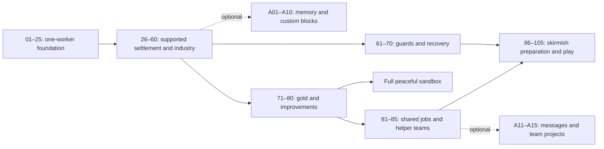

# BlocklyBots: campaign plan v2

18 October 2026 · Ages 7–9 · Content specification. Reviewed against the engine on 18 October 2026 (see [Review and delivery phases](#review-and-delivery-phases)); delivery phases 1 and 2, the v2 infrastructure and the foundation (missions 01–25), are implemented alongside v1; the rest is proposed

This plan reworks the [40-mission campaign](campaign-plan.md) into a gradual route from a first instruction to the full economy and computer opponent in [SKIRMISH_PLAN.md](../SKIRMISH_PLAN.md). It proposes **105 main-path missions in twenty-one chapters, plus 15 optional lessons in three programming workshops**. This is a working itinerary, not a mission limit: split a lesson again whenever playtesting reveals two unfamiliar ideas competing for attention.

The early campaign centres on **one robot, one building, or one visible delivery at a time**. Missions 1–25 teach instructions, loops, decisions, and concrete material handling. Shared programs, per-robot settings, shared edits, and individual copies move from missions 21–24 to **81–84**, after the full peaceful economy. Mission 85 introduces reasoning about another helper's incoming delivery. The message workshop moves from an after-25 option to **an optional continuation after 85**. Children can build and enjoy a complete peaceful settlement before learning team management or communication.

Most lessons ask the child to write a complete small program from a clear task description. Prepared code is reserved for deliberate repair/change lessons and background work outside the learning task. Pictures, block explanations, and optional examples provide support while leaving the programming decisions to the child.

The continuation still teaches construction, all six resource families, physical supply networks, paid robot assembly, guards, recovery, improvements, and strategy. Memory and custom blocks remain optional workshops after 60, taught without shared-job prerequisites. Adding five late team lessons makes room for concrete practice early; it does not compress the economy or guard lessons. The 105 main-path missions and 15 workshop lessons are destinations to return to over time, not an expectation that every 7–9-year-old must complete them.

This document specifies the proposed v2 campaign. It does not renumber the implemented campaign, change its saves, or claim that skirmish features already exist. [PLAN.md](../PLAN.md) and the original campaign remain the record of the current release until v2 is implemented. The skirmish plan owns shared economy and combat mechanics; this plan owns their teaching sequence. Any unresolved shared rule must be settled before its dependent mission is authored.

## Learning and pacing

- A mission introduces **one main idea**. A new resource name, a recipe, a new interface, and a new programming structure each consume attention. Do not introduce all four together.
- **The child writes the focus program.** Most missions begin with only When Started in that workspace. Explain the job, the available materials, and the relevant rule in the briefing; let the child choose blocks and put them in order. A short demonstration of a new block lives beside the workspace and does not insert a solution. Familiar travel, unloading, loops, and conditions are no longer filled in by default.
- **One editable program through mission 40.** The child controls one robot or building in each lesson. Other workers may demonstrate a familiar action, but their programs already work, use explicit places, and need no assignment, settings, synchronization, or repair. Show the selected worker's immediate input and output first; a whole-chain overview is optional.
- **Separate a busy world from managing a team.** Through 80, supplied support jobs belong to individual entities; changing the focus program affects only that entity. Use literal source/item/destination choices in blocks, not `my Source` settings or a shared library. From 41, a project may offer a second independent edit in a separate pictured step, after the first outcome is understood. Do not make children trace several instruction pointers or decide who waits for whom to pass these lessons.
- **Delay communication deliberately.** Team tools first appear in 81–85, on a small peaceful island with familiar goods. Messages, inboxes, request/reply, and cross-program waiting appear only in workshop C after 85. Stock waits and supplied production support suffice everywhere on the main path; communication is never a sandbox or skirmish prerequisite.
- Use a repeating progression: learn a block's meaning → write a small program → test or repair → solve a fresh task with familiar blocks. Keep prepared faulty programs for actual debugging lessons and working programs when the lesson is specifically about changing or sharing one. Chapter projects ask children to author a complete useful job. Background programs handle only work outside the stated learning task.
- Missions 1–5 aim for 3–6 minutes, ordinary lessons for 5–10, and small production projects for 10–15. The full bootstrap in 102 is a project across several sessions, with a save after each building stage. Full matches may take 15–25 minutes of running play plus unlimited paused thinking time. Validate these targets with children writing the programs, including time spent reading or hearing the briefing; they are not deadlines.
- One or two missions make a session. Save inside projects and matches; a child never has to finish a chapter or match in one sitting.
- Most immediate orders use 1–4 pictured items. Larger construction bills and multi-stage chains use grouped recipe pictures and visible deliveries, not mental arithmetic exercises.
- Give each mission one visible main outcome. Authoring checks may inspect several contributing events, but the child sees a single order, reserve, building, protected route, or match objective.
- Introduce Pause, Step, and Next block early and reuse them throughout. Opening the editor pauses the whole world, including production, the opponent, combat, and recovery.
- Offer a short prediction before Run and an explanation after success. Pointing and speaking count; neither reading fluency nor typing is the programming test.
- No speed medals, block-count requirements, hint penalties, lost lives, or surprise attacks during a first encounter. Keep pictures, readable instructions, Pause, and optional help as programs become more independent.
- Combat uses playful pulses and shield segments. Let children stay in peaceful economy play. Combat lessons can be revisited with demonstrations and generous Practice settings.

Every mission stands alone. Its island, stock, robots, programs, settings, improvements, and opponent state are authored for that mission; nothing depends on the child's previous solution. Reusing a familiar idea means writing it again in the current mission, unless a Change or Repair card explicitly provides an example. Restart keeps this mission's edits and drafts while restoring its world; Back to starter restores its declared starting workspace, usually just When Started. Progress records completion and unlocks, not a settlement carried into the next lesson.

### Mission descriptions and optional help

Each mission opens with a short briefing, normally two or three short sentences: **what to achieve, where the useful things are, and the rule that matters**. Name the robot or building to program. Put quantities beside item pictures and mark named places on the island. Explain new block behavior in ordinary language, including whether an action waits or repeats. A first-use explanation may name its block, but the normal briefing does not dictate a block-by-block solution or point to a preselected empty socket.

Keep the goal sentence visible while the child edits. The remaining context can be replayed as speech and reread without opening a hint. Show larger orders as a few pictured stages so better explanations do not become a wall of text. Children should be able to describe the intended result before opening the toolbox; reading fluency and remembering a long spoken list are not prerequisites.

Use four explicit workspace types in the cards below:

| Workspace | What is present when the lesson opens | When to use it |
| --- | --- | --- |
| Build | Only When Started in the focus program; blocks are in the toolbox, with no connected actions, loop shells, condition gaps, or ordered loose stacks | Default for authoring a delivery, production rule, guard behavior, or project job; empty named procedure definitions may accompany their first workshop lesson |
| Repair | A complete but faulty program, with its symptom described and the answer unmarked | When finding and fixing a fault is the learning objective |
| Change | A working program needed for the specific comparison, shared edit, or live-edit lesson | Explain what must change and what outcome to check; do not turn an ordinary authoring lesson into a one-gap exercise |
| Explore | A placement, inspection, assignment, or recovery fixture with no new code required | When the lesson teaches that interface or world behavior rather than programming |

The current cards use **Build for 81 of 105 main missions**. The other 24 are 12 Repair, six Change, and six Explore lessons with specific reasons for prepared code. Ten of the fifteen workshop lessons also use Build. Check this balance when adding lessons; a source dropdown or a missing loop block is not a substitute for authoring a familiar job.

An already working building or courier may remain as **background support**. The card must identify it and say what the child authors. Do not prefill the focus job just because other parts of the island are complex. Through 80, background programs remain independent, so reducing prepared code does not bring team management forward again.

Help is available from the start but opens only when requested: **Look** identifies useful evidence, **Think** explains a relevant relationship, **Try** shows a small fragment, and **Show me** opens a worked example separately. Inserting an example requires the child's explicit choice and preserves their draft. There is no forced failed attempt, automatic solution reveal, or loss of reward for using help. Author reference solutions are for validation and optional examples, not default player programs.

## Chapter map

| Chapter | Missions | Main learning | Milestone |
| --- | --- | --- | --- |
| 1. Hello, Helper! | 01–05 | Instructions, order, observing and repairing | Camp receives its first wood |
| 2. Do It Again | 06–10 | Repeat, loop boundaries, two basket spaces | Reliable repeated deliveries |
| 3. A Working Island | 11–15 | Make, Pick Up, one delivery into a building, Forever | Bridge opens; basic free play |
| 4. Look Before You Act | 16–20 | Stock, If/Else, Wait Until, feedback | A useful reserve |
| 5. One Helper, Useful Jobs | 21–25 | Stone, mixed baskets, pictured recipes, deliveries in stages | First kits; expanded solo sandbox |
| 6. Make Room to Grow | 26–30 | Placement, construction bills, local materials, access | Build and use a workshop |
| 7. Water Makes Things Grow | 31–35 | Spring versus well, water deliveries, farms | A working food chain |
| 8. Energy for More Helpers | 36–40 | Charge packs, paid helper assembly, recovery | First settlement economy |
| 9. Supply What Is Needed | 41–45 | One helper's Supply, sources, finite orders, shelf room | A dependable supplier |
| 10. Materials for Industry | 46–50 | Stone blocks, charcoal, sharing wood, advanced construction | A supplied industrial district |
| 11. From Ore to Iron | 51–55 | Ore, three-input smelting, tracing shortages | Reliable iron bars |
| 12. Keep the Factory Flowing | 56–60 | Recipe readiness, batch targets, one missing route, buffers | Working industry with supplied support |
| 13. Meet the Guards | 61–65 | Guard, Advance, free repair, repeated danger decisions | A guard that returns safely |
| 14. Back to Work Safely | 66–70 | Reboot, paid guards, individual destinations, danger sensing | Protect a production route |
| 15. Gold and Clever Parts | 71–75 | Gold, fair smelter scheduling, gears, circuits | All six resource families connected |
| 16. Improve the Settlement | 76–80 | Bigger baskets, stronger shields, one-time improvements | Peaceful full-economy project |
| 17. Ready for a Team | 81–85 | Shared programs, settings, shared edits, own copies, incoming deliveries | First deliberately managed helper team |
| 18. Prepare a Skirmish | 86–90 | Population targets, faster repair, rallying, camp objective, opponent inspection | Understand the match |
| 19. Play and Recover | 91–95 | Supported matches, setbacks, home/central routes, expansion choices | Win a working-industry match |
| 20. Manage the Full Economy | 96–100 | Full-economy Practice, bottlenecks, investment, safe editing | A resilient full settlement |
| 21. Your Island Strategy | 101–105 | Choose, bootstrap, rehearse, debug, play | Full skirmish finale |
| Workshop A. Remember the Job | A01–A05 | Local variables and counted orders | Optional after 60; no team tools needed |
| Workshop B. Make Your Own Blocks | A06–A10 | Procedures and one typed input | Optional after 60; independent of A01–A05 |
| Workshop C. Talk and Work Together | A11–A15 | Individual messages and system projects | Optional after 85; independent of A01–A10 and combat |

The child can stop at several satisfying points. Keep basic free play after 15 and an expanded solo sandbox after 25. Add peaceful energy templates after 40, industry after 60, guard practice after 70, and the full peaceful economy after 80. A peaceful template identifies its independent background jobs and offers an empty focus program with a pictured task; a fully working demonstration is a separate choice. Team tools are not needed to enjoy it. After 85, offer shared-job tools and the message workshop as further choices. Mission 91 opens First settlement Practice, 95 opens Working industry Practice, and 96 opens Full skirmish Practice. Do not require the finale or optional workshops to revisit those modes. Economy preset and opponent difficulty are separate: the full economy works with Practice; Friendly and Challenge are optional replay choices.

Missions 01–60 follow the chapter sequence. After 60, offer two chapter routes: guard training 61–70, and peaceful gold/improvements 71–80. Either route can come first. Team chapter 81–85 requires 80 and remains peaceful; it does not require guard training. Mission 86 requires both 70 and 85; later match chapters proceed in order. Thus a child can unlock the complete peaceful economy before team management, and later learn messages without fighting. If the guard route has not been taken, mission 78 supplies a noncombat shield demonstration with recovery and assembly programs already configured; the child edits only the improvement. Completing it does not claim the guard lessons were learned.

Workshop progress grants no implicit main-path prerequisite and does not enlarge a lesson's default toolbox. Offer advanced blocks in an optional expanded drawer only after the relevant workshop. Replays always use the selected mission's own availability profile.

## Shared world rules and teaching boundaries

1. **Physical actions remain familiar.** Go To finds a route to a named place. Collect takes a raw item from a resource node; Pick Up takes stock from a building. Unload transfers the basket. No coordinates, steering, bucket returns, hunger, thirst, or consumable movement fuel are introduced.
2. **Stock belongs somewhere.** Materials must reach the building that uses them. A global total is informational. Source choices for Supply name neutral resource sites or friendly stores, never the recipient itself or an opposing store.
3. **Capacity matters.** Helpers initially carry two items total, including water and mixed loads. Bigger baskets adds one slot, once per side. Building inputs must fit a whole recipe, outputs a whole batch, and construction sites their whole bill.
4. **Programs share one clock.** An action finishes before its following block. Make and Pick Up may wait for missing supplies; this is observable, normal behavior. Forever never reaches a block placed after it. One-time construction belongs outside it.
5. **Sensors are observations.** Stock, room, and Ready to make do not reserve anything. Supply and production must recheck and acquire their reservations through the shared engine. Repeat reads its count on entry. If only checks when execution reaches it.
6. **Supply performs one bounded delivery cycle.** It uses actual travel, basket space, collection/pickup, and unloading. It returns after that cycle, or after a short, visible no-work wait. Forever repeats it. Its pictured steps can be opened and stepped through. Demand comes from a declared recipe, production plan, construction bill, or queued assembly, with an explicit target; it is not inferred from arbitrary code.
7. **Expose the cause of waiting.** Show here, in use, on the way, and room with pictures; show detailed reservation terms only in the inspector. Never count one item as both free stock and incoming. Two suppliers cannot claim the same unmet delivery indefinitely or block an unrelated ingredient.
8. **Jobs and sides differ.** A job group shares instructions. Player/computer ownership controls editing, inventories, defaults, and messages. A shared edit cannot change the opponent. Each robot still has its own instruction pointer and memory.
9. **Assembly is paid and limited.** Camp makes helpers; workshop makes guards. A chosen job is inherited. Use the skirmish limits of six helpers/four guards for introductory matches and eight/six for full matches; a small lesson may declare a smaller limit. Population includes active robots, rebooting robots, and reserved assembly slots, each exactly once. It does not mean “robots currently ready at the flag.”
10. **Combat decisions keep returning.** Guard and Advance perform a movement segment, firing cycle, or timed watch, then return so low-shield and danger conditions can run again. Go home and repair restores a robot at its own camp. Basic recovery is free; an optional charge pack accelerates one recovery. Defeated robots reboot with their job assignment retained.
11. **Improvements are side-wide and one-time.** Both existing and new eligible robots benefit. A basket upgrade changes capacity, not existing contents. The shield rule must not provide a free heal through an upgrade or program edit. Do not teach a specific current-shield increase until the shared rule is fixed.
12. **Resource sites remain viable.** Advanced v2/skirmish profiles use productive sites with finite pickup buffers and fixed extraction/regrowth rates, plus slow viable home supplies. Legacy foundation fixtures can retain their explicit finite lesson budgets. Neither version inherits depleted resources from earlier play.
13. **Opponents follow the same rules.** Announced Practice attacks are produced by authored programs and paid stocks. Scripted training may start with visibly preplaced robots. No resources or raiders appear invisibly during a lesson to force its outcome. Both camps reaching zero shield on one tick is a draw.

The bridge still costs four planks; a workshop building costs four planks and two raw stone; a kit still costs two planks and one raw stone. **Stone blocks do not replace raw stone in familiar recipes.** Production and assembly quantities below follow the skirmish prototype. Other building bills are not numerically settled there: missions must display and budget the eventual shared recipe rather than inventing a different campaign cost. Exact build costs are an implementation gate, not a calculation left to children.

## Mission cards

Quoted text is the draft child-facing briefing, including the task context that previously had to be inferred from a prepared program. Each card declares its starting workspace, learning focus, background support, player-authored work, completed-world evidence, and an optional observation prompt. The defaults above apply to every card. Background jobs are visible and inspectable. No card requires a reference program's exact block layout; new-block demonstrations and hints do not run in the child's workspace automatically.

### Foundation: missions 01–25

These adapt the original foundation around one editable worker. Missions 13–15 simplify the first building relationship, and 21–25 replace early team management with stone, baskets, and kit practice. Each setup is authored afresh, including a basket that deliberately starts with wood or an already opened bridge.

### Chapter 1 — Hello, Helper!

#### 01. Hello, Helper!

“Robo 1 is at camp. Give it a Go To instruction to reach the grove, where the trees grow. Press Apply, then Run to try your program.”

- **Workspace:** Build.
- **Learn:** A block tells a robot what to do.
- **Setup and support:** One helper at camp and a clearly marked grove. Show the Go To block's place selector and identify Apply and Run without placing an action or choosing the destination.
- **Player task:** Choose Go To and its grove destination, attach it under When Started, and run.
- **Success:** Robo 1 reaches the grove's interaction point.
- **Hint / talk:** “Put the instruction under Start.” Ask the child to point to the place the robot will go before running.

#### 02. One Piece of Wood

“Robo 1 is already beside the trees. Use Collect Wood to put one piece in its basket. Watch the basket picture when the action finishes.”

- **Workspace:** Build.
- **Learn:** An action can change what a robot carries.
- **Setup and support:** Robo 1 starts at the grove with an empty two-space basket. Introduce Collect Wood in the toolbox; other workers are inactive.
- **Player task:** Write the collection instruction and run it.
- **Success:** The robot holds one wood after collection completes.
- **Hint / talk:** “The robot is already beside the wood.” Ask what changed and what did not.

#### 03. Bring It Home

“Robo 1 is at the grove with one wood in its basket. Bring it to camp and leave the wood there. Unload Basket puts carried items into the place where the robot is standing.”

- **Workspace:** Build.
- **Learn:** Instructions run from top to bottom.
- **Setup and support:** Start at the grove carrying one staged wood. Offer travel and Unload Basket, with a short explanation of unloading; no ordered placeholders appear.
- **Player task:** Choose and order the travel and unloading actions.
- **Success:** One wood reaches camp and the robot's basket is empty.
- **Hint / talk:** “Where must the robot be before it can unload?” Follow the highlight from travel to unloading.

#### 04. The Mixed-Up Instructions

“Robo 1 should bring one wood from the grove to camp, but this program gets stuck. Use Step to see where it stops. Change the instructions so the delivery finishes.”

- **Workspace:** Repair.
- **Learn:** Debugging means noticing what happened and changing a cause.
- **Setup and support:** An empty robot starts at camp with a complete four-action program that tries Collect before Go To Grove. Keep the misplaced action unmarked; the toolbox contains the familiar actions.
- **Player task:** Inspect the failed action, repair the order, and test the complete delivery. Demonstrate Next block as a navigation control if requested.
- **Success:** The repaired program delivers one wood without the location error.
- **Hint / talk:** “Which instruction needs the robot to be at the grove?” Change one thing, then try again.

#### 05. Camp Is Ready

“Camp needs two pieces of wood. The grove has wood, and your robot can carry two items. Write the whole job, ending with the wood at camp.”

- **Workspace:** Build.
- **Learn:** Make a complete short sequence independently; no new block.
- **Setup and support:** An empty basket at camp, a reachable grove, and a two-wood order beside camp. Show source and destination on the map, without an ordered action strip.
- **Player task:** Write a complete collection and delivery program. One full load or two smaller trips are valid.
- **Success:** Two new wood reach camp.
- **Hint / talk:** “Tell the robot the whole job.” Reveal a small camp improvement and ask the child to describe their instructions in order.

### Chapter 2 — Do It Again

#### 06. Again, Please!

“Your robot is already at the grove. Collect two wood and bring them to camp. Repeat runs the instructions inside it as many times as its number says.”

- **Workspace:** Build.
- **Learn:** Repeat does its inside instructions a chosen number of times.
- **Setup and support:** An empty robot at the grove and a two-wood camp order. Demonstrate Repeat's meaning separately with a two-clap animation; leave the player's workspace empty apart from Start. Collect is a single toolbox block, never a prepared stack.
- **Player task:** Build a counted collection loop and the return-and-unload sequence; choose the repeat count.
- **Success:** Two wood are collected and delivered.
- **Hint / talk:** “What happens once? How many times should it happen?” Point to each basket space as a round finishes.

#### 07. A Whole Trip Again

“Bring three wood to camp, carrying one on each trip. Each trip must end with an empty basket before another starts. Make the robot repeat the whole trip.”

- **Workspace:** Build.
- **Learn:** A loop can repeat an entire sequence.
- **Setup and support:** One helper at camp and a pictured three-delivery order. No trip, loop, or ordered loose blocks are supplied.
- **Player task:** Write a one-item round trip, decide which actions repeat, and set the count for three deliveries.
- **Success:** Three one-item deliveries complete, with the robot ending empty at camp.
- **Hint / talk:** “Which parts must happen on every trip?” Compare repeating Collect with repeating the whole journey.

#### 08. Two Basket Spaces

“This robot tries to put three wood in a basket with only two spaces. Repair its job so four wood reach camp. It will need to empty its basket between loads.”

- **Workspace:** Repair.
- **Learn:** A program must respect a physical limit.
- **Setup and support:** A complete faulty program collects three before unloading. Show basket capacity and the four-wood goal, but do not supply a second partly filled solution.
- **Player task:** Inspect the full-basket wait and rewrite the collection and trip counts to finish the order.
- **Success:** Four wood reach camp, and no trip needs more than two basket spaces.
- **Hint / talk:** “The basket is full. What must happen before another collection?” Waiting is a clue, not a punishment.

#### 09. A Repeat Inside a Repeat

“This program makes two trips, but each trip brings only one wood. Change it so every trip brings a full basket of two, still in two trips. Try a Repeat inside the trip's Repeat to collect them.”

- **Workspace:** Change.
- **Learn:** An inner loop finishes as part of each outer round.
- **Setup and support:** Provide the complete working two-trip, one-wood-per-trip program because the lesson is about changing its structure. Its outcome (two wood, in two one-item loads) must not already meet the goal. Explain that the inside loop finishes before the rest of that trip; do not highlight a replacement socket.
- **Player task:** Make each trip's collection happen twice, preferably with an inner loop, and check that both full-basket trips finish.
- **Success:** Four wood arrive in two full-basket deliveries. Two Collect blocks in a row are an accepted alternative; the goal judges the world, not the blocks.
- **Hint / talk:** “Two pieces for this trip; then the next trip begins.” Animate the two loop counts separately. Do not require multiplication vocabulary.

#### 10. The Loop Detective

“This job should bring three wood home, one on each trip. The robot collects, but the wood never reaches camp. Follow one loop round with Step and repair what happens during each trip.”

- **Workspace:** Repair.
- **Learn:** Review loop boundaries and diagnose a full-basket wait.
- **Setup and support:** A complete three-trip loop has the return-and-unload pair after the loop. Do not mark the fault or supply a corrected alternative by default.
- **Player task:** Find which actions need to happen on every round, move them, and rerun the order.
- **Success:** Exactly three one-item deliveries finish without a full-basket stall.
- **Hint / talk:** “What is repeated? What is left until the very end?” Award a delivery badge without introducing another mechanic.

### Chapter 3 — A Working Island

#### 11. Wake Up the Sawmill

“The sawmill already has one wood. Program the sawmill to turn it into one plank. Make Plank finishes when the plank is ready.”

- **Workspace:** Build.
- **Learn:** A building can run a program too.
- **Setup and support:** The selected sawmill holds one wood and has output room. Explain Make Plank's input and output with pictures; no robot delivery is required.
- **Player task:** Write the sawmill's production instruction and observe the completed plank.
- **Success:** One plank is produced by the building.
- **Hint / talk:** “Which thing does the making?” Show that making takes time while the same action remains highlighted; no Wait block is needed.

#### 12. The Plank Courier

“Two finished planks are waiting at the sawmill. Program your helper to bring both to the depot. Use Pick Up for items on a building's shelf.”

- **Workspace:** Build.
- **Learn:** Pick Up takes a finished item from a building.
- **Setup and support:** A helper starts at camp; the sawmill holds two planks. Explain Pick Up separately from raw-material Collect. No travel, pickup, unloading, or loop is placed.
- **Player task:** Write the full journey to the sawmill and depot, including collecting the stored load and unloading it.
- **Success:** Two planks move from the sawmill into the depot.
- **Hint / talk:** “Collect finds raw materials. Pick Up takes something stored here.” Use different source pictures as well as words.

#### 13. Wood Goes In, Planks Come Out

“The sawmill needs two wood to make two planks. Your helper starts at camp, and the wood is at the grove. Write its delivery job; the sawmill already knows how to make the planks.”

- **Workspace:** Build.
- **Learn:** A delivery puts ingredients where a building can use them.
- **Setup and support:** The sawmill has a visible two-plank background program and no wood. The selected helper starts empty at camp. Show the sawmill's ingredient picture and identify its program as background support.
- **Player task:** Author the complete two-wood delivery to the sawmill and run it until both planks finish.
- **Success:** The robot supplies two wood and the sawmill produces two planks.
- **Hint / talk:** “Where does the sawmill need the wood?” Observe the material change without comparing two program highlights. Pause and Step still affect the whole world.

#### 14. Keep It Going

“Keep bringing wood from the grove to camp. A Forever block repeats its inside instructions until you pause. Make sure the basket is emptied on every trip.”

- **Workspace:** Build.
- **Learn:** Forever keeps a useful job running.
- **Setup and support:** One helper, enough grove wood, and a roomy camp; no other worker is active. Explain Forever beside the workspace without inserting a loop or trip.
- **Player task:** Write a complete repeating delivery job and use Pause after observing several trips.
- **Success:** Four new wood reach camp through completed trips, and the helper starts another trip until the child pauses.
- **Hint / talk:** “What should happen after this delivery?” Compare the familiar counted Repeat with a job that keeps going.

#### 15. Across the Stream

“The bridge needs four planks. A courier already brings them to the bridge site. Program the site to build the bridge once the pieces arrive; Build waits until its bill is filled.”

- **Workspace:** Build.
- **Learn:** A one-time Build action turns delivered materials into a finished structure.
- **Setup and support:** Stage four planks at the sawmill and a background courier making two full loads. Focus the site's empty program and its four-plank bill. Explain that Build is a one-time action.
- **Player task:** Write the site's building program and watch the delivered bill become the bridge.
- **Success:** The site consumes four planks, completes the bridge, and opens the route across the stream.
- **Hint / talk:** “Which pieces became the bridge?” Celebrate with a crossing and unlock basic free play. Never put Build Bridge in Forever; no production-chain setup is needed here.

### Chapter 4 — Look Before You Act

#### 16. How Many Are Ready?

“Your helper is beside the sawmill. Bring every plank on its shelf to the depot; this time there may be one or two. The stock block reads that number, and Repeat uses the number when it starts.”

- **Workspace:** Build.
- **Learn:** A sensor supplies a number from the world.
- **Setup and support:** One isolated helper at the sawmill; announced trials begin with one or two planks and no competing program. Explain the stock sensor and its number-shaped output without assembling a loop.
- **Player task:** Build a pickup loop whose count reads the shelf, followed by the complete depot delivery.
- **Success:** The courier transfers the starting stock correctly in two visible trials: one plank and two planks.
- **Hint / talk:** “The number comes from the shelf.” Explain that Repeat reads its count when the loop starts; it does not keep changing the count as items are taken.

#### 17. Only When We Need It

“Program the sawmill to look at its plank shelf once. If there are fewer than two planks, make one; otherwise leave the shelf alone. The wood is already here.”

- **Workspace:** Build.
- **Learn:** If chooses whether to do an action, using a true-or-false comparison.
- **Setup and support:** Announced trials start with one or two planks, enough wood, and output room. Explain If and the less-than comparison with a pictured shelf line; no condition or Make block is connected.
- **Player task:** Build the stock comparison and conditional production action, then try both starting shelves.
- **Success:** In two small trials, starting with one plank makes one more; starting with two makes none.
- **Hint / talk:** “Is the shelf below the line?” A single If checks once. Repeated checking is reserved for mission 20.

#### 18. This Job or That Job

“Your helper has two possible jobs. If a plank is ready at the sawmill, bring it to the depot. Otherwise, bring one wood from the grove to the sawmill.”

- **Workspace:** Build.
- **Learn:** Else chooses another action when the condition is false.
- **Setup and support:** One helper at camp and an inactive sawmill. Trials begin with one plank or none. Explain Else as the other path when If's question is false; neither delivery branch is supplied.
- **Player task:** Write the stock question and both complete delivery branches, each ending with an empty basket.
- **Success:** One trial with a plank delivers it to the depot; another with none delivers wood to the sawmill.
- **Hint / talk:** “Which path will run this time?” Both branches return with an empty basket, and only one branch runs per check.

#### 19. Wait for a Full Load

“Wait at camp until the sawmill has two planks ready. Then bring both to the depot in one load. Wait Until keeps checking a question, so you do not have to guess how long making takes.”

- **Workspace:** Build.
- **Learn:** Wait Until holds the program at a condition until it becomes true.
- **Setup and support:** A background sawmill produces two planks over time. The selected helper begins at camp with no program. Explain Wait Until's condition; vary the producer's start time between visible trials.
- **Player task:** Write the waiting condition and the full pickup-and-delivery journey.
- **Success:** The courier departs only once two planks are ready, then delivers both together. Repeat with the producer starting later.
- **Hint / talk:** “What should become true before the trip starts?” Pick Up already waits for a missing item; this wait deliberately chooses when the whole batch journey begins. Do not guess a number of waiting steps.

#### 20. Just Enough Planks

“Keep two planks ready on the sawmill shelf. A courier will take one away twice, and a collector keeps bringing wood for replacements. Make the sawmill check again after each decision so it refills the shelf without making a third plank.”

- **Workspace:** Build.
- **Learn:** Combine sensing, If, and Forever into a feedback loop; no new block.
- **Setup and support:** A background collector keeps the sawmill's wood store supplied, and the plank shelf has room for more than two, so a sawmill that makes planks without looking visibly overfills it. Staged wood alone cannot show this: the sawmill holds only four wood, which a careless program turns into four planks, and after the two removals the shelf would show two anyway. A background courier makes two announced removals. Provide a pictured reserve line and individual familiar blocks only.
- **Player task:** Author the complete repeated stock check and production rule, then observe both refills.
- **Success:** The sawmill builds and restores a two-plank reserve after both removals, without making a third plank when two are already ready and inputs/output space are available.
- **Hint / talk:** “When does the program look again?” Observe a complete settled producer cycle after the final refill, not just the instant the count reaches two.

### Chapter 5 — One Helper, Useful Jobs

#### 21. Bring a Stone

“Bring two stones from the stone pit to camp. The bridge is already open, and your helper has two basket spaces. Stone uses the same collection and delivery actions as wood.”

- **Workspace:** Build.
- **Learn:** The familiar collection trip works for a different raw material.
- **Setup and support:** One helper at camp, an open bridge, and a marked pit. Show raw stone's source and icon; no wood trip is supplied for editing.
- **Player task:** Write the full stone-collection trip with literal source, item, and destination choices.
- **Success:** Two raw stone reach camp in a valid load.
- **Hint / talk:** “What changes when we want stone?” No library, robot settings, or second helper appears.

#### 22. Two Different Things in One Basket

“Bring one wood and one stone home in the same basket. Wood is at the grove and stone is at the pit. Both kinds use the same two basket spaces.”

- **Workspace:** Build.
- **Learn:** Different items use the same two basket spaces.
- **Setup and support:** One empty helper and two nearby sources. The goal card shows one wood and one stone together, without an ordered route. Other workers are inactive.
- **Player task:** Plan the two-source trip, collect a mixed load, and unload both items at camp.
- **Success:** A mixed load of one wood and one stone is unloaded at camp without exceeding capacity.
- **Hint / talk:** “Is there a separate basket for each kind?” Keep the route finite and the other workers inactive.

#### 23. What Makes a Kit?

“The workshop already holds two planks and one stone. Together they make one kit. Program the workshop to make the kit and watch which ingredients it uses.”

- **Workspace:** Build.
- **Learn:** A recipe can need more than one kind of ingredient.
- **Setup and support:** An already built workshop contains exactly one kit recipe. Show the ingredient and output pictures; no helper route or production action is placed.
- **Player task:** Write the workshop's one-kit production program.
- **Success:** The workshop consumes two planks and one stone and produces one kit.
- **Hint / talk:** “Point to everything this kit needs.” Introduce the recipe separately from transporting its ingredients.

#### 24. One Recipe, Two Trips

“Help the workshop make one kit from two planks and one stone. The planks are at the sawmill and the stone is at the pit. Your basket holds only two items, so plan more than one delivery; the workshop already knows how to make the kit.”

- **Workspace:** Build.
- **Learn:** A recipe larger than the basket can be delivered in stages by one helper.
- **Setup and support:** Stage the ingredients at their sources. The workshop's one-kit program is background support; the helper starts empty with only Start. Keep the recipe and basket capacity visible.
- **Player task:** Write all journeys needed to deliver the complete recipe with one helper, choosing the order and valid loads.
- **Success:** The one helper delivers both loads and the workshop makes one kit; no load exceeds two items.
- **Hint / talk:** “Must every ingredient arrive in the same basket?” No second helper or signal is needed to finish the recipe.

#### 25. Our First Workshop

“The workshop needs enough ingredients for two kits. Each kit takes two planks and one stone; find them at the sawmill and stone pit. Write one helper's delivery plan, remembering its two basket spaces.”

- **Workspace:** Build.
- **Learn:** Repeat a familiar two-trip recipe delivery; no new programming structure.
- **Setup and support:** Stage four planks and at least two stone. The workshop has a two-kit background program. Show the two-kit order and one-kit recipe, without supplying a trip or loop.
- **Player task:** Create the complete delivery plan. Repeating a one-kit delivery round or grouping valid loads by ingredient are both accepted.
- **Success:** The workshop consumes four planks and two stone and produces two kits.
- **Hint / talk:** “What is one whole round of this job?” Restore part of the workshop district, celebrate the solo-programming milestone, and expand free play with ready-made support jobs.

### Chapter 6 — Make Room to Grow

#### 26. Choose a Home for the Workshop

“Choose a place for a new workshop. A blueprint marks where it will go; the building appears only after its materials arrive. Place the blueprint and look at its pictured bill.”

- **Workspace:** Explore.
- **Learn:** Placing a blueprint chooses a site; it does not create a finished building.
- **Setup and support:** Show two valid plots, the camp, and one workshop blueprint. Placement is the focus; no courier program is needed yet.
- **Player task:** Choose a plot and inspect the unpaid construction bill.
- **Success / observe:** A reachable workshop site is placed and its unpaid bill is visible. “What still has to arrive?” This is an interface lesson; payment follows separately.

#### 27. Bring the Building Pieces

“The workshop site needs four planks and two stones. Planks are at the sawmill, and stones are at the pit. Program one helper to bring the whole bill in loads that fit its two-space basket; the site already has its Build instruction.”

- **Workspace:** Build.
- **Learn:** Construction consumes materials delivered to its site.
- **Setup and support:** Preplace the site and stage its exact bill at the named sources. Only the site's building program is prepared; the courier begins at camp with an empty workspace.
- **Player task:** Plan and write the complete construction-delivery job, including every trip and unload.
- **Success / observe:** Completed deliveries pay the exact bill and the site becomes a workshop. “Which shelf needs these pieces?” Do not require the child to create placement and all courier programs together.

#### 28. Leave a Way Through

“Choose a workshop site with a clear way in. Helpers need a path to the building and a place to stand while unloading. Check the placement picture before you build; delivery jobs are already ready.”

- **Workspace:** Explore.
- **Learn:** Placement must preserve routes and interaction space.
- **Setup and support:** Show a valid plot and an obstructing preview, with reachable interaction cells pictured. Reject invalid placement before accepting it. Background couriers and site building behavior are prepared solely to demonstrate access.
- **Player task:** Choose a reachable site, inspect the access preview, and watch a courier use the completed route.
- **Success / observe:** The workshop is built and a courier reaches both it and the existing sawmill. “Where will the helper stand to unload?” No trial can permanently trap a robot.

#### 29. Right Pieces, Wrong Place

“The workshop has not been built, even though camp holds all its pieces. Inspect this courier's job and follow where the pieces go. Repair the delivery so the workshop site receives its bill.”

- **Workspace:** Repair.
- **Learn:** A settlement total is different from stock at the consumer.
- **Setup and support:** Stage the exact bill at camp and a complete faulty courier that picks it up but unloads back at camp. The site has a working Build program. No destination field is highlighted.
- **Player task:** Use the inventory and route to find the wrong destination, repair it, and finish construction with the same materials.
- **Success / observe:** The same staged materials reach the site and complete construction. “Here at camp, or here at the site?” No extra resources appear during the repair.

#### 30. Open for Work

“Build a workshop, then supply its first kit. The building uses four planks and two stones; the kit needs two more planks and one more stone. Program one helper's deliveries from the sawmill and stone pit; making and building jobs are already ready.”

- **Workspace:** Build.
- **Learn:** Combine familiar construction and production, without a new block.
- **Setup and support:** Provide a working sawmill and wood collector, six raw wood, three raw stone, and a valid site. Background site behavior builds once then makes one kit. Display separate building and kit bills; the selected courier has no prepared route.
- **Player task:** Write the complete delivery job in two pictured stages, accounting for consumed building materials before supplying the kit.
- **Success / observe:** Four planks/two stone build the workshop; two more planks/one stone make a kit. “Which pieces became the building, and which became the kit?” Construction does not silently leave its consumed inputs available.

### Chapter 7 — Water Makes Things Grow

#### 31. A Bucket from the Spring

“Bring one bucket of water from the spring to camp. Water at a spring is collected like wood or stone. It takes one basket space, and there is no empty bucket to return.”

- **Workspace:** Build.
- **Learn:** Water is another collectible item and uses one basket space.
- **Setup and support:** One empty helper at camp and a reachable spring. Introduce the water icon and its raw-source Collect action; no delivery program is supplied.
- **Player task:** Write and run the full water-collection trip.
- **Success / observe:** One water reaches camp and the basket is empty. “Does water need a space too?” Empty-bucket returns are not a job.

#### 32. Wake Up the Well

“Program the well to make two buckets of water. It needs time, but no ingredients. Make Water fills one bucket each time it finishes.”

- **Workspace:** Build.
- **Learn:** A well produces water over time without material inputs.
- **Setup and support:** A prebuilt empty well with room for two output items. Show its progress bar and explain the no-input recipe; no Repeat is placed.
- **Player task:** Write a finite two-water production program and observe its progress.
- **Success / observe:** Two water are produced without consuming an ingredient. “What is the well waiting for while it fills?” Pause must freeze extraction.

#### 33. Take Water from the Well

“Two buckets are ready on the well's shelf. Bring both to camp in one load. Use Pick Up here because the well is a building, unlike the spring.”

- **Workspace:** Build.
- **Learn:** A well is a building source: use Pick Up for its output.
- **Setup and support:** Stage two water at the well; the selected helper starts empty at camp. Keep all other routes inactive and show the well and spring source icons.
- **Player task:** Write the full pickup-and-delivery program with a valid two-item load.
- **Success / observe:** Two water move into camp in one load. “Which water is stored on a shelf?” Keep all other routes inactive.

#### 34. Water Becomes Food

“The farm already has one bucket of water. Program it to grow food. One water makes two food when the growing action finishes.”

- **Workspace:** Build.
- **Learn:** One delivered water grows a batch of two food.
- **Setup and support:** A prebuilt farm contains one water and room for two food. Show the recipe and crop progress; there is no delivery task.
- **Player task:** Write the farm's one-batch production program.
- **Success / observe:** One water is consumed and two food are produced. “Where did the water go?” Crop growth uses the same paused world clock as every other recipe.

#### 35. Our Little Farm

“Bring four food home from the farm. Each bucket from the well lets the farm grow two food, and your helper carries only two items. Program the water deliveries and food pickups; the well and farm already know their jobs.”

- **Workspace:** Build.
- **Learn:** Practise bringing a building's input and then collecting its output.
- **Setup and support:** The well produces two water and the farm makes two batches as background support. One helper starts at camp without a route. Show the recipe, sources, and camp goal; Pick Up's ordinary waiting behavior remains visible.
- **Player task:** Write the complete one-helper plan for bringing in water and carrying the resulting food home, choosing valid loads and repetition.
- **Success / observe:** Two delivered water become four food at camp. “What went into the farm, and what came out?” Reveal peaceful farm scenery; no spoilage or feeding meter appears.

### Chapter 8 — Energy for More Helpers

#### 36. Food into Charge Packs

“The fuel station holds two food and one water. Program it to turn them into two charge packs. Packs help make new robots; your existing robot can move without one.”

- **Workspace:** Build.
- **Learn:** The fuel station turns two food and one water into two charge packs.
- **Setup and support:** Stage one complete recipe visibly from berries and spring water. Show berries and crops as the same food item and provide a separate plant-energy illustration. The station's workspace is empty.
- **Player task:** Write the station's one-batch production program.
- **Success / observe:** The paid batch completes with two packs. “What powers a new robot?” Existing robots keep moving with no pack consumption.

#### 37. Feed the Fuel Station

“The fuel station needs two food and one water to make two charge packs. Food is at the berry patch and water is at the spring. Write one helper's deliveries; all three ingredients will not fit in its two-space basket.”

- **Workspace:** Build.
- **Learn:** Practise a mixed-input recipe using separate deliveries.
- **Setup and support:** The station has a one-batch background production job and no inputs. Sources are reachable. The helper begins empty with no trip or destination filled in.
- **Player task:** Plan and author the complete food and water deliveries, using Collect at both natural sources.
- **Success / observe:** Two food and one water arrive and produce two packs. “Which ingredient is still missing?” Collect food at berries; do not use the farm's Pick Up action here.

#### 38. Make One More Helper

“Camp has two planks and one charge pack, enough for a new helper. Program camp to make one helper. Its delivery job is already chosen, so you can watch it work after assembly.”

- **Workspace:** Build.
- **Learn:** Camp spends ingredients to assemble a helper.
- **Setup and support:** Stage the bill at camp and leave one population slot free. The Make a Helper block offers the mission's one fixed Collector job, whose program is background support. Explain the payment and assembly progress separately from job assignment.
- **Player task:** Write the camp's one-time assembly instruction and observe the new helper's first delivery.
- **Success / observe:** The costs are spent once, the new helper appears in a valid space and completes its supplied delivery. “Which pieces made this helper?” The engine gives it its job; job assignment and inheritance are not concepts the child must explain yet. No free Add Robot control is available.

#### 39. No Packs Left

“Camp is waiting for a charge pack to make a helper. The fuel station has no food, although berries are reachable. Find why the food collector is not bringing them; existing helpers can work even with no packs.”

- **Workspace:** Repair.
- **Learn:** Empty energy stock pauses expansion but does not stop recovery or existing work.
- **Setup and support:** Start with zero packs, a prebuilt fuel station, reachable berries and spring, and paid assembly waiting at camp with planks staged. All other routes work. The selected collector has a complete faulty food trip with the wrong source place, not an empty input socket.
- **Player task:** Follow the food shortage to the collector, diagnose its route, and repair the program until packs reach camp and assembly completes.
- **Success / observe:** Gathered ingredients make packs and one paid helper completes. “Who can still work before the new pack exists?” No pack or intermediate ingredient is granted after start.

#### 40. A Growing Settlement

“Help camp make one new helper from freshly made supplies. Bring it two planks from the sawmill and one charge pack from the fuel station. Write the full delivery job; the other workers already gather and make these items.”

- **Workspace:** Build.
- **Learn:** Integrate wood, water, food, fuel, and paid assembly.
- **Setup and support:** Prebuild the full chain with independent background gathering, production, and camp assembly. Processed stocks begin empty; the selected final courier has only Start. Pin the two-source assembly bill instead of providing a route with a destination gap.
- **Player task:** Author the whole plank-and-pack delivery with one helper, allowing pickups to wait for newly produced goods.
- **Success / observe:** Two gathered wood become the helper's planks; two extracted water cover one farm cycle and one fuel cycle; one of the resulting packs pays assembly. The helper makes its first delivery. “Follow one ingredient all the way.” Unlock peaceful First settlement templates.

### Chapter 9 — Supply What Is Needed

#### 41. Open a Supply Job

“The fuel station needs two food; its water is already there. Two food are waiting at the farm. Try Supply: choose where this helper may find ingredients, and it makes one delivery using its basket.”

- **Workspace:** Build.
- **Learn:** Supply is an inspectable delivery routine, not instant material creation.
- **Setup and support:** Stage two food at a friendly farm and one water at the fuel station. Declare one batch's input target and park production. Explain Supply's source selection and bounded cycle outside the empty focus workspace.
- **Player task:** Choose the source and destination, write one Supply action, and open its pictured travel, pickup, and unload steps.
- **Success / observe:** One bounded cycle delivers the two food and returns to its caller. “Which ordinary actions are inside?” The station's production program is parked so arrival remains visible.

#### 42. Supply, Then Look Again

“Keep the fuel station supplied until it makes four charge packs. Food is at the farm and water is at the well. Each Supply trip brings a needed ingredient, so make the helper come back and check for another job.”

- **Workspace:** Build.
- **Learn:** Repeating Supply revisits declared needs and can serve different ingredients.
- **Setup and support:** Stage four food and two water at separate source buildings. The station has a finite two-batch background program with a one-batch input target. No Supply action or loop is placed.
- **Player task:** Choose both sources and author a repeating Supply job, then observe different ingredients and the final no-work wait.
- **Success / observe:** Four packs are made through completed food and water deliveries; once needs are filled, the supplier waits briefly and returns. “Why did its next trip carry something different?” It must not hold food while indefinitely blocking the water delivery.

#### 43. Does This Shelf Need More?

“The farm's order is one water. Program your helper to bring a bucket only if that order is still missing one. Needs asks whether the building's order needs more; try both an empty shelf and a shelf that already has water.”

- **Workspace:** Build.
- **Learn:** Needs compares a building's pictured order with what it already has.
- **Setup and support:** One helper and a friendly well with water. The farm has a one-water target and parked production. Announced trials vary its stock; no other courier or incoming claim changes the result.
- **Player task:** Build the Needs condition and the conditional Supply job, choosing the source and recipient yourself.
- **Success / observe:** The empty-shelf trial receives one bucket; the full-shelf trial starts no delivery. “Which recipe picture is still empty?” The sensor still uses the engine's real demand rules; incoming claims from other helpers are introduced only in 85.

#### 44. Leave Room to Unload

“Bring one water from the well to the farm, but wait at camp until the farm has room. Space tells you how much shelf room is free. Test your program when the shelf has space and when it starts full.”

- **Workspace:** Build.
- **Learn:** Space for an item is a capacity observation, separate from stock need.
- **Setup and support:** One courier begins at camp. A full-shelf trial includes a background farm cycle that frees space; a second trial starts with room. Stage pickup water at the well, with no prepared wait or trip.
- **Player task:** Write the room condition, the wait at camp, and the complete one-water delivery.
- **Success / observe:** The courier leaves after room exists and completes its delivery in both fixtures. “What made space?” Explain that the later unload still checks capacity; the condition did not reserve it.

#### 45. The Missing Water Route

“The fuel station needs food and water, but this supplier only brings food. Both ingredients are available nearby. Open the Supply steps and repair where the helper is allowed to look so two batches finish.”

- **Workspace:** Repair.
- **Learn:** Diagnose a source configuration through the visible supply steps.
- **Setup and support:** One helper has a complete repeating Supply program whose source list omits the well. Provide adequate food and water, a one-batch input target, and a two-batch background producer. Do not highlight the missing source.
- **Player task:** Inspect the waiting reason and source list, correct the configuration, and test both ingredients arriving.
- **Success / observe:** The single helper supplies both ingredients across valid loads and two batches finish. “Where can this helper find water?” No shared edit, second supplier, or incoming-delivery comparison is required.

### Chapter 10 — Materials for Industry

#### 46. Cut a Stone Block

“The stonecutter has two raw stones. Program it to make one stone block for a larger building. A stone block is a different item from the raw stone used in kits.”

- **Workspace:** Build.
- **Learn:** Stone blocks are processed goods, distinct from raw stone.
- **Setup and support:** A prebuilt stonecutter holds two raw stone and has output room. Compare source and product icons without placing its Make action.
- **Player task:** Write one stone-block production instruction and inspect the result.
- **Success / observe:** Two stone become one stone block. “Which picture does the old kit recipe use?” Keep kits and basic workshop construction on raw stone.

#### 47. A Foundation for the Smelter

“The new smelter site needs stone blocks. They are ready at the stonecutter; its bill shows how many to bring. Write the whole delivery job; another courier brings the planks, and the site already knows how to build.”

- **Workspace:** Build.
- **Learn:** Advanced buildings use a familiar construction process with processed inputs.
- **Setup and support:** Preplace a reachable site and stage the exact shared-registry bill at friendly stores. Prepare only the plank courier and Build program. The focus courier has no route. Render the finalized block quantity as item pictures before authoring this fixture.
- **Player task:** Read the stone-block portion of the bill and program all its pickups, trips, and unloads within basket capacity.
- **Success / observe:** The full bill is delivered and the smelter is built. “Does this site ask for stone, or stone blocks?” Its production stays parked until the iron lessons.

#### 48. Wood for the Kiln

“The kiln holds two wood. Program it to make charcoal for the smelter. One batch uses both wood and produces two charcoal.”

- **Workspace:** Build.
- **Learn:** Two wood become a batch of two charcoal at the kiln.
- **Setup and support:** A prebuilt kiln contains the exact recipe inputs and output room. Show recipe and progress pictures; no fire-management system or extra fuel meter appears.
- **Player task:** Write the one-batch charcoal program.
- **Success / observe:** One batch produces two charcoal. “Which source can feed both the sawmill and the kiln?” No fire management or extra fuel meter is introduced.

#### 49. Share the Wood

“The sawmill and kiln both need wood. These collectors are busy, but only the kiln gets deliveries. Inspect the selected collector's route and repair it so both buildings finish their orders.”

- **Workspace:** Repair.
- **Learn:** One raw resource can serve two useful chains.
- **Setup and support:** Two independent complete collector programs both deliver to the kiln. The sawmill and kiln have finite orders for two planks and two charcoal. Only one collector needs editing; the other is background support. Keep the wrong destination unmarked.
- **Player task:** Trace the missing wood, repair the selected collector's destination, and verify both outputs.
- **Success / observe:** At least two planks and two charcoal are produced from separate paid inputs. “Which building was missing its share?” Require no efficiency optimum or arithmetic split.

#### 50. An Industrial Corner

“Build the smelter, then leave two charcoal in its input store. The sawmill and stonecutter make its building pieces, and the kiln makes charcoal. Use the site's pictured bill to write your helper's deliveries; all three makers already have jobs.”

- **Workspace:** Build.
- **Learn:** Combine construction materials and fuel preparation.
- **Setup and support:** Background gathering and production make the exact construction bill and two charcoal from raw sources. A valid site has its Build program. The selected helper's workspace is empty; show construction and first-fuel orders separately.
- **Player task:** Author the whole construction-and-fuel delivery plan, using valid loads and waiting pickups as needed.
- **Success / observe:** The smelter finishes and receives two newly made charcoal. “Which deliveries built it, and which will help it work?” Budget construction and fuel separately; do not use staged processed inputs in the reference solution.

### Chapter 11 — From Ore to Iron

#### 51. Bring Iron Ore

“Bring two iron ore to the smelter. Ore comes from the iron deposit and uses basket space like stone. It must be made into bars later; this job is only the delivery.”

- **Workspace:** Build.
- **Learn:** Ore is a raw collectible; iron bars will be its processed output.
- **Setup and support:** One empty helper at camp, a reachable deposit, and a prebuilt smelter with production parked. Distinguish ore and bar icons.
- **Player task:** Write the complete two-ore collection and delivery program.
- **Success / observe:** Two iron ore reach the input store. “Is this ready to build a robot yet?” Leave production off for this delivery lesson.

#### 52. The Smelter's Three Ingredients

“The smelter has two iron ore, one charcoal, and one water. Program it to make a batch of two iron bars. All four ingredients are used together.”

- **Workspace:** Build.
- **Learn:** One iron batch needs two ore, one charcoal, and one water.
- **Setup and support:** Visibly stage one complete iron recipe and room for two output items. Keep delivery programming outside this first recipe lesson.
- **Player task:** Write the smelter's one-batch iron program and observe payment and output.
- **Success / observe:** The complete input set is consumed once and two bars finish. “Point to every ingredient before Run.” Do not substitute charge packs for charcoal.

#### 53. Join the Three Routes

“Help the smelter make four iron bars. Each batch needs two ore, one charcoal, and one water. Program one supplier to bring every ingredient from the marked deposit, kiln, and well; the smelter already knows how to make two batches.”

- **Workspace:** Build.
- **Learn:** Practise supplying a three-input producer with known tools.
- **Setup and support:** Stage charcoal and water at their source buildings; ore stays at its deposit. Give the smelter a finite two-batch background program and declared demand. The single supplier starts without a source list or program.
- **Player task:** Choose all three sources and write the complete repeated Supply job, then trace each ingredient's deliveries.
- **Success / observe:** Four ore, two charcoal, and two water arrive across valid loads and produce four bars. “Which route brought each picture?” Supplies must not require a four-item basket.

#### 54. Follow the Missing Ingredient

“The smelter is waiting for charcoal. The kiln can make it, but first needs wood. Follow the selected wood collector's route and repair the earliest missing delivery so an iron batch can finish.”

- **Workspace:** Repair.
- **Learn:** Trace a shortage upstream to its cause.
- **Setup and support:** Ore and water routes and building programs work. The kiln's collector has a complete faulty trip to the sawmill. The overview can show the material chain, but does not mark the block to change.
- **Player task:** Inspect the kiln's input and collector's travel, repair the cause, and follow newly made charcoal through to iron.
- **Success / observe:** New wood becomes charcoal, a completed delivery feeds the smelter, and an iron batch finishes. “Where did the first missing piece belong?” Changing the final Make block alone cannot solve the cause.

#### 55. Our Iron Works

“Make four iron bars from the island's raw resources and deliver them to the depot. Program a supplier for the smelter's ore, charcoal, and water. The kiln, well, smelter, and finished-bar courier already have jobs.”

- **Workspace:** Build.
- **Learn:** Build a small complete industrial chain without a new block.
- **Setup and support:** Prebuild the required producers with empty processed stores. Background jobs supply kiln wood, produce water and charcoal, make two iron batches, and export completed bars. The selected supplier has no program or sources chosen.
- **Player task:** Plan the three-source Supply job and run it until all four newly made bars arrive at the marked depot.
- **Success / observe:** Four ore, two wood, and two water become four iron bars at a marked depot through two batches. “Follow one bar back to its sources.” Working buildings alone are not counted as completed deliveries.

### Chapter 12 — Keep the Factory Flowing

#### 56. Ready to Make?

“Program the smelter to check whether it can make iron. Ready to Make asks whether every ingredient is here and the whole batch will fit. Make one batch if it is ready; otherwise leave it for now.”

- **Workspace:** Build.
- **Learn:** Ready to Make checks all inputs and a full output batch's space.
- **Setup and support:** Trials provide complete inputs and room, then missing water; a full output shelf is an optional variation. Explain Ready to Make as one true-or-false block; no If wrapper is placed.
- **Player task:** Write the readiness condition and conditional production action, then test the same program in both trials.
- **Success / observe:** The ready fixture completes a batch; the unready fixture finishes its check without attempting Make or spending ingredients. “Which picture says why it cannot start?” The real Make action still checks atomically; no new timed-wait block is needed.

#### 57. Batches Need Room

“Keep four iron bars on the smelter's shelf. A batch makes two bars, and a courier will take two away once. Program the smelter to check its own stock again and refill only when needed.”

- **Workspace:** Build.
- **Learn:** Stock targets must account for a recipe's batch size.
- **Setup and support:** Trials start with zero or two bars, continuing inputs, and capacity above four. A background courier removes two once. Explain This Building as this smelter; no reserve loop or comparison value is supplied.
- **Player task:** Build the complete repeated stock check and batch-production rule for a four-bar reserve.
- **Success / observe:** Both trials reach four, replace the removed pair, and settle without starting an unnecessary batch. “How many appear each time?” Arbitrary odd starting stocks are excluded from this first batch lesson.

#### 58. Water for Everyone

“The farm, fuel station, and smelter each need water. Two deliveries work, but the smelter's shelf stays empty. Repair the selected courier's route so every building can finish one batch.”

- **Workspace:** Repair.
- **Learn:** Several consumers share one useful resource.
- **Setup and support:** Farm and fuel routes work independently. The selected courier has a complete faulty delivery to the farm instead of the smelter. Other ingredients are staged and well throughput is sufficient. Show stock evidence without marking the wrong block.
- **Player task:** Find the wrongly served shelf and repair the selected route, then check all three completed cycles.
- **Success / observe:** Each consumer completes one paid cycle after the repaired delivery. “Which shelf was still missing water?” Do not require library assignment, shared settings, or a scheduling language.

#### 59. A Longer Delivery

“Supply the smelter with water for two batches, even when the well is farther away. Choose whether it should keep water for one or two batches ready. Write a delivery job that keeps checking its order; a travelling bucket is not lost.”

- **Workspace:** Build.
- **Learn:** A small input buffer absorbs travel delay; a temporary wait is not automatically a bug.
- **Setup and support:** Two announced route layouts share the same adequate sources and background production jobs. The water courier has no program; pictured input-target choices fit the stores. Other ingredients have working routes.
- **Player task:** Choose a buffer target and write the water-supply program; run the same plan on both route layouts and explain normal travel waits.
- **Success / observe:** Two batches finish in each layout without manual nudges; the child can point to waiting goods or incoming goods. “Is it missing, or still travelling?” Do not require uninterrupted production or guessed delays.

#### 60. A Balanced Factory

“Deliver four iron bars, two kits, and two charge packs to the marked stores. The island's workers already gather and make them from raw materials. Write one helper's collection and delivery plan, using the pictured order to decide its trips.”

- **Workspace:** Build.
- **Learn:** Plan a complete finished-goods order across familiar industry outputs.
- **Setup and support:** Prebuild production with empty processed stocks and complete independent background input and production jobs. Leave the final courier unprogrammed. Mark each output source and compatible destination; no pickup route or loop is supplied.
- **Player task:** Author the complete finished-goods order with valid loads, waiting for freshly produced items when necessary.
- **Success / observe:** All requested goods are newly produced and delivered; no chain is permanently starved. “Which loads finished this order?” Unlock peaceful industry templates. Completing the order does not require assigning a group or changing multiple workers.

### Chapter 13 — Meet the Guards

#### 61. Meet Your Guard

“Send your guard to the flag. Advance moves it a short way toward a place, then lets the next instruction run. Make the guard keep advancing until it arrives.”

- **Workspace:** Build.
- **Learn:** A guard has a different job and toolbox from a helper.
- **Setup and support:** One guard, a reachable flag, and no opponent. Explain Advance's short return and the guard's distinct toolbox; no Forever shell is placed.
- **Player task:** Write a repeating movement program with the flag as its destination.
- **Success / observe:** The guard reaches the flag. “Which robot carries things, and which protects them?” Collection and Supply choices are absent from the guard's toolbox.

#### 62. Watch This Place

“Protect the crossing when the practice visitor arrives. Guard moves toward its chosen place and watches nearby without chasing across the island. Write a job that keeps returning to that watch.”

- **Workspace:** Build.
- **Learn:** Guard approaches and protects an area without chasing across the map.
- **Setup and support:** A healthy guard and one announced preplaced visitor on a short finite route. Explain Guard's bounded watch cycle; economy and assembly are outside this fixture.
- **Player task:** Write the complete repeated protection program and select the crossing.
- **Success / observe:** The guard reaches its area, responds to the visitor, and remains within its allowed protection area after the visitor leaves. “What is the guard watching?” Tune the fixture so defeat/reboot is not needed yet.

#### 63. Move and Watch

“Move your guard to the flag, watching for the practice opponent on the way. Advance can respond to a nearby opponent and then continue its journey. Keep it checking its route until it reaches the flag.”

- **Workspace:** Build.
- **Learn:** Advance combines movement with nearby engagements, then continues toward its place.
- **Setup and support:** One healthy guard, a short route, and an easy visible opponent. Show side shapes and badges. The focus guard has no program; no old Guard action is preselected for replacement.
- **Player task:** Write the advancing job, test the encounter, and compare the observed travel with guarding one place.
- **Success / observe:** The guard engages the opponent when eligible and continues to the flag when the path is clear. “How did this differ from watching one place?” Use an easy finite encounter, with no moving-target selection block to learn.

#### 64. Come Home for Repair

“Your guard has a damaged shield and is away from camp. Program it to go home and repair. This action includes the journey and the repair, and costs no charge packs.”

- **Workspace:** Build.
- **Learn:** Go Home and Repair is a complete free recovery action.
- **Setup and support:** One damaged guard away from camp, zero packs, and no opponents. Explain Go Home and Repair and show its progress bar.
- **Player task:** Write the recovery instruction and observe a complete free repair.
- **Success / observe:** The guard reaches its own camp and completes basic repair without spending resources. “Does an empty pack shelf stop this repair?” No speed comparison yet.

#### 65. Check the Shield Again

“Protect the crossing while your guard's shield is healthy. When its shield is low, send it home to repair, then let it protect the crossing again. Make it check its shield more than once.”

- **Workspace:** Build.
- **Learn:** Repeated conditions make a guard respond to a changing shield.
- **Setup and support:** Announced healthy and low-shield trials; the healthy trial includes a gentle encounter that later lowers the shield. Explain the Low Shield condition, but supply no loop or branch.
- **Player task:** Author the repeated condition and both protection/recovery behaviors, then test a full protect-repair-return cycle.
- **Success / observe:** The guard protects while healthy, returns and repairs when low, then resumes its job. “When does it look at the shield again?” Verify short Guard actions return to the condition; do not pretend If interrupts a running action.

### Chapter 14 — Back to Work Safely

#### 66. Back After a Setback

“This guard lost its shield and is rebooting. Watch its recovery bar with Step, then Run. Its job is still there, so it should return to protecting the crossing when it recovers.”

- **Workspace:** Explore.
- **Learn:** Losing shield disables a robot temporarily; its assigned program remains.
- **Setup and support:** A visibly rebooting guard, a complete Defender job, and an occupied population slot after an explained encounter. Keep the optional encounter replay separate.
- **Player task:** Inspect the recovery and resumed job; explain whether a new robot or new payment was needed.
- **Success / observe:** The same robot recovers through the documented restart rule and resumes protection without payment or reassignment. “Is it gone, or coming back?” Explain any program-local restart through the highlighted block, not through a new memory lesson.

#### 67. Build a Guard

“The workshop holds one kit, one iron bar, and one charge pack. Program it to make one guard. The new guard's protection job is already chosen.”

- **Workspace:** Build.
- **Learn:** A workshop pays one kit, one iron bar, and one pack to assemble a guard.
- **Setup and support:** Stage the exact bill and an available guard slot. A fixed Defender job is background support for the resulting guard, as in helper assembly; the workshop's program is empty.
- **Player task:** Write the workshop's one-time paid assembly instruction and watch the guard take up its job.
- **Success / observe:** One paid guard appears and reaches its assigned protection area. “Which building makes helpers, and which makes guards?” Assembly cannot consume the same kit twice.

#### 68. Protect the Other Place

“One guard already protects camp. Write a job for the other guard to protect the crossing. Each guard has its own instructions, so changing this one will leave the camp guard's job alone.”

- **Workspace:** Build.
- **Learn:** A guard's destination determines which place it protects.
- **Setup and support:** Two healthy guards; only the camp guard has a background program. The selected guard starts with Start, using literal places and no shared controls. Announce a short practice visit.
- **Player task:** Author the selected guard's complete protection job and test both places remaining covered.
- **Success / observe:** Each guard reaches and protects its intended area through a short announced visit. “Which place does this guard watch?” Editing the selected guard affects only its own program and never heals either shield.

#### 69. A Courier Notices Danger

“Keep bringing supplies when the route is clear. If an opponent is nearby, send the helper home to repair instead. Opponent Near asks about danger when the program checks it, so make the helper check again between jobs.”

- **Workspace:** Build.
- **Learn:** Opponent Near? can choose between a delivery and a safe return.
- **Setup and support:** One supplier, known sources and finite demand, with clear and threatened trials. Provide enough margin for a bounded delivery to finish before retreat is needed. Explain the new sensor; no branches are supplied.
- **Player task:** Build the complete repeated danger decision, safe-return branch, and configured Supply branch.
- **Success / observe:** The clear trial delivers; the threatened trial returns home and later resumes after the visitor leaves. “When will it check again?” Supply is bounded, but the condition is not an instant escape interrupt.

#### 70. Keep the Route Open

“Protect the water courier until the smelter finishes two iron batches. Another guard already watches camp, and the makers know their jobs. Write your guard's protection and repair plan, choosing a place that covers the water route.”

- **Workspace:** Build.
- **Learn:** Production and protection can support one visible goal.
- **Setup and support:** A complete background iron chain, water courier, and home defender. The focus guard is healthy and unprogrammed. Announce one finite raid and provide a planning pause before it.
- **Player task:** Choose a protection area and author the full shield-aware guard job, then test it through the raid and completed production.
- **Success / observe:** Two new iron batches finish after the raid has run its course, the player's camp remains active, and interrupted workers recover. “Which delivery did the guard help?” Unlock guard practice; no opponent-camp victory is required yet.

### Chapter 15 — Gold and Clever Parts

#### 71. Find Gold Ore

“Bring two gold ore from the home deposit to the smelter. Gold ore is collected like iron ore, but has its own picture. This is a safe delivery trip; making the bar comes later.”

- **Workspace:** Build.
- **Learn:** Gold is the sixth raw resource family and has its own ore picture.
- **Setup and support:** One helper at camp and a short safe gold source. The smelter's production is parked and iron inputs are empty. No collector program is supplied.
- **Player task:** Write the complete two-item gold-ore collection and delivery.
- **Success / observe:** Two gold ore arrive. “Which ore did this trip carry?” No contested mining or opponent pressure accompanies the first gold lesson.

#### 72. A Gold Bar

“The smelter holds two gold ore, one charcoal, and one water. Program it to make one gold bar. A gold batch makes one bar, while an iron batch makes two.”

- **Workspace:** Build.
- **Learn:** The same smelter supports another recipe with a different output quantity.
- **Setup and support:** Stage the full gold recipe with output room and keep iron production inactive. Show both output quantities side by side.
- **Player task:** Write one gold-production action and compare its paid batch with iron.
- **Success / observe:** One paid gold batch yields one bar. “Do both recipes make the same number?” Keep iron production inactive until recipe selection is taught next.

#### 73. Give Both Metals a Turn

“The smelter owes us two iron bars and one gold bar. Iron's ingredients are here, but gold ore arrives later. Repair the program so waiting for gold does not stop iron, and both orders finish.”

- **Workspace:** Repair.
- **Learn:** A missing recipe must not block another ready recipe forever.
- **Setup and support:** A complete faulty production loop attempts gold unconditionally before the iron check. Each recipe has a complete finite stock-target wrapper. Announced delayed-gold and fully supplied trials have sufficient shared inputs and room. No missing socket or offending block is highlighted.
- **Player task:** Trace the blocking action and repair the readiness decisions while retaining finite targets; test both recipes completing.
- **Success / observe:** Iron completes while gold is absent; after its announced delivery, both targets fill without starvation. “Which block was holding the whole program?” Explain why this uses two checks rather than an Else that always favors iron. Two readiness checks alone do not guarantee fairness under shared-input scarcity; the supplied target wrappers prevent repeatedly feeding one finished order.

#### 74. Make Gears

“The forge has one iron bar. Program it to make two gears. Gears are parts we can use to improve our robots.”

- **Workspace:** Build.
- **Learn:** The forge adds a processing stage for improvements.
- **Setup and support:** A prebuilt forge, one iron bar, and output room. Show the bar-to-gears recipe and its smelter source; no transport task is added.
- **Player task:** Write the forge's one-batch gear program.
- **Success / observe:** One bar becomes two gears. “Where was the bar made?” No new transport block is needed.

#### 75. Make Circuits

“The electronics lab needs one gold bar and one iron bar to make two circuits. Both bars are waiting at the marked smelter shelves. Program one helper to bring them; the lab already knows its recipe.”

- **Workspace:** Build.
- **Learn:** The electronics lab combines one gold bar and one iron bar into two circuits.
- **Setup and support:** Prebuild the lab with a one-batch background program. Stage the bars at the named source shelves. The selected helper starts empty; no bar courier or route is prepared.
- **Player task:** Plan and write the complete two-metal delivery with one helper.
- **Success / observe:** One gold and one iron are delivered and become two circuits. “Which two metal paths meet here?” Count actual deliveries and a completed batch.

### Chapter 16 — Improve the Settlement

#### 76. One More Basket Space

“Give our helpers one more basket space. The workshop already has the price: two gears, one circuit, and two charge packs. Program it to buy the basket improvement once.”

- **Workspace:** Build.
- **Learn:** A paid improvement changes every eligible robot on one side, once.
- **Setup and support:** Stage the exact bill at the workshop. Show two friendly helpers and one opponent for comparison; a background later assembly demonstrates that a new helper benefits too.
- **Player task:** Write the one-time improvement program and check who gains capacity.
- **Success / observe:** The cost is paid once and player helpers gain a third slot. A supplied later helper assembly shows inheritance. “Who received the extra space?” The upgrade creates no carried items.

#### 77. Use the New Space

“Your helper now has three basket spaces. Bring two planks from the sawmill and one stone from the pit to the workshop in one load. The workshop already knows how to turn them into a kit.”

- **Workspace:** Build.
- **Learn:** Revisit a familiar delivery after its physical limit changes.
- **Setup and support:** Clearly stage the completed basket improvement and required source stock. Only the workshop's kit program is prepared; the helper has no route.
- **Player task:** Write the complete mixed three-item collection and delivery without unloading early.
- **Success / observe:** A single mixed three-item load pays that kit's recipe. “Which extra trip did the new space save?” Compare pictures with the old two-slot basket; do not silently change ordinary collectors to a three-item load in unupgraded missions.

#### 78. Stronger Shields

“Give our guards one more shield space. The workshop has two gears, two circuits, and two charge packs to pay for it. Program the shield improvement, then watch how repairing fills a damaged shield.”

- **Workspace:** Build.
- **Learn:** A second improvement increases guard shield capacity.
- **Setup and support:** Stage the bill, healthy and damaged friendly guards, and a passive opponent comparison. Background repair and later guard assembly demonstrate the agreed current-versus-maximum rule, including on the peaceful route. No combat program needs editing.
- **Player task:** Write the one-time shield-improvement instruction and observe capacity, repair, and inheritance.
- **Success / observe:** Only player guards gain the new maximum, once, with no unintended heal; free repair can fill the new maximum. A supplied new guard also inherits it. “Did the picture show a new space or a repair?” Lock the exact shared shield rule before implementing this fixture.

#### 79. Already Improved

“Let the workshop improve baskets once, then make kits. Improvement Finished tells it whether that purchase is already done. Write a job that checks before choosing what to do next.”

- **Workspace:** Build.
- **Learn:** Improvement Finished? distinguishes a one-time project from repeatable work.
- **Setup and support:** Announced not-yet-improved and already-improved fixtures have sufficient inputs and output room. Explain the sensor separately; no loop, condition, or branches are placed.
- **Player task:** Author the repeated improvement-status decision and its purchase/production behaviors, then test both starting states.
- **Success / observe:** Both trials make a kit; the first pays for one upgrade, the second pays for none. “What should happen the next time it looks?” Do not require repeatedly attempting an already completed purchase.

#### 80. The Clever Factory

“Choose bigger baskets or stronger shields. Bring the pictured parts and charge packs to the workshop to pay for your choice. Other workers make them from the island's raw resources; write your helper's whole delivery plan.”

- **Workspace:** Build.
- **Learn:** Connect all six resource families to one useful outcome.
- **Setup and support:** Prebuild production with empty processed stores and independent background raw-input, production, and kit jobs. The chosen improvement determines the visible workshop bill and its one-time background purchase. The final courier starts unprogrammed; display sources for gears, circuits, and packs.
- **Player task:** Choose the improvement and author every required pickup, load, and delivery, watching newly made parts reach the bill.
- **Success / observe:** Newly gathered wood, water, food, iron ore, and gold ore feed a paid improvement; a supplied stone route also completes a fresh kit, keeping the construction family visible. Every required intermediate is actually made. “What did gold help us change?” Unlock the full peaceful economy.

### Chapter 17 — Ready for a Team

Return to a small peaceful island with wood, stone, and short trips. This chapter follows mission 80 but uses no advanced recipes or opponents. Hide the larger factory so the new difficulty is managing instructions across two helpers. Missions 81–84 relocate the original shared-job lessons; 85 adds a first explicit incoming-delivery comparison. No messages are needed.

#### 81. Two Helpers, One Plan

“These two helpers need the same stone-delivery job. Give both the working plan in the library. They share instructions, but each robot takes its own trips and may be on a different step.”

- **Workspace:** Explore.
- **Learn:** Two robots can use one shared program.
- **Setup and support:** Provide one complete two-trip, one-stone program because assignment is the new concept. Two empty helpers start at different distances; show the assignment preview naming both.
- **Player task:** Assign the shared job, run it, and compare individual progress and completed deliveries.
- **Success:** Each helper completes two deliveries, for four new stone at the depot.
- **Hint / talk:** “They share instructions. Must they be on the same block?” Compare their highlights only now, after practising individual jobs throughout the economy.

#### 82. Same Plan, Different Places

“Send one helper's stones to camp and the other's to the depot. Their shared plan uses my Destination to read each robot's own choice. Change those choices, then try the source and item choices in separate small rounds.”

- **Workspace:** Change.
- **Learn:** A per-robot setting supplies a choice to a shared program.
- **Setup and support:** A complete shared stone-collector program uses my Destination. Both helpers' destinations start unchosen, so the starting world cannot meet the goal. Later announced trials introduce my Source and my Item individually, keeping the other choices configured. No filled destination answer is highlighted.
- **Player task:** Configure the two destinations, then the supported source/item trials, and verify each robot follows its own choices.
- **Success:** Both helpers deliver their pictured orders to their own destinations; the later trials also collect the configured materials.
- **Hint / talk:** “Which choice belongs to this helper?” If changing one setting is not yet clear, repeat that trial before introducing another. No child-defined procedure input is needed.

#### 83. One Edit Helps Everyone

“Both helpers use this one-item collection plan. Change it so each brings two pieces on a trip. Before Apply, check which robots will receive your shared edit.”

- **Workspace:** Change.
- **Learn:** Applying an edit to a shared program updates everyone assigned to it.
- **Setup and support:** Two configured collectors share a complete one-item trip, paused with empty baskets. Show the affected-helpers preview but do not highlight Collect or prescribe a replacement fragment.
- **Player task:** Decide how to change the carried amount, edit once, and test both full-basket deliveries.
- **Success:** Both helpers use the revised shared program and complete a two-item delivery of their configured material.
- **Hint / talk:** “Who will use this change?” Compare both baskets. Restart from a clean mission checkpoint for comparisons; cargo-preserving live edits have their own later lesson in 99.

#### 84. A Special Job for One

“Both helpers currently keep collecting. Make one helper stop after a single trip while the other keeps working. An individual copy gives one helper a plan you can change without changing its friend's plan.”

- **Workspace:** Change.
- **Learn:** An individual copy can change without changing the shared original.
- **Setup and support:** Two paused helpers with empty baskets share a complete Forever collector. Explain the own-copy control and preview; the behavioral edit is left to the child.
- **Player task:** Create an individual copy for the chosen helper, change its stopping behavior, and verify the other still repeats.
- **Success:** The special helper completes one trip and stops; the other completes at least two using the unchanged shared program.
- **Hint / talk:** “Is this change for everyone or just this helper?” Returning to the shared job is an optional experiment, not another required assignment task.

#### 85. Is More Already Coming?

“The farm needs one bucket of water. Write a job that brings it only if it is still needed; Needs also notices a bucket another helper is already bringing. Test an empty route and a route with a bucket on the way.”

- **Workspace:** Build.
- **Learn:** Needs accounts for goods already promised by another courier as well as goods on the shelf.
- **Setup and support:** Use the one-water farm target from 43 with production parked. A second helper is background support only in the claimed-delivery trial. Show its incoming bucket, and leave the focus helper's program empty in both trials.
- **Player task:** Author the Needs decision and Supply behavior, predict both trials, and test that exactly one bucket arrives.
- **Success:** The unclaimed trial sends water; the claimed trial avoids an extra delivery. Each farm receives exactly its one required bucket through completed deliveries.
- **Hint / talk:** “Is it missing, or is somebody already bringing it?” Do not expose reservation arithmetic. Unlock optional message workshop C; this comparison uses stock and delivery observations, without a Send or Wait For Message block.

### Chapter 18 — Prepare a Skirmish

#### 86. How Many Robots Belong to Us?

“Grow our helper team to the number shown on the goal card. Helpers being built or rebooting already count, even when they are not standing at camp. Program camp to check the count before making another helper.”

- **Workspace:** Build.
- **Learn:** Population counts include robots assembling or rebooting, not just those standing nearby.
- **Setup and support:** Small target trials plus a full-limit fixture with one rebooting robot. Show active, assembling, and rebooting slots, enough paid inputs, and a known delivery job for new helpers. The camp's control program is empty.
- **Player task:** Write the population comparison, paid assembly action, and repeated check, then test against over-assembly.
- **Success / observe:** Paid assembly fills the chosen target without an extra robot; the full-limit fixture starts no additional assembly. “Does a rebooting helper still have a place?” Reservations are shown and counted once; a full-cap wait is valid feedback, not an error.

#### 87. Spend a Pack on Repair?

“This robot is at camp with a damaged shield. Try spending one charge pack to repair faster, then compare with a free repair. It can still recover when the pack shelf is empty.”

- **Workspace:** Explore.
- **Learn:** A pack can shorten recovery without making recovery depend on packs.
- **Setup and support:** One damaged robot at camp and two announced recovery fixtures: paid acceleration and zero-pack basic repair. Other programs are parked. The recovery choice and timing must follow the agreed shared implementation.
- **Player task:** Choose each recovery option, observe its payment and duration, and compare the completed repairs.
- **Success / observe:** Both recover; only the fast option consumes one pack and it completes sooner under the same simulation conditions. “What else might that pack help us make?” This is an operation-choice lesson; its exact interface and timing depend on the shared recovery implementation.

#### 88. Meet at the Flag

“Gather three guards at a safe flag before their next job. Their shared plan already tells them to guard the flag. Place it where they can reach it, and check that all three arrive.”

- **Workspace:** Explore.
- **Learn:** A rally flag names a place for a squad.
- **Setup and support:** Three assembled guards share a complete Guard Rally Flag job. Flag placement and actual arrival are the focus; display arrivals separately from the population row.
- **Player task:** Place the flag, run the gathering, and inspect the three guards at its area.
- **Success / observe:** All three guards reach the rally area and keep watching it. “Are all the robots counted at camp ready here yet?” Do not use population alone as proof of arrival or assembly completion. Sending them onward is the next lesson.

#### 89. The Other Camp

“Win this practice encounter by bringing the other camp's shield to zero. Write your squad's job to advance toward that camp and return home for repair when shields are low. Your own camp must keep its shield.”

- **Workspace:** Build.
- **Learn:** A skirmish is won by reducing the opposing camp's shield to zero while protecting one's own.
- **Setup and support:** A gathered healthy squad, a weak practice camp, and no active enemy economy. Pin both camp shields and explain win, loss, and draw. The squad's shared program contains only Start.
- **Player task:** Author the full advance-and-repair behavior, assign it to the squad, and run the encounter.
- **Success / observe:** The opponent camp reaches zero through completed hits and the player's camp remains active. “Which shield decides the match?” Show defeat and draw explanations in the result help, without forcing the child to lose a tutorial.

#### 90. See What the Computer Is Doing

“Look at the opponent's program to find which route its guard is approaching. Then write your defender's job to protect that route until our courier finishes its delivery. You can inspect the opponent's instructions, but only change your own.”

- **Workspace:** Build.
- **Learn:** The visible opponent runs inspectable programs but belongs to another side.
- **Setup and support:** A small opponent settlement with paid stocks and one announced advancing guard; a friendly courier has its background delivery. The opponent is read-only. The player's focus guard starts unprogrammed.
- **Player task:** Inspect the opponent's route, choose a defense place, and write a complete protection-and-repair job.
- **Success / observe:** The announced visit resolves and a marked courier delivery completes with the player's camp active. “Which plan can you change?” Pause and Step advance or freeze both sides together.

### Chapter 19 — Play and Recover

#### 91. Your First Practice Match

“Win your first Practice match while our workers keep the settlement running. Write your guards' jobs to protect useful routes, repair, and approach the other camp. This short match includes the iron needed to make guards.”

- **Workspace:** Build.
- **Learn:** Combine the camp objective with supported economy and guard decisions.
- **Setup and support:** Use First settlement with independent working food/energy/construction and paid assembly support. Display the finite iron allowance and generous raid announcements. Begin the player-controlled defender and advancing squad programs at Start; full worked guard plans are optional help.
- **Player task:** Author and assign the guard behaviors, choose their places, and adjust the plan during a paid match.
- **Success / observe:** Win by camp shields under the real paid resource rules. “Which program change helped?” Announce that iron was supplied for this short lesson; never imply that this preset has a self-sustaining metal chain. Unlock its replayable Practice mode.

#### 92. A Setback Is Part of the Match

“A courier is rebooting, and the fuel station is waiting for its deliveries. Its delivery job will return with it. Inspect the threatened route and change the defender's job so the courier can safely supply two fuel batches.”

- **Workspace:** Change.
- **Learn:** Repair the economy's interruption instead of replacing all its programs.
- **Setup and support:** An explained mid-match fixture has a rebooting courier, waiting fuel station, and long recovery gap. Display initial damage and stock. A working defender plan is present for the specific mid-match change; courier recovery is background behavior.
- **Player task:** Use waiting and danger evidence to change protection where useful, then observe recovery and completed pack deliveries.
- **Success / observe:** After reboot, two fuel batches finish and their packs reach consumers while camp stays active. “Did it need a new robot, a safe route, or time to return?” No scripted extra gift resolves the shortage.

#### 93. Safe Supplies or a Shorter Route?

“Choose water from the safe home well or the faster central spring. Program the chosen delivery so the smelter can finish two batches. The central route is exposed during the announced visit; camp must stay safe whichever route you choose.”

- **Workspace:** Build.
- **Learn:** Home sources are viable; central sources offer a travel or throughput advantage with exposure.
- **Setup and support:** Keep the rest of industry and basic defense working. Offer both viable sources with pictures explaining Pick Up versus Collect; no Collector or Supplier preset is selected. The focus helper starts at Start.
- **Player task:** Choose a source, author the complete water-supply job, and test it through the announced encounter.
- **Success / observe:** Either route delivers enough water for two marked iron batches while camp survives the encounter. “What did your choice change?” Neither speed nor using the contested resource is required for success.

#### 94. More Help or Another Guard?

“Our materials can pay for another helper or another guard. Choose which would help this route through the next two visits. Program the matching building to make your choice, then see whether the pictured delivery order finishes.”

- **Workspace:** Build.
- **Learn:** Limited materials create a choice between economic growth and immediate protection.
- **Setup and support:** A working-industry fixture has affordable choice bills, existing job options, basic recovery, and minimum defense supporting either strategy. The selected assembly program starts at Start; no gold chain is required.
- **Player task:** Choose an investment, write the paid assembly control, and assign the new robot's familiar job.
- **Success / observe:** The two announced visits resolve, camp remains active, and the marked supply order completes. “What did you spend, and what became easier?” Accept both tested strategies and other valid programs.

#### 95. A Working-Industry Match

“Win a Practice match using iron made here, instead of a supplied iron allowance. Write the smelter-to-workshop delivery and your squad's advancing job. The other workers gather ingredients and make kits, packs, and bars.”

- **Workspace:** Build.
- **Learn:** Sustain a match using the taught metal economy.
- **Setup and support:** Use Working industry with prebuilt chains, empty metal output, and working background input/production, home defense, and paid assembly. The iron courier and advancing squad have no programs. Optional examples can help with one job at a time.
- **Player task:** Author the full iron delivery and advance/repair behavior, then sustain paid guard production through the match.
- **Success / observe:** The opponent camp is defeated; at least one player guard has been assembled from newly produced iron, a kit, and a pack. “Which route kept your workshop going?” Unlock Working industry Practice.

### Chapter 20 — Manage the Full Economy

#### 96. Every Chain, Friendly Pace

“This island has every resource chain, but the opponent is still set to gentle Practice. Choose to make a new guard or buy an improvement. Write its workshop job while the other workers make and deliver the pictured ingredients.”

- **Workspace:** Build.
- **Learn:** Full economy and opponent difficulty are separate settings.
- **Setup and support:** Provide full-economy background gathering, production, delivery, and defense, including gold/electronics. The selected final assembly or improvement job starts at Start with its bill visible. Announce one small visit; other production uses separate authored support jobs.
- **Player task:** Inspect the chosen bill, write the paid final job, and observe the outcome while camp survives the visit.
- **Success / observe:** A chosen newly produced guard or paid improvement completes and camp survives the announced visit. The child can enter Full skirmish Practice afterward; winning a long match is not the entry gate. “What can stay gentle while the factory grows?”

#### 97. Find the Bottleneck

“Our workshop is waiting to make a new guard. Follow the missing ingredients back through the factory until you find the delivery that stopped. Repair its job, then check that the new guard is actually made.”

- **Workspace:** Repair.
- **Learn:** Read the full economy as small connected chains.
- **Setup and support:** A running full settlement has one complete faulty source configuration: the farm's water supplier has no usable water source. Other jobs work. Ingredient links are available, but no wrong field or answer is highlighted.
- **Player task:** Trace the shortage, inspect the root route, repair it, and follow completed food, pack, and guard production.
- **Success / observe:** Correcting the root route leads to completed food, packs, delivery, and guard assembly without injected intermediates. “Which waiting building was closest to the cause?” Show only the relevant group first, with the full map expandable.

#### 98. Invest Now or Grow the Squad?

“Choose whether to make guards straight away or buy an improvement first. Read the pictured costs and write the workshop's production plan for your choice. Use it to win the Practice match; both approaches can work.”

- **Workspace:** Build.
- **Learn:** Gold-funded improvements are strategic options, not mandatory purchases.
- **Setup and support:** Use the same full-economy checkpoint with working material delivery and squad behaviors. Present the two investment possibilities as descriptions and bills, not executable starter strategies. Leave the focus workshop program empty; other valid strategies remain welcome.
- **Player task:** Author the chosen production/improvement policy using familiar checks and actions, then test and revise its strategy.
- **Success / observe:** Either strategy can win by camp shields, using the actual costs. “What did you wait for, and what did you gain?” Do not require both improvements, a specific build order, or the fastest victory.

#### 99. Change a Job with a Full Basket

“This supplier is paused with water in its basket. Change its supply job and check which helpers your edit affects. After Apply, the carried water must still reach a useful destination before the helper takes another load.”

- **Workspace:** Change.
- **Learn:** Editing restarts execution under an explicit cargo-preserving policy.
- **Setup and support:** Start with a complete restart-safe program, an incoming claim, and one carried water. Retain its inspectable cargo-settlement behavior because this lesson studies a real live edit, not inventing a new recovery protocol. Show valid recipients with water demand.
- **Player task:** Choose and apply a useful job change, then trace the existing cargo, released or updated claim, and next completed delivery.
- **Success / observe:** Applying the change preserves and eventually delivers the water exactly once, releases or updates the old claim correctly, and the revised job completes another delivery. “What happened to the water already in the basket?” Gate this lesson on the shared v2 restart contract; do not reuse the legacy cargo-emptying behavior.

#### 100. Make the Routes Dependable

“Keep supplying water while the factory makes one new guard and your chosen improvement. Write the supplier's job and choose how much water its destinations keep ready. Try the normal route and a longer one; both orders must finish without restarting workers.”

- **Workspace:** Build.
- **Learn:** Use buffers, safe sources, and helper allocation in a complete network.
- **Setup and support:** The full economy has working background jobs except the selected water supplier. Both route layouts use the same finite order, stock, and available slots. Show safe sources, pictured buffer targets, and the ability to assign another helper after the team chapter.
- **Player task:** Author a water-supply plan, choose targets and helper allocation as needed, and test completion on both layouts.
- **Success / observe:** The order completes in both fixtures without manual resource moves, repeated Apply, or starvation. “Which wait was normal, and which needed a change?” Save inside either fixture; no speed target is scored.

### Chapter 21 — Your Island Strategy

#### 101. Choose a Plan

“Plan the first deliveries for a new island. Camp needs two planks and one charge pack for another helper. Choose who will bring those items and write their jobs, using the source pictures to see what is already being made.”

- **Workspace:** Build.
- **Learn:** Turn a familiar strategy into a small set of jobs.
- **Setup and support:** Use a fresh starter fixture with visible stocks and background production for the immediate order. The helpers chosen for its final deliveries have empty programs. Job cards describe responsibilities and sources without inserting executable code.
- **Player task:** Decide the division of work, author the needed delivery programs, and deliver the paid helper ingredients.
- **Success / observe:** Those jobs deliver the paid helper ingredients to camp without manual stock changes. “What will each helper do first?” Defer enemy pressure and later build choices to their own missions.

#### 102. From Camp to a Complete Economy

“Build a settlement that can make one new guard and one robot improvement. The building cards show each price and what it can produce. Choose a building to work toward, write the jobs it needs, and save whenever you want to continue later.”

- **Workspace:** Build.
- **Learn:** Bootstrap the full economy using known construction and production dependencies.
- **Setup and support:** Start with camp/sawmill/well, four helpers, one guard, and the skirmish starter stock. Supply only visible initial gathering/making support identified on the goal card. New building programs and expansion routes start empty. Show recipe and construction dependencies as reference pictures, not a prewritten build-order script; no attacks occur.
- **Player task:** Choose the construction order and author delivery, building, and production programs in manageable stages until all required chains, the new guard, and the improvement are paid for.
- **Success / observe:** One additional paid guard and one chosen improvement complete; no intermediate stock is injected after start. The resource ledger proves every required chain was built and used. “Which building made the next building possible?” This longer project supports saves and optional pauses after each pictured subgoal.

#### 103. Rehearse the Defenses

“Keep this settlement working through two announced visits. Write the defender jobs and a safe supply route, including what robots should do when danger or low shields appear. The makers already know their jobs, and there is time to recover between visits.”

- **Workspace:** Build.
- **Learn:** Test an integrated economy/defense plan before a full match.
- **Setup and support:** Provide a fresh complete settlement with production and paid assembly support. Leave the chosen route and defender programs at Start. Two finite visits have a recovery gap and an optional planning pause.
- **Player task:** Author protection, repair, and route decisions, then observe both visits and a later assembled guard reaching work.
- **Success / observe:** Both visits finish, camp stays active, and a new guard assembled afterward reaches its job. “Did the team recover between visits?” Victory is not awarded merely because camp was healthy at the start.

#### 104. The Final Rehearsal

“Finish the pictured order for one new guard. One familiar problem is stopping this factory: inspect what is waiting and find its cause. Repair the program and follow the ingredients until assembly finishes.”

- **Workspace:** Repair.
- **Learn:** Independently investigate a familiar system using evidence.
- **Setup and support:** A fully pictured order and a complete faulty system use one announced variant: missing source access or unconditional gold production blocking iron. Offer overview, Step, and chain links without highlighting the answer.
- **Player task:** Diagnose and repair the selected fault, then verify a completed paid guard rather than a temporary stock change.
- **Success / observe:** A purposeful repair completes the paid order in the selected fixture. Offer the other fixture as an optional replay, not a hidden test. “What did you see that helped you choose a change?” This mission prepares confidence, not a new mechanic.

#### 105. Your Island, Your Strategy

“Lead your island to a Practice victory: the other camp's shield must reach zero while yours stays active. Write your supply and guard plans, choosing when to grow or improve your robots. Pause, inspect, and change your programs whenever the island needs a different plan.”

- **Workspace:** Build.
- **Learn:** Transfer familiar programming and strategic choices to a full match.
- **Setup and support:** Use a fresh Full skirmish start with all six home resources and real costs. Clearly identify background gathering, build, and maker jobs that keep familiar infrastructure available. The selected main supply route, guard-production control, and squad behaviors begin at Start. Goal cards explain responsibilities; worked plans are available only through requested help.
- **Player task:** Author and connect the economic and guard decisions, test them in the real match, and adapt the strategy. Save/resume and all learned hints remain available without scoring penalties.
- **Success / observe:** The opponent camp reaches zero while the player's survives, using the real simulation and paid economy. Any viable mix of basic guards, expansion, or improvements is valid. On defeat or draw, explain the outcome and offer retry with this mission's programs retained. “Show one change that helped your island.” Celebrate completion; Friendly, Challenge, and peaceful sandbox remain choices.

## Optional programming workshops

These adapt the fifteen advanced lessons from v1. Each workshop uses a small, peaceful, mission-owned island with the original wood/stone/kit recipes. Workshops A and B become optional after mission 60; their examples use individual programs and do not require shared jobs. Workshop C becomes optional after mission 85, once the child has practised managing two helpers. None requires combat. A child may return much later, and the main path never requires these workshops. Lessons inside each workshop are sequential; A, B, and C do not require one another.

### Workshop A — Remember the Job

#### A01. A Number to Remember

“Give your helper an order of two deliveries, then try three. A variable is a named place to remember a number. Store the order there and let the program read it to decide how many one-wood trips to make.”

- **Workspace:** Build.
- **Learn:** A variable is a named piece of a robot's memory.
- **Setup and support:** One helper at camp, a reachable grove, and a variable name order with a live value display. Explain setting and reading memory separately; no assignment or delivery loop is placed.
- **Player task:** Write the stored order and complete delivery loop, then change only the initial order number between trials.
- **Success:** Each trial completes exactly its requested number of one-item deliveries.
- **Hint / talk:** “Where can the robot look up the number?” Keep the name supplied and editable; do not require keyboard entry.

#### A02. Count Finished Deliveries

“Bring three wood home, one on each trip, and keep count of finished deliveries. Start the remembered count at zero. Add one only after the wood has been unloaded.”

- **Workspace:** Build.
- **Learn:** Change a variable as the program runs.
- **Setup and support:** One empty helper and a variable named delivered. Explain change by one beside the workspace and show the destination and memory display; no initialization, trip, or increment is placed.
- **Player task:** Author the full three-trip delivery and counter program, checking when the number changes.
- **Success:** Three completed one-item deliveries produce a remembered count of three. The count does not rise while an unload is still waiting or in progress.
- **Hint / talk:** “When is a delivery really finished?” Pause immediately before and after unloading to compare the value.

#### A03. How Many Are Left?

“Your helper has three deliveries left to do. After each finished one-wood trip, remember one fewer. Keep checking that number, and wait when no deliveries are left.”

- **Workspace:** Build.
- **Learn:** A changing value can control whether more work happens.
- **Setup and support:** One helper, a variable named remaining, and a three-item order. Explain subtracting one as one fewer, not negative-number arithmetic. Supply no Forever, wait condition, or trip.
- **Player task:** Write initialization, repeated positive-count checking, the delivery, and the completed-trip decrement.
- **Success:** Three items are delivered, remaining becomes zero, and the robot waits before collecting a fourth.
- **Hint / talk:** “What should the robot remember after this delivery?” Optional experiment: change the starting order to two and run a fresh trial.

#### A04. My Count, Your Count

“The other helper already counts its own finished deliveries. Add a count to this helper's two-trip program, starting at zero and counting after unloading. Watch both displays: each robot remembers its own number.”

- **Workspace:** Change.
- **Learn:** A remembered count belongs to the robot whose program changes it.
- **Setup and support:** The selected helper has a complete working two-delivery program with no counter; the other has an independent complete counting program. Different starting distances make their values differ during travel. Keep memory displays beside their own baskets; no shared assignment is used.
- **Player task:** Add local initialization and completed-delivery counting to the selected program, then compare both independent values.
- **Success:** Each helper ends with delivered equal to two; together they deliver four items.
- **Hint / talk:** “This helper says one. What might the other say?” Do not imply that changing one variable changes the other robot's memory.

#### A05. The Forgetful Counter

“Three deliveries arrived, but this helper's counter says one. Step through a trip and watch which instruction changes the memory. Repair the counter so it remembers all three finished deliveries.”

- **Workspace:** Repair.
- **Learn:** Review initialization and updating by debugging.
- **Setup and support:** A complete three-trip program resets delivered to zero inside each round before incrementing after unloading. Physical deliveries work. Do not highlight initialization.
- **Player task:** Diagnose the repeated reset, repair where initialization runs, and test from a fresh checkpoint.
- **Success:** Three deliveries complete and the final count is three. Repeat from the mission checkpoint to show that a new run starts at zero.
- **Hint / talk:** “Which instruction makes the robot forget?” Ask the child to explain the observed mismatch before showing a repair fragment.

### Workshop B — Make Your Own Blocks

#### A06. My Delivery Block

“Make your own block called Bring Wood. Put the whole one-wood trip inside its definition, then use its call block twice. Each call runs that job and returns when it finishes.”

- **Workspace:** Build.
- **Learn:** A procedure packages a familiar sequence as one callable block.
- **Setup and support:** One empty helper and an empty named Bring Wood definition to avoid a typing task. Explain definition versus call; no delivery actions or calls are placed.
- **Player task:** Write the procedure's complete journey and the main program that calls it twice.
- **Success:** Both calls return after unloading; two wood arrive at camp.
- **Hint / talk:** “What is hidden inside your new block?” Let the child open the routine and follow execution entering it and coming back.

#### A07. Fix It in One Place

“This program uses Bring Wood three times, but its basket gets stuck full. Open that block's definition to find what the delivery job is missing. One repair there will change every call.”

- **Workspace:** Repair.
- **Learn:** Reused behavior is maintained in its definition.
- **Setup and support:** A complete main program calls a faulty Bring Wood procedure three times; its definition omits Unload. Preserve the faulty program because debugging reuse is the objective.
- **Player task:** Inspect the definition, fix the trip, and rerun from an empty-basket checkpoint without editing every call.
- **Success:** Three successful deliveries finish without changing each call.
- **Hint / talk:** “Where does this block get its instructions?” Compare the definition with the places it is used.

#### A08. One Routine, Two Destinations

“Let Bring Wood deliver to camp or the depot. Give the block a destination input, so each call can choose a place. Use it once for camp and once for the depot.”

- **Workspace:** Change.
- **Learn:** An input gives a routine a choice for this call.
- **Setup and support:** A complete Bring Wood definition currently delivers to literal camp, and its main program calls it twice. Explain one place input separately; do not insert the parameter or replace the Go To input for the child.
- **Player task:** Add and use a destination parameter, configure the two calls, and test both deliveries.
- **Success:** One wood reaches each destination using the same definition.
- **Hint / talk:** “What changes between these two calls?” Keep the input pictured on each call block; explaining per-robot settings is not a prerequisite.

#### A09. Tell the Routine How Many

“Create Bring Some Wood with a number input called amount. That number means one-wood trips, not items in one basket. Call it for one trip, then for three.”

- **Workspace:** Build.
- **Learn:** Practise a procedure input as a number, using familiar Repeat.
- **Setup and support:** One helper and an empty named procedure with its numeric amount input declared to avoid interface or typing overhead. Explain how an input's value is read inside a definition; no loop, actions, or calls are placed.
- **Player task:** Write the complete repeated trip using amount, then create the two calls and verify their separate contributions.
- **Success:** The first call delivers one wood; the second adds three, for four total.
- **Hint / talk:** “Does three mean three things in the basket, or three trips?” Keep one input per routine; additional inputs are an optional later experiment.

#### A10. Little Jobs Make a Big Job

“Make and deliver two kits using smaller blocks of your own. Each kit needs two planks and one stone, then must be carried from the workshop to the depot. Plan the little jobs and call them in a useful order.”

- **Workspace:** Build.
- **Learn:** Break a larger task into named, understandable parts; no new block.
- **Setup and support:** Stage four planks at the sawmill and two stone at the pit; the workshop has a two-kit background job. Offer optional pictured name choices for procedures, with no definitions or calls placed. Other helpers are inactive.
- **Player task:** Define the delivery subtasks and write the main program that combines them for two kits; choose any valid decomposition.
- **Success:** Two kits are produced and delivered to the depot. Pick Up naturally waits if the workshop is still making a kit.
- **Hint / talk:** “Which little job must happen before the next?” Draw or point through the three-part plan before running. Multiple valid decompositions are welcome.

### Workshop C — Talk and Work Together

Offer this as a later curiosity after 85, with a replayable two-character demonstration before A11. A child should first be able to explain which helpers an edit affects and follow one delivery between them. If that is still difficult, keep the workshop available to return to and recommend more peaceful play. Start with one sender and one receiver; add request/reply and system debugging only in the following lessons.

#### A11. You Have a Message

“The courier is waiting for a note called plank ready. Program the sawmill to make one plank, then send that note to the courier. The note tells it to start its pickup; it does not carry the plank.”

- **Workspace:** Build.
- **Learn:** One program can send a named message that another explicitly waits for.
- **Setup and support:** The sawmill holds one wood and starts with only Start. A background courier already waits for plank ready before its complete pickup and depot delivery. Explain Send's recipient and name fields, and show the receiving inbox.
- **Player task:** Write the production-and-send sequence, choose the courier and message, and step through sending and consumption.
- **Success:** The matching message is sent after production, consumed by the courier's wait, and one plank reaches the depot.
- **Hint / talk:** “The note tells your friend something; it does not carry the plank.” This introduces messages even though a simple pickup could wait for stock without one.

#### A12. Ask, Deliver, Reply

“The workshop sends stone please whenever it needs one stone. Write a helper's job that waits for that note, brings the stone, then replies stone delivered. Keep listening so the workshop can make two kits.”

- **Workspace:** Build.
- **Learn:** A request and a reply coordinate repeated work.
- **Setup and support:** The workshop holds four planks and has a complete background two-order request/wait/production program. The collector starts empty. Explain Wait For and the two message names without placing a wait, trip, reply, or loop.
- **Player task:** Author the full receive-deliver-reply cycle and its repetition, ensuring replies follow completed unloading.
- **Success:** Two requests cause two stone deliveries and two kits. Each reply follows its completed delivery; the workshop has only one outstanding request at a time.
- **Hint / talk:** “Who starts the conversation? Who answers?” Use two named message choices, without payloads, broadcasts, or hidden event handlers.

#### A13. Everybody Is Waiting

“The workshop and collector are both waiting for a note, and no stone moves. Follow their programs to find who could send the first note. Repair the conversation so two stones arrive and two kits are made.”

- **Workspace:** Repair.
- **Learn:** Diagnose a coordination problem across programs.
- **Setup and support:** Provide the complete request/reply system with the workshop incorrectly waiting for stone delivered before its first stone please. Show both inboxes and active waits, but do not mark the faulty order.
- **Player task:** Trace the circular wait, repair the first request's position, and run two full cycles without manual nudges.
- **Success:** Two complete request/delivery/reply cycles produce two kits without manual nudges or guessed delays.
- **Hint / talk:** “Can either friend send the first note?” The defect is ordering, not an invisible lost message. Restore the same checkpoint for the corrected run.

#### A14. The Celebration Rehearsal

“Use three helpers to make one kit from wood and stone, then bring it to the depot. The sawmill and workshop already know their recipes. Decide who brings each ingredient and who carries the finished kit, then write their jobs.”

- **Workspace:** Build.
- **Learn:** Plan and test a small complete system; no new block.
- **Setup and support:** Provide three empty helper programs, reachable raw sources, and complete background sawmill/workshop production. Show the material chain and blank responsibility cards. Custom routines are available only after workshop B; no helper plans are preselected.
- **Player task:** Allocate responsibilities and author the complete helper jobs. A reference plan for validation uses a wood collector, a plank-and-stone courier, and a kit courier; it is not the default player workspace.
- **Success:** One kit made from this mission's supplied raw materials reaches the depot, with each stage visible in the overview.
- **Hint / talk:** “Where is the next missing piece?” Let the child fix one observed issue. The finale starts a fresh island with empty helper programs; requested examples remain available separately. Messages are available, not compulsory when stock-waiting already works.

#### A15. Welcome to Robot Island!

“Make four kits from the island's wood and stone and deliver them to the depot. Write your helpers' jobs and use the recipe pictures to plan their loads. Try the longer courier route too; the order must still finish without restarting workers.”

- **Workspace:** Build.
- **Learn:** Extend, explain, and repair a cooperating system; no new feature in the finale.
- **Setup and support:** Use a fresh island with at least eight wood and four stone, sufficient storage, and working background maker programs. Helper workspaces begin at Start; no rehearsal code transfers automatically. Show the four-kit order and announce the longer-route trial. Optional examples can be requested for individual jobs.
- **Player task:** Build and test a complete delivery system for four kits. Messages may help but are not required; counters and custom routines remain optional after their own workshops.
- **Success:** Four newly made kits reach the depot. Each recipe's materials are accounted for, and the production network completes the order under both the normal and slower-courier rehearsal conditions. Ordinary temporary waits are allowed.
- **Hint / talk:** “Show one thing your program remembers, repeats, decides, or tells a friend.” Celebrate the restored island and offer the independent sandbox with its own starter programs. Do not require every advanced block family in one solution.

## Coverage and progressive availability

This matrix is the completeness check against the expanded skirmish plan. “Available” means the concept has been taught in the selected path, not that every dropdown must appear in every subsequent lesson. Hide irrelevant items, opponents, recipes, and construction choices; keep known supporting jobs inspectable.

| Feature or decision | First focused lesson | Practice / transfer |
| --- | --- | --- |
| Sequence, Apply, Run, Pause, Step, Next block | 01–04 | Used throughout; both sides share the clock in 90 |
| Repeat, nested Repeat, basket limits | 06–09 | 10, 25, 77; nesting stays optional |
| Building Make, Pick Up, Forever, Build | 11–15 | Every production chain; placement 26–30 |
| Stock, comparison, If, Else, Wait Until, feedback | 16–20 | 43–44, 56–59, 65, 69, 73, 79, 85–86 |
| Shared jobs, settings, affected-robot preview, own copy | 81–84 | 88–89, 99, A14–A15; absent from required tasks through 80 |
| Wood/planks, raw stone/kits, mixed two-item loads | 02, 11, 21–24 | 25, 27–30, 49–50, 60, 102 |
| Spring water, well output, water as cargo | 31–33 | 35, 37, 53, 58–59, 93 |
| Food from farms and berries | 34–37 | 39–40, 60, 97, 102 |
| Fuel station and charge packs | 36–37 | 38–40, 67, 76, 78, 87 |
| Paid helper/guard assembly with a supplied job | 38 / 67 | 40, 76, 78; choosing shared jobs follows 81–84 in 86, 95, 102 |
| Supply's ordinary steps, one-cycle return, explicit sources | 41–42 | 45, 53, 69, 99 |
| Declared targets and Needs for one supplier | 41–43 | 45, 57–60, 73; no competing supplier in the introductory trials |
| Another helper's incoming delivery and duplicate demand | 85 | 99–100; the engine handles reservations from 41 without making them an early team lesson |
| Space for Item and output capacity | 44 / 56 | 57, 59, 73; capacities validated in every fixture |
| Stonecutter / stone blocks and advanced building bills | 46–47 | 50, 102 |
| Kiln / charcoal and competing wood uses | 48–49 | 54–55, 60, 102 |
| Iron ore / bars and three-input recipes | 51–53 | 54–60, 67, 95, 102 |
| Ready to Make, complete batches, useful buffers | 56–59 | 73, 100, 104 |
| Guard, Advance, bounded action cycles | 61–63 | 65, 68, 70, 88–90 |
| Free repair, low shield, reboot, resumed jobs | 64–66 | 69–70, 78, 87, 92, 103 |
| Opponent Near and protected supply routes | 69–70 | 90, 92–93, 103 |
| Gold ore / bars and fair recipe scheduling | 71–73 | 80, 96–100, 104–105 |
| Forge / gears and electronics lab / circuits | 74–75 | 76, 78, 80, 98, 102 |
| Bigger baskets, mixed three-item loads | 76–77 | 80, 98; all unupgraded fixtures stay at two |
| Stronger shields, existing/new robot effects | 78 | 80, 98; no free heal on edit or improvement |
| Improvement Finished and once-only purchases | 79 | 80, 98, 100, 102 |
| Population sensors, caps, assembly/reboot slots | 38 (pictured slot), 86 (programmed target) | 88 distinguishes counts from readiness; 100, 102 |
| Optional faster recovery for one pack | 87 | 92, 98, full matches |
| My Camp, Opponent Camp, This Building, rally flag | 38/64, 89, 57, 61/88 | Contextual dropdowns explain relative ownership; This Building is introduced as “this smelter” in 57 |
| Side identity, shared-job scope, opponent read-only inspection | 63, 81–84, 90 | All matches; shared-edit isolation is an engine requirement |
| Camp victory, defeat, draw, retry, save/resume | 89–91 | 95, 98, 105; save/resume already offered in earlier projects |
| Productive home sites versus contested faster supplies | 93 | 94, 98, 100, 105 |
| First settlement / Working industry / Full presets | 40/91, 60/95, 80/96 | Economy selection stays separate from difficulty |
| Practice / Friendly / Challenge | 91 / optional replays | Main path uses Practice; no hard-difficulty progression gate |
| Safe edits with cargo and claims | 99 | All advanced templates already obey this contract |
| Local variables and custom blocks | A01–A10, optional after 60 | Independent programs; never needed to unlock team lessons or win a skirmish |
| Individual messages, request/reply, system debugging | A11–A15, optional after 85 | No combat prerequisite; never required on the main path or for sandbox play |

Out of scope remains out of scope: no fog of war, multiplayer, additional combat types, patrol block, explicit Attack target block, numerical combat sensors, building-repair job, job-group broadcasts, pipes, conveyors, markets, grain/flour/meals, or depleting ore. No required AND/OR, general arithmetic, lists, recursion, procedure return values, global variables, or message payloads. These are not silently added to make a reference solution work. The two named improvements and all six resource families are included now, not deferred expansions.

## Recipe and budget ledger

Use one shared recipe registry for the game, cards, goal checks, and budgets. These quantities reproduce the current skirmish proposal; timing remains its prototype timing, displayed as progress rather than a child calculation. Balance changes must update fixtures and teaching pictures together.

| Operation | Complete input set | Result | First lesson |
| --- | --- | --- | --- |
| Sawmill | 1 wood | 1 plank | 11 |
| Bridge site | 4 planks | Open bridge | 15 |
| Workshop site | 4 planks + 2 raw stone | Workshop building | 27 |
| Workshop kit | 2 planks + 1 raw stone | 1 kit | 23 |
| Well | No material inputs; extraction takes time | 1 water | 32 |
| Farm | 1 water | 2 food | 34 |
| Fuel station | 2 food + 1 water | 2 charge packs | 36 |
| Camp assembly | 2 planks + 1 charge pack | 1 helper in the selected job | 38 |
| Stonecutter | 2 raw stone | 1 stone block | 46 |
| Charcoal kiln | 2 wood | 2 charcoal | 48 |
| Smelter iron | 2 iron ore + 1 charcoal + 1 water | 2 iron bars | 52 |
| Workshop assembly | 1 kit + 1 iron bar + 1 charge pack | 1 guard in the selected job | 67 |
| Smelter gold | 2 gold ore + 1 charcoal + 1 water | 1 gold bar | 72 |
| Forge | 1 iron bar | 2 gears | 74 |
| Electronics lab | 1 gold bar + 1 iron bar | 2 circuits | 75 |
| Improve baskets | 2 gears + 1 circuit + 2 charge packs | Helpers gain one basket slot, once per side | 76 |
| Improve shields | 2 gears + 2 circuits + 2 charge packs | Guards gain one maximum shield segment, once per side | 78 |
| Camp fast repair | 1 charge pack | Accelerate one recovery; basic recovery remains free | 87 |

Other construction bills follow these dependencies: additional sawmills use wood/raw stone; wells, farms, fuel stations, stonecutters, kilns, and workshops use planks/raw stone; smelters and forges use planks/stone blocks; electronics labs use planks/stone blocks/iron bars. Their exact quantities, stores, and footprints must be finalized in the shared registry before authoring missions 47, 50, or 102. A stonecutter cannot need stone blocks, a smelter cannot need iron, and a fuel station cannot need packs to build.

Illustrative budgets below cover the **production order with buildings already present**, unless construction is explicitly named. Wells supply the counted water through timed extraction. Food comes from farms in these examples; berry variants have a different water budget. These are authoring arithmetic, not child-facing worksheets.

| Order | Minimum new raw inputs / extraction | Expected batch leftovers |
| --- | --- | --- |
| 30: build a workshop and make one kit | 6 wood → 6 planks; 3 raw stone | None |
| 40: one helper using grown food | 2 wood; 2 water (one farm, one fuel) | 1 charge pack |
| 55: four iron bars | 4 iron ore; 2 wood → 2 charcoal; 2 water | None |
| 60: four iron bars, two kits, two packs | 6 wood (4 for planks, 2 for charcoal); 2 raw stone; 4 iron ore; 4 water | None |
| One guard entirely from raw inputs | 4 wood (2 for planks, 2 for charcoal); 1 raw stone; 2 iron ore; 3 water | 1 charcoal, 1 iron bar, 1 charge pack |
| One basket **or** shield improvement, starting without parts | 2 wood; 2 iron ore; 2 gold ore; 4 water | Basket choice leaves 1 circuit; shield choice uses both |
| 80: one of those improvements plus one fresh kit | Previous row plus 2 wood and 1 raw stone | Same circuit remainder for baskets |
| Both improvements from fresh raw inputs | 4 wood; 4 iron ore; 4 gold ore; 8 water | 1 circuit |

For every implemented mission, compute an exact ledger from its actual staged state, production plans, recipe batches, and destinations. Account for leftovers, input/output reservations, in-flight cargo, construction costs, and spare capacities separately. Do not count an assembly's kit both as an inventory item and again as its constituent planks/stone. Do not assume that a three-item cost can be carried in one pre-upgrade load.

For mission 102, begin with the skirmish proposal's visible starter stock (8 planks, 6 raw stone, 6 food, 4 packs) and camp/sawmill/well, then verify the entire dependency graph using actual build costs. Home sources provide continuing inputs. A separate authoring check starts with **zero charge packs** and proves recovery through berries/spring, a constructible fuel station, and existing helpers. This check prevents an accidental construction/energy deadlock; the child is not asked to solve an undisclosed harder start.

## Teaching support and reliable goals

Use the optional help sequence defined above: Look, Think, Try, then a separate Show me example. Briefings and block explanations must be sufficient to understand the task before a hint is opened. Examples never overwrite a draft or fill the workspace automatically. A full-basket hint must not appear when the actual problem is a missing source or an unbuilt destination.

Each new item gets a source picture, recipe picture, and visible result. Keep the active chain pinned while other groups collapse. Offer Collector, Courier, Supplier, Producer, Defender, and Attacker examples through requested help, with inspectable internals. Construction dependencies and prices are ordinary reference information; executable build-order examples are optional help. Background jobs need not be rewritten just to focus on one route. Supply cannot become unexplained magic.

The default editor offers the taught blocks appropriate to the selected entity. A helper cannot see guard actions, a well cannot assemble robots, and a guard cannot supply materials. Relative places resolve to the program's side. Through 80, the lesson's editing flow uses individual programs and literal choices; shared-library assignment, robot settings, and own-copy controls stay out of that flow. The program library itself stays reachable in every mission, as decided on 17 October 2026 ([PLAN.md](../PLAN.md) §16), so any program can be opened; no lesson through 80 needs Give to, teams, or copies, and the settings tool is offered only from 82. In 81–85, reveal each team control with its lesson and preview every affected friendly entity. Message blocks and inbox panels appear only in workshop C or explicitly expanded play after it. A child's completed optional workshop must not unexpectedly fill the next beginner lesson with extra blocks.

Keep a short goal sentence visible, with the briefing's source information and relevant rule available beside it. Use item pictures for quantities and shapes and badges as well as color for side identity. Use the [glossary](glossary.md) and add consistent English/German words for every new good, building, action, condition, waiting reason, result, and hint during implementation. These English briefings still need localization and playtesting. Offer replayable explanations, optional read-aloud, large touch targets, and the persistent goal card. Do not require typing resource names or calculating tick timing.

Mission authoring must follow these rules:

1. **Complete fixtures:** Every mission and trial defines its terrain/profile, reachable sources, placed buildings/sites, robot positions, stock, capacities, slots, shield state, available programs, plans/targets, opponent state, and unlocks. No unknown leftovers, program references, research, or names come from another mission. A story can show the same growing island while its state is freshly authored.
2. **Visible staging:** Identify prebuilt chains, staged ingredients, preplaced training robots, and already completed improvements at the start. Tutorial staging happens before Run. Production and recovery objectives never rely on hidden top-ups or an opponent receiving free replacement units.
3. **Small controlled trials:** Reset the world between announced condition fixtures; preserve the same child's program. Explain the changed stock, shield, danger, or route. Do not allow unrelated couriers to race for a sensing lesson's resources. Trials share the same global clock, not per-entity clocks.
4. **Declared finite demand:** Exact orders publish their remaining recipe/assembly demand; targets stop requesting new inputs when the finite order finishes. Continuous reserve lessons use a visible ongoing target instead. This distinction prevents a parked producer from silently drawing endless supplies.
5. **Completed evidence:** Count completed collection, transfer, production, construction, assembly, repair, and combat events. An order does not finish when Unload begins, a slot is reserved, or a hit is scheduled. Exact orders also check pending actions and excess deliveries. Placing a valid site is sufficient for placement-only mission 26.
6. **Stable feedback:** Reserve lessons provide enough input and output room to expose overproduction, remove stock deliberately, and observe an entire subsequent control cycle. Fair scheduling checks both recipes with shared charcoal/water, not just independent stock. Verify temporary shortages recover instead of treating every pause as failure.
7. **Bounded protection:** “Protect the route” means a specified announced encounter resolves and a specified subsequent delivery/production finishes with camp active. It cannot complete immediately from a healthy starting camp, or demand endless survival. Early fixtures allow safe retreat without frame-perfect timing.
8. **Whole-match evidence:** Match lessons use the normal camp shield result, including loss and simultaneous-defeat draw. Reference matches use fixed seeds/strategies and generous simulation bounds; those bounds are development checks, never a child-visible countdown. Retry keeps the current mission's programs; returning to a completed mission starts its own fixture.
9. **Valid alternatives:** Accept any solution satisfying the visible world outcome. Do not demand exact block IDs, routine names, the reference route, an upgrade purchase in an open strategy mission, or a block family solely because it is available. Use assignment, memory, or message traces as teaching evidence in their own lessons without prescribing workspace layout.
10. **Independent play:** Free play, sandbox, v1 campaign, v2 campaign, and skirmish retain separate worlds/programs. Unlocking a mode does not transfer a child's campaign inventory, research, or programs into it. A future explicit export/copy feature would be separate from mission progression.
11. **Teaching boundaries:** Record which entity the child edits and which programs are supplied support. Reference solutions for 01–40 change at most one program; through 80 they require no shared assignment, per-robot setting, copy, message, or cross-program coordination. Check early sandbox templates against the same boundaries. Production waits remain visible, but understanding several running programs is not an unstated completion requirement.
12. **Independent authoring:** Keep the initial workspace, background jobs, optional examples, and reference solution as separate content records. Build fixtures contain only Start in the focus program, plus explicitly declared empty procedure metadata where needed. Repair/Change/Explore fixtures justify their prepared programs. Each briefing states the intended outcome, useful starting facts, and the new rule without exposing the solution's block arrangement. Validate one complete child-authored job for each Build mission; do not substitute a test that inserts a single missing block into a solved starter. A Repair or Change starter, run with the background jobs, must not already meet the mission's goals.

## Implementation handoff and compatibility

The existing implementation provides the original v1 40-mission campaign, the base recipes, per-entity editing, shared jobs, settings, local variables, procedures, and individual messages. Its early team progression is what this proposal changes; the revised v2 mission cards are not implemented. Relevant sources are [mission definitions](../src/content/missions/campaign.js), [recipes](../src/sim/recipes.js), [placement](../src/sim/placement.js), [campaign progression](../src/campaign.js), and [mission verification](../scripts/verify-missions.js). Skirmish additions are proposed; planning a lesson is not evidence that its block, sensor, UI, or objective has been built.

| Delivery slice | Content it enables | Required engine/content capability |
| --- | --- | --- |
| v2 campaign infrastructure and solo foundation | 01–25 | Explicit v2 ids, chapter/branch graph, independent fixtures, authored unlock profiles, progress migration, one-program focus, declared workspace types, briefings and optional-example storage separate from starters |
| Construction teaching | 26–30 | Existing workshop placement/construction plus clear staging, local bill views, supplied post-build production |
| First settlement economy | 31–40 | Water/food/fuel registries, finite buffers and timed production, productive resource profile, paid helper assembly and job inheritance |
| Supply and industry | 41–60 | Bounded inspectable Supply, explicit demand/source plans, claim cleanup, Needs/Space/Ready sensors, stone blocks/charcoal/iron, batch storage, shared build bills |
| Guard practice | 61–70 | Ownership, shield/combat rules, bounded Guard/Advance, danger sensing, repair/reboot, paid guards, reachable combat targets |
| Full peaceful economy | 71–80 | Gold, two-recipe scheduling, forge/lab, once-only side-wide improvements and effects on existing/new robots |
| Late team teaching | 81–85 | Delayed library/settings/copy controls, affected-entity previews, two-helper fixtures, visible incoming-delivery comparison |
| Match teaching | 86–95 | Population semantics, paid acceleration, rally targets, camp results, read-only opponent inspection, deterministic paid computer strategy, preset selection |
| Full campaign continuation | 96–105 | Full economy against Practice, safe edits/cargo recovery, staged independent bootstrap authoring, optional examples, long-project saves |
| Optional programming workshops | A01–A15 | A/B gates after 60, C gate after 85, independent capability profiles; no workshop dependency on combat or another workshop |

Implementation order can follow the skirmish plan's technical stages, including a combat prototype before all industry. **Teaching order follows the prerequisites above**, including the two routes after mission 60. Do not expose unfinished chains to children because their engine scaffolding exists.

Before implementing the dependent lessons, agree these shared contracts in the engine/skirmish specification:

- **Construction:** Finalize every bill, capacity, footprint, interaction cell, and build completion assignment. Mission references load those same records. Full settlements on both sides need sufficient space and routes; do not force them onto the foundation island's narrow map.
- **Supply and production:** Define quantities physically present, free to take, reserved for a recipe, and arriving. Production claims a whole recipe atomically. Supply only claims a deliverable load and releases claims on reassignment, cancellation, route failure, or reboot. Targets and per-recipe scheduling must be visible and fair under shared-input scarcity. A supplied routine returning without work still consumes bounded simulation time.
- **Assembly and population:** Count occupied/reserved slots once, reserve atomically across buildings, pay once, spawn at a valid tick boundary, and inherit a side-scoped job. Decide cancellation settlement without duplication. Counts include reboots, so count-based plans cannot assume a squad is physically ready.
- **Shield improvement:** Recommended v2 contract: increase maximum shield by one, leave a damaged active guard's current shield unchanged, and let normal repair fill the new maximum; newly assembled guards start at their correct full maximum. Apply it once. This is a proposed shared rule to adopt or revise explicitly, not a statement about an existing implementation.
- **Recovery and editing:** Retain assigned jobs and use a documented restart point after reboot. Recommended v2 cargo policy: preserve carried goods on the returning robot, release old delivery claims, then let its restart-safe job settle the load before seeking more. Program Apply likewise preserves cargo and never resets shields or repair delays. Decide pending-action settlement and inbox/local-memory restart semantics before fixtures; recovery must neither duplicate goods nor silently teach the legacy empty-basket policy. The inspector explains the resulting wait and cargo state.
- **Combat and repair:** Freeze eligible targets, friendly-fire policy, range, short-action return points, recovery delays, camp-defeat handling, and simultaneous hits/draw. Provide a visible camp fast-repair choice, its one-pack payment, and a measured timing difference. Scripted first encounters use the same rules.
- **Persistence:** Save claims, active production, crop/well progress, assembly slots, upgrades, computer decisions, combat targets, recovery state, current mission/trial, programs, and drafts. All progress uses simulation ticks. Reload while paused must not let either side or a farm advance.

### Preserve the existing campaign

Use stable versioned ids, for example `c2-m001`–`c2-m105` and `c2-a01`–`c2-a15`, rather than assigning v1's `m26` to new construction content. Keep v1 content and saves readable during rollout. A migration may credit equivalent lessons only through an explicit mapping:

| Existing v1 lessons | Proposed v2 equivalents | Migration condition |
| --- | --- | --- |
| 01–20 | 01–20 | Credit only after validating the retained outcomes, including the simplified building lessons |
| 21–24 | 81–84 | Credit the relocated shared-job lessons; never mark new solo lessons 21–24 complete by number |
| 25 | 23 | Credit the kit-recipe outcome after validation; the new one-helper practice in 24–25 remains to do |
| 26–30 | A01–A05 | Credit optional memory workshop completion |
| 31–35 | A06–A10 | Credit optional custom-block workshop completion |
| 36–40 | A11–A15 | Credit optional messages/system workshop completion |
| None | 21–22, 24–80, 85–105 | New or substantially rewritten lessons remain uncompleted; prior v1 finale does not skip them |

Do not discard a currently in-progress v1 world merely because a new campaign exists. Preserve it in its original slot or offer an explicit switch with a recoverable snapshot. Transfer completion/unlock records through the mapping, not stocks/programs/robot names into new missions. A v1 player with all forty lessons completed begins new v2 practice at 21, retains validated credit for the relocated team lessons and workshops, and continues to construction after the new solo practice. Preserve already earned workshop access as an explicit migration exception to the new-player gates, without backfilling intervening mission completion or expanding beginner toolboxes. Updating the title map, mode saves, compatibility checks, golden files, README, and PLAN.md is implementation work; this proposal alone does not change them.

The current campaign list and unlock calculation are linear. V2 needs prerequisite-aware chapter/branch data, a default toolbox profile per mission, and a separate optional-workshop capability set. Support both orders through the guard and peaceful-industry routes. Mission 81 checks 80; mission 86 checks 70 and 85. Workshops A/B check 60; workshop C checks 85 and never checks the guard route. Chapter-entry gates also apply to later lessons within that chapter: migrated credit for 84 does not unlock 85 before 80, and later credits do not skip earlier route requirements for entering matches. Previously earned workshop access is the explicit exception described above. Do not concatenate workshops to the main list and accidentally make them prerequisites. Use completion-based stable ids for navigation and saves; display numbers are presentation.

### Authoring package and validation

For each mission implement its full fixture, staged-resource notice, declared Build/Repair/Change/Explore workspace, separate background programs, narrow toolbox, trial variants, pictured goal, brief source/rule explanation, contextual hints, optional worked example, English/German copy, exact objective observation, reward/unlock, replay/reset behavior, reference solution, resource/capacity ledger, and generous deterministic completion bound. Provide a deliberate failing program and recovery route for debugging lessons. These cards specify intended behavior, not executable or already tested definitions.

Extend `npm run verify:missions` to exercise every v2 main lesson and workshop independently with the real simulator and actual allowed blocks. Check dependency coverage, references, ingredients, all batch capacities, accessible sources, completed-action goals, finite demand, no hidden top-ups, and order leftovers. Verify Build starters are empty apart from their declared metadata, then load author reference solutions separately for simulator checks. Confirm background work alone cannot finish the programming goal; UI-only Explore goals have their own evidence. Check optional examples preserve drafts and remain opt-in. Check that the rewritten early lessons succeed with only the focus program changed, and that neither shared-job nor message capabilities are hidden prerequisites. Verify the 60/80/85 workshop and route gates, both route orders, migrated completion records, all skirmish presets with Practice, and accepted alternative plans for strategic choice missions.

Shared-engine changes also require the original campaign checks and meaningful regression coverage for ownership isolation, simultaneous combat/draw, reserved slots, production/assembly payment, Supply contention and cleanup, recipe fairness, upgrade duplication, cargo-safe Apply/reboot, and no-pack recovery. Reproduce runs with Run/Step/replay, and save/load during crop growth, delivery claims, smelting, assembly, upgrades, fighting, and rebooting. Test touch layouts and English/German text. None of these implementation checks has been run merely by writing this plan.

## Review and delivery phases

Reviewed on 18 October 2026 against the engine as it stands (`src/sim`, `src/blockly`, `src/content/missions`).

### What the engine can teach today

- Missions 01–25, 81–84, and workshops A01–A15 use only what exists: wood, raw stone, planks, kits, the bridge, the workshop and its placement; Go To, Collect, Pick Up, Unload, Make and Build; Repeat, Forever, If, Else and Wait Until; stock and comparisons; shared programs, teams, settings and own copies; variables, blocks of one's own, and messages.
- Missions 26–30 also need a goal for a building finished on its construction site (today's `built` goal knows only bridges) and a placement-only goal for 26.
- Everything else needs engine work first, in the order of the skirmish plan's stages: water, food, charge packs and paid assembly (31–40); Supply, declared targets, Needs, Space and Ready to Make, stone blocks, charcoal, iron and buildings with two recipes (41–60, 85); gold, the forge, the lab and improvements (71–80); sides, shields, combat, recovery and the computer opponent (61–70, 86–105).

### Corrections made in this review

- Mission 09's starting program already met its own goal (four wood in two full loads), so the Change lesson would have passed with no change. It now starts with one wood per trip.
- Mission 20 staged its replacement wood in the sawmill, which holds four. A sawmill making planks without looking would make four, and after the two removals the shelf would show two: the overproduction the lesson is meant to expose would pass. A background collector now keeps the wood coming, as v1's validated mission 20 does.
- Mission 82 didn't say how its settings start. They start unchosen, so the starting world can't meet the goal.
- Authoring rule 12 now says it outright: a Repair or Change starter, with the background jobs, must not already meet the mission's goals. `npm run verify:missions` checks this for every mission.
- The gates named missions that won't exist for a long time (A and B after 60, C after 85, 81 after 80), so during the rollout they would have locked the workshops and the team chapter away. Interim gates, below, fix that.
- The program library stays reachable in every mission (the 17 October decision); the teaching boundary through 80 is what the lessons need, not a hidden library.

### How v2 is built

- **Self-contained setups.** v1 builds a mission's start by making every earlier mission's setup in turn. After 60 the map branches, so there is no single list of earlier missions: a v2 mission's setup is complete on its own, the island's base (Robo 1, the camp, the grove) plus everything its setup adds, opens, stages and runs.
- **Prerequisites as data.** Each v2 mission names the missions it requires; by default the main-path mission before it. A mission opens when all of them are done (with ?dev, every mission opens).
- **Interim gates.** A requirement on a mission not yet implemented stands for the implemented main-path mission with the highest number below it. While 26–80 don't exist, A and B's 60 and 81's 80 resolve to the foundation's last implemented mission; as missions arrive, the gates move to their final places with no change to the content.
- **Toolbox profiles.** A mission's toolbox offers the blocks it introduces and those every mission it requires, directly or not, introduced. On the linear part this is v1's rule; each route after 60 keeps its own, and workshop blocks never reach the main path.
- **Focus program.** Each mission names the program the child edits (`focus`), which its card opens. A Build mission's focus starter holds the start block alone (verified).
- **Help.** v1's ladder carries over: Look, Think, Try, and from Try, Show me a start (a fragment, when the mission has one) and Show me the whole program (its reference solution). Putting either into the editor keeps a draft that has unapplied changes in the program's history, “Current, not applied yet”, to go back to.

### Rollout alongside v1

v1 stays the campaign at `/play` until v2 has everything v1 teaches. v2 is played at `/play2`, a campaign with its own save and progress, listed with the prototypes on the title page; replaying one of its missions uses the replay v1 uses. Free play and the sandbox open when either campaign has reached them.

The first time a device opens v2, the v1 progress on it is credited through the migration table above, for the v2 missions implemented so far. v1's save is never changed.

**Switch-over** comes when v2 has missions 01–25, 81–84, and workshops A01–A15, all verified: then `/play` becomes v2, and v1's missions stay readable for old saves and tests.

### Delivery phases

| Phase | Content | Engine work | Status |
| --- | --- | --- | --- |
| 1 | v2 infrastructure; chapters 1–2 (01–10) | None: content and campaign code | Implemented 18 October 2026 |
| 2 | Chapters 3–5 (11–25) | None | Implemented 18 October 2026 |
| 3 | Missions 81–84; workshops A and B (A01–A10) | None; interim gates | |
| 4 | Workshop C (A11–A15); switch-over | None; interim gate for 85 | |
| 5 | Chapter 6 (26–30) | Building-finished and placement goals | |
| 6 | Chapters 7–8 (31–40) | Water, food, packs; well, farm, fuel station, berries, spring; paid assembly with a supplied job | |
| 7 | Chapters 9–12 (41–60) and 85 | Supply, targets and claims; Needs, Space, Ready to Make; stonecutter, kiln, smelter, iron | |
| 8 | Chapters 15–16 (71–80) | Gold, forge, lab, improvements | |
| 9 | Chapters 13–14 (61–70) | Sides, shields, Guard and Advance, repair and reboot, paid guards | |
| 10 | Chapters 18–21 (86–105) | Population, the opponent, matches and presets, safe edits | |

Phases 8 and 9 can swap, as either route after 60 can come first. A phase is done when its missions pass `npm run verify:missions` in English and German, with a test for each lesson's deliberate mistake.

## Playtest gates

Observe explanations and purposeful repairs alongside completion. Before showing an example, ask the child to say or point out the goal, source, destination, and relevant limit from the briefing. Then observe whether they can start a useful program and explain the order they chose. Distinguish an unclear task description from an unfamiliar block or a programming misconception; revise the explanation or task size before adding prefilled code. High hint use is information about the lesson, not poor performance by the child. Check both younger and older players and allow children to prefer peaceful building. If a project needs an adult to explain several new ideas, split its work into further missions or saved stages.

| After | Evidence to look for | Adjustment if needed |
| --- | --- | --- |
| 05 / 10 | Write a delivery from the briefing; distinguish a repeated action from a repeated trip | Clarify the goal/source wording, shorten routes, show loop behavior separately |
| 15 / 20 | Follow one building's inputs and output; predict both condition outcomes and repeated checks | Keep one editor in focus; use staged inputs and pictured stock trials |
| 25 / 30 | Plan and write all loads for one helper; distinguish construction from production | Clarify the recipe and basket pictures; separate building and kit order cards |
| 35 / 40 | Distinguish spring from well; trace water → food → packs → helper | Add another one-link route repair; repeat zero-pack recovery |
| 45 | Explain one helper's Supply trip, a filled recipe target, and a missing source | Open its ordinary steps; keep one supplier and one destination |
| 50 / 55 | Distinguish stone from blocks and ore from bars; trace missing charcoal to wood | Use one recipe per fixture and a shorter chain map |
| 60 | Author a complete multi-source delivery order and explain normal pickup waits | Clarify source labels and split the pictured order into smaller stages |
| 65 / 70 | Explain the next shield check, free recovery, and why a route needs protection | Slow finite encounters, longer recovery gaps, smaller squads |
| 75 / 80 | Explain both smelter products, parts, and the chosen improvement | Prebuild more chains; split scheduling from delivery again |
| 85 | Explain which helpers share an edit, which choice belongs to one helper, and whether a bucket is already coming | Return to two short stone trips; separate settings trials further; leave messages for a later visit |
| 90 / 95 | Distinguish jobs from sides, slots from arrivals, and camp outcome from robot losses | Repeat flag gathering/read-only inspection; use simpler presets |
| 100 | Write a supply plan that tolerates a longer route; explain targets and investment choices | Reduce simultaneous decisions, improve route descriptions, and offer a requested worked fragment |
| 105 | Author useful supply/guard decisions, pause, inspect, recover, and finish a full match | Add another focused authoring rehearsal or saved stage; never require Friendly/Challenge to pass |
| A05 / A10 / A15 | Explain local counts, a routine input, or who sends the first message | Use the original small examples again; keep workshops optional |

Record whether the child understood the briefing, started independently, requested a fragment or full example, explained their program order, and transferred the idea to a fresh task. Also record stalled causes, mistaken resource/ownership models, unnecessary restarts, and ability to resume a saved project. Tune descriptions, task size, quantities, distances, stock targets, helper counts, pacing, and raid spacing from playtests. The 120 lessons are a proposed scaffold; age suitability and completion times still need observation.

